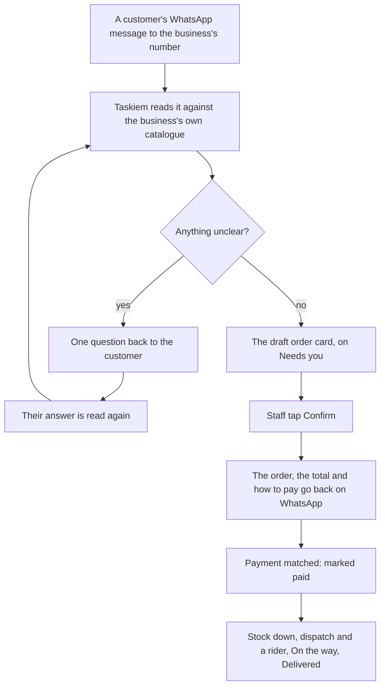

# Chat: five more flows

Status: **plan**, for review (8 November 2026; phase 0 added 9 November, from the founder's checks on a phone). Written with the founder; the live
doc is [the shared plan](https://claude.ai/artifact/FycMX9CLMjjE6oMBiGCumm), and this file is its copy beside the code.

## Summary

Five flows that take work businesses do by hand in WhatsApp today and put it in the chat, each built on parts Taskiem already has. Orders from customers' messages come first, because most orders start there.

| # | Flow | What it replaces | Size |
| --- | --- | --- | --- |
| 1 | Orders from customers' messages | Retyping "2 jollof, 1 chapman, deliver to Yaba" from the business's WhatsApp into an order, then chasing payment | Large |
| 2 | Tasks for staff | Instructions lost in WhatsApp groups, and "did you do it?" | Small |
| 3 | Expenses from a receipt photo | Typing amounts from receipts, or not recording them at all | Small |
| 4 | Quote to cash | A quote in a PDF or a message, a deposit chased by hand, the balance forgotten | Medium |
| 5 | Restocking that drafts itself | Noticing stock is low, working out how much to buy, then ordering by message | Small to medium |

Every flow keeps the rule the chat already follows: Taskiem reads and proposes, a person confirms. Nothing is sent to a customer, spent or ordered on a guess.

## What exists today

Much of each flow's back half exists; what is missing is mostly the front: reading a customer's message, a photo, or a person's instruction, and turning it into the record that already works.

| Flow | Already there | Missing |
| --- | --- | --- |
| 1 Orders from messages | The business's own WhatsApp number (`engine/whatsapp/own.go`), routing of a stranger's message (`waUnbound`) to a menu of public workflows; customer account numbers and automatic matching of what they pay (`engine/invoicing`, `engine/matching`); invoices sent on WhatsApp with "Pay by transfer"; the 24-hour window and templates; riders and dispatch; voice-note transcription (beta, staff only) | A conversation with a customer as a thread; reading free text or a voice note as an order; a customer who isn't a known person gets "link your account" today; order totals go by SMS or email, not WhatsApp |
| 2 Tasks | Approvals, alerts put off "Later", money leaks assigned to a person, shift handover (`/v1/chat-handover`), rider dispatch for deliveries | Any task or to-do; "remind me" only starts the workflow builder |
| 3 Receipt expenses | "spent 12,000 on diesel" on WhatsApp and the web form record expenses in the money log, with a keyword category | Reading a photo: the AI layer takes text only (`ai.Message`), and a photo sent to Taskiem becomes a product or the logo |
| 4 Quote to cash | Storefront quotes: priced by the owner, 50% deposit and 7 days by default, accepted on the customer's status page; "quote AK-… 45000" in chat; invoices allow part payments | A quote built in the chat from tagged items and services; a web view to price one; deposit then balance as one story; trade "Ask for a quote" is only a text message |
| 5 Restocking | `Suggest()` (to target level); the low-stock card's Reorder for a linked supplier opens the order sheet; `DraftLowTx` drafts orders for low items by supplier; sending by business link, or by WhatsApp/Telegram with Confirm and Change, or SMS | Reorder for a supplier who isn't linked; one order per supplier gathering all their low items; a set day to draft them; the card telling when a draft is waiting |

## Flow 1: orders from customers' messages

Customers already message the business's own WhatsApp number. Taskiem keeps each customer's conversation as a thread in the chat, reads an order out of a message or voice note against the business's own products, and puts a draft order in front of staff. Confirmed, it goes back to the customer with the total and how to pay, and runs on through the order steps that exist.

**1. Customers' conversations, in the chat.** Messages from people who aren't staff, a rider or a linked business, sent to the business's own number, stop getting "link your account". They become a Customers list beside business chats: one thread per customer, with their name, what they owe and past orders. Staff reply there and the reply goes out from the business's number, inside WhatsApp's 24-hour window (outside it, only the approved templates, as today). The public-workflow menu still answers a customer who asks for it by its word.

**2. Reading an order.** A customer's message ("2 jollof and 1 chapman, deliver to 12 Herbert Macaulay, by 1pm"), a voice note (transcribed, as staff's are today), or a photo of a written list is read against the business's products, prices and stock:

- items and quantities, matched to products ("jollof" to Jollof rice; the variants plan's sizes when it exists);
- delivery or pickup, address, time;
- anything unclear becomes a question, never a guess: "Jollof: plate (₦4,500) or cooler (₦38,000)?"

Only the business's own catalogue is matched; a word that matches nothing is shown as written, for staff to pick.

**3. The draft order card**, in the customer's thread and on the Taskiem chat's "Needs you": the lines with prices, the delivery fee, the total, what is out of stock, and the questions. Staff tap a question's answer, change a line, or send the question to the customer as one message. **Confirm** is always a person's tap; a business can let a role confirm, never the model alone.

**4. Back to the customer**, on WhatsApp from the business's number: the order, the total and how to pay, using what exists: their own account number when they have one (paid money matched to them automatically), or a one-time account or payment link for this order, with "Pay by transfer". Pay on delivery is a choice per order.

**5. Paid, then fulfilled.** Matching marks the order paid and tells the customer; stock goes down as storefront orders do; delivery goes to dispatch and a rider; "On the way" and "Delivered" go to the customer. Each step is a line in the thread, so anyone can see where an order is.

**What it does not do:** it never confirms an order, quotes a price or promises a time by itself; it never invents an item or a price; it answers nothing but the order without staff, beyond "Thanks, we've got your message" if the business turns that on.

## Flow 1, from message to delivery

What Taskiem can't read for sure goes back to the customer as one question, and their answer is read again; only a staff tap turns the card into an order, which then runs on the payment matching, stock and dispatch that exist.

## Flow 2: tasks for staff

An owner or manager gives a task by tagging a person in any chat; it becomes a card with who, what, by when and a Done button, and Taskiem follows it up so the owner doesn't have to.

**Giving a task:**

1. **In words:** "@Tunde deliver Rivers Foods' order by 3pm" in the Taskiem chat or a business chat. Taskiem sees a person, a thing to do and a time, and offers "Make it a task?" (the same chip as a typed request). One tap makes the card; nothing is made from words alone.
2. **From a card:** "Give this to…" on an order, a low-stock card, a bill or a delivery, so the task links to the thing ("Deliver P-7K8YED").
3. **From Tools:** a Tasks tile with a short form: who (one person or a role, "any cashier"), what, when, and whether a photo is needed when done.

**Doing it:**

- The person sees it in their Taskiem chat, and on WhatsApp if that is where they work: "Ada asked you: deliver Rivers Foods' order by 3pm. Reply DONE when it is done, or send a photo."
- **Done** closes it, with a photo when one was asked for (a delivered parcel, a cleaned kitchen, a shelf restocked). A task linked to an order closes with the order's own step. Deliveries stay with rider dispatch, which already offers an order to a rider and follows it: "Give this to…" on an order to deliver opens dispatch rather than making a second, competing task.
- **Can't do it:** "Can't" with a word ("no fuel") goes back to whoever gave it.

**Following up:**

- 30 minutes before it is due, a nudge to the person; when it is late, a line to whoever gave it, "Deliver Rivers Foods' order is 20 minutes late (Tunde)", with Remind and Give to someone else.
- The morning briefing gains "Tasks: 3 due today, 1 late from yesterday".
- **Repeating tasks:** "every day at 7am: count the cash float", "every Monday: clean the freezer", each day's a task of its own.

**Limits:** a task is between people in one business; a linked business can't be given one. Staff see their own tasks and those of roles they hold; owners and managers see all.

## Flow 3: expenses from a receipt photo

A photo of a receipt sent to Taskiem (in the web chat, or on WhatsApp) is read for its amount, seller, date and what was bought, and proposed as an expense to confirm with one tap. It joins the expenses people already record by typing "spent 12,000 on diesel".

1. **Send the photo.** A photo with no product name and price (which today becomes a product) and that looks like a receipt is read; "receipt" or "expense" as its caption makes sure. A photo that can't be read asks for the amount instead.
2. **The proposal:** "Spent ₦18,500 at Total Ikeja on 8 Nov: diesel, 20 litres. Fuel." with Record, Change and Not an expense. The category comes from the business's own past expenses first, then today's keyword list (fuel, rent, salary, transport, food, phone, other), and the owner can add their own.
3. **Recorded:** an expense entry in the money log, with the photo kept with it as its proof, and a diary line: "Expense: ₦18,500 fuel (Total Ikeja) · Tunde".
4. **Staff and petty cash:** a staff member's receipt is recorded as theirs. With the payments plan's limits, one over their limit, or over the day's petty cash, waits for the owner's OK; the owner sees the photo beside it.
5. **Duplicates:** the same amount, seller and date twice asks "Already recorded on 8 Nov. Record again?"
6. **The week:** "how much did we spend this week?" answers by category, as "how did we do" answers sales.

Reading a photo needs the AI layer to take an image as well as text (`engine/ai`: `ai.Message` is text only today); it uses the same model provider the chat already uses, switched on per business like voice notes, and the photo never leaves for anything but the reading.

## Flow 4: quote to cash

A quote is built in the chat from the business's own products and services, sent as a card (to a customer on WhatsApp, or to a linked business in its chat), and carried through deposit, work and balance as one story. It extends the storefront quote that exists (priced by the owner, 50% deposit, 7 days) rather than adding a second kind.

1. **Build it.** From a customer's message ("catering for 80 guests on the 20th?"), from Tools, or from @-tagging items and services: lines with quantities and prices, a discount, delivery or setup, the deposit share (50% by default) and how long it stands (7 days by default). A service's price and time come from Services; lowest prices from the deals work apply to a discount.
2. **Send it.** To a customer: a WhatsApp message from the business's number with the quote, the deposit and Accept and Ask a question; the quote opens on the status page that exists. To a linked business: a quote card in its chat, turning today's "Ask for a quote" text into a real answer it can accept, counter (as offers already can) or decline.
3. **Accepted.** An invoice for the deposit is made and sent with "Pay by transfer"; paid, the job is booked (a date, the staff or tasks it needs, from Flow 2), and a line says "Deposit paid: ₦420,000 of ₦840,000".
4. **The balance.** When the work is done (or on a date set in the quote), the balance invoice goes out on its own, with the deposit shown as paid. Reminders follow as for any invoice.
5. **Lapsed or declined:** the card says so, and the owner can send it again with new dates or prices.

One quote is one record from first price to last payment: "Eko Events: quote Q-0012, ₦840,000; deposit paid; balance due 22 Nov". The owner can price one from the web too (no page does today).

## Flow 5: restocking that drafts itself

Taskiem already suggests how much to buy and can draft and send orders to suppliers; this joins those pieces so that every low item ends in a ready order, one per supplier, waiting for one tap.

1. **One order per supplier.** When items run low, Taskiem drafts an order to each item's usual supplier, gathering all that supplier's low items in one (`DraftLowTx` does this per item today), each sized to bring it back to its target level, and at least the supplier's minimum.
2. **Any supplier.** A linked supplier gets it in the chat (as the Reorder card does today); a supplier who isn't linked gets it on WhatsApp, Telegram or SMS with Confirm and Change (as purchase orders already can). The low-stock card offers Reorder for both, not only linked ones.
3. **One tap.** The card says "Order to Bayo Rice Mills is ready: 3 items, ₦612,000" with Send, Change and Not now. Over the person's limit, it waits for the owner's OK (as today).
4. **When.** As soon as items run low, or on a set day ("every Monday at 8am, draft what we need"), the owner chooses. Nothing is sent without a tap unless the owner switches a supplier to "send on its own up to ₦100,000".
5. **Learning the right amount.** "Usually lasts" from the last eight weeks of sales: the card says "20 bags lasts about 9 days", and suggests a higher target when the item ran out twice in a month.
6. **Arrived.** Receiving the order (as today) records the stock in, and the low-stock card goes.

## Data model, engine and API

Two shared pieces carry several flows: customer conversations (flows 1 and 4) and reading things into proposals (flows 1, 2 and 3). The rest extends records that exist.

| Flow | New or changed | Engine | API |
| --- | --- | --- | --- |
| 1 | `customer_conversations`, `customer_messages` (sealed like link messages, one thread per customer phone per business); `order_drafts` (lines, questions, status: reading, waiting for staff, waiting for customer, confirmed, dropped) | `waUnbound` routes a stranger on an own number to the conversation; a new `engine/orders/read` matches text against the catalogue; confirmed drafts become storefront orders (kind `chat`), so stock, payment matching and dispatch work as they do | `/v1/customer-chats` list, messages, reply; `/v1/order-drafts/{id}` change, ask, confirm, drop |
| 2 | `tasks` (who or role, what, due, needs photo, links to a record, status, repeat rule) and `task_events` | `engine/tasks`: due and late nudges on the existing scheduler; Done by WhatsApp reply or photo; repeats made daily | `/v1/tasks` create, list mine, done, can't, give to |
| 3 | Money entries gain an optional photo and "read from a receipt" | `engine/ai`: messages may carry an image; `engine/receipts` reads amount, seller, date, items, category | `POST /v1/money/receipts` reads a photo and returns a proposed entry; the existing entries route records it |
| 4 | Storefront quotes gain lines (not one basket line), a link to a customer conversation or a linked business, and deposit and balance invoices | `storefront.Quote` builds from lines; accept makes the deposit invoice; done or a date makes the balance invoice | `/v1/quotes` create, send, list; accept and decline as today on the status page and in link chats |
| 5 | Per-supplier schedule and "send on its own up to"; "usually lasts" per item | `DraftLowTx` gathers by supplier and runs on the schedule; `Suggest()` learns from eight weeks of sales | `/v1/reorders` list ready drafts; send as today through purchases |

**Reading things (one place):** every flow that reads (an order, a task in words, a receipt) uses one reader that returns a proposal with what it is sure of and what it must ask, never an action. It runs the model the chat already uses, with the business's own catalogue, people and categories as its context, and is off until the business switches on reading photos or voice notes.

## Safety, privacy and plain words

- **Nothing on a guess.** A read order, task or expense is a proposal until a person taps; the model never confirms an order, sends a price, spends money or messages a customer.
- **Customers' messages are customers' data.** Kept sealed like business chats; shown only to staff with a role that handles orders; deleted on the customer's STOP with the business's records of their orders kept, as invoices are today.
- **WhatsApp's rules.** Replies to customers only inside the 24-hour window; outside it, only approved templates (order total, payment received, on the way). Nothing is sent to a customer who said STOP.
- **Prices are the business's own.** A read order uses the catalogue's prices; staff can change one before confirming, and the change is a line in the thread.
- **Receipts.** A photo is read and kept with its expense; it is never used for anything else, and an owner can delete it.
- **Money.** Expenses and reorders keep the limits and owner's OK of the payments plan; restocking never sends on its own above what the owner set.
- **Plain words:** "Customers", "Needs you", "Tasks", "Done", "Quote", "Deposit", "Balance", "Ready to send"; no "draft", "parse", "OCR" or "SKU" on owners' screens.

## Phase 0: the chat's tools, motion and tables, put right

Before the new flows add more sheets and cards, four things the founder saw on a phone are fixed, because every flow below stands on them. Each was checked against the code and in a browser at 384 × 780 and 360 × 740 px (9 November 2026).

1. **The tools menu runs off the top of the screen.** It has no height limit and no scrolling of its own (`.tk-tools` in `src/chat.css`). With nine tools it is two columns of five at phone width, 628 px tall, and starts 38 px from the top of a 740 px screen. On a phone whose browser bar takes some of the height it starts above the screen, so its heading and first row are cut off. It also floats 8 px above the message bar on a margin, with a shadow, rather than resting on it. **Fix:** a height limit of the space above the message bar, less a gap at the top. The tiles scroll inside it while the "Tools" heading and the Recent row stay in place. It rests on the message bar as one surface. The tiles are shorter at phone width, so nine fit without scrolling on a 360 × 640 screen.
2. **A sheet rises twice.** Opening a sheet from a tile or a card plays two motions one after the other. First the sheet grows from what was tapped (`Sheet` in `src/kit.tsx`, an `el.animate` of 360 ms, during which the class `tk-morphing` turns the CSS animation off). When that ends the class is removed, so the CSS slide-up (`tkd-sheet` in `src/chat.css`) starts from the beginning. The sheet jumps to the bottom of the screen and rises again with an overshoot. Measured frame by frame, its top edge settles at 84 px, jumps to 780 px, then comes back to 84 px. The grow itself starts 368 px above the screen, not at the tile. Every sheet opened with a `from` does this: the tools, alert and approval cards, the buyer's sheets, a business's card. Also behind the jumpy feel: the sheet's entrance is defined three times (`tk-sheet-up` in `kit.css`, `tkd-sheet`, `tkd-drawer` and `tkd-panel` in `chat.css`), and `tk-rise` and `tk-grow` are each defined twice with different motion (`motion.css` and `kit.css`; the last one loaded wins). **Fix:**
   - One entrance per sheet. From a tile or card, it grows from the right place and nothing plays after it. Without one, it slides up once.
   - One definition of each keyframe and each surface's animation, in `motion.css`, with the other files using its names.
   - The rows' stagger starts after the sheet has arrived, not during it.
   - A check in the motion tests that a sheet's top edge never moves away from its resting place once it has reached it.
3. **A box flashes over whatever is tapped.** Android's browser draws a translucent box over a tapped link or button unless the page turns it off. The app turns it off only for the bottom tab bar, list rows, stat tiles and the side drawer (`src/styles.css`), so everything else gets the default 40% blue box, measured on a tool tile and the tools button. This includes the tools, Recent chips, sheet buttons, the close ✕ and every link in the app. Keyboard focus rings are not the cause: they already show only for the keyboard (`:focus-visible`). **Fix:**
   - `-webkit-tap-highlight-color: transparent` for the whole app.
   - In its place, a pressed state on every button, tile, chip and link: a slight dim and scale on `:active`, within 100 ms, as the tiles' hover already has. A tap still feels answered.
   - Focus rings for the keyboard stay as they are.
4. **The Tables tool is a plain list.** Opening a table in the chat's Tables tool (`TableTool` in `src/pages/ChatToolForms.tsx`) shows the first 20 rows only and the first three columns only, each row as "name: value" text. There is no header, no colour, no search and no way to see row 21. The desk's Tables page already searches and pages, through the same API (`?q=` and `next_cursor`). **Fix:** a table viewer worth opening:
   - **The table's look:** a header row in the brand's pine, its first column fixed while the rest scroll sideways, banded rows, and each column drawn by its type: money in naira, right-aligned; dates as dates; yes/no as a coloured pill; a photo as a thumbnail; a status column's values as coloured pills.
   - **Finding a row:** a search bar over every text column, and pages of 25 with "1–25 of 312", back and next.
   - **On a phone:** the same table, with no page scrolling sideways (the table scrolls inside its frame). Tapping a row opens it to edit, as today.
5. **Also found while checking:** the message box's hint wraps onto a second line that is cut off ("Ask Taskiem, or @ to tag" at 360 px; "Message, @ to tag" on the founder's phone). **Fix:** it fits on one line at 360 px, shortened if need be.

Done when: at 360 × 640 and 390 × 844, the tools menu shows its heading and every tile; every sheet opened from a tile or a card arrives in one motion; a tap shows no box anywhere in the app; a table opens with a coloured header, search and pages; and the axe, plain-words and motion tests pass in both themes.

### As built: phase 0

Built 9 November 2026 (`web/e2e/chat-phase0.spec.ts` checks each at 360 × 640 and 390 × 844, in both themes with axe).

- **The tools menu** (`ToolsPanel` in `src/pages/ChatTools.tsx`, `src/chat.css`):
  - It measures the room above the message bar, the keyboard's too (`visualViewport`), and takes that as its height limit.
  - The tiles scroll inside it; its heading and Recent stay in place.
  - On a phone it rests flush on the bar, with rounded top corners only.
  - Below 600 px a tile is a row (icon beside its words), two to a line, so nine fit on a 360 × 640 screen without scrolling (the menu is 386 px tall there).
- **One motion per sheet** (`Sheet` in `src/kit.tsx`, `src/chat.css`):
  - A sheet opened from a tile or card carries the class `tk-grown` from its first render, so the CSS rise is off before it is measured and stays off.
  - Measured frame by frame, its top edge now comes from the tile to its place once and stays there.
  - The rise in `kit.css` was a second definition of the one in `chat.css` and is gone; `kit.css`'s own `tk-rise` and `tk-grow` are now `tk-card-in` and `tk-bar-up`.
  - **Also fixed:** every dialog (`.modal`) used to open squashed from a flat line, because `kit.css`'s bar keyframe had replaced `motion.css`'s grow. `pop-in` is defined once, and `.modal` is animated once.
  - **Where it differs from the plan:** the sheet's motion stays in `chat.css` (defined there alone) rather than moving to `motion.css`.
- **No tap box** (`src/styles.css`, `src/main.tsx`): `-webkit-tap-highlight-color: transparent` for the whole app. In its place, a pressed look on buttons, links, tabs, menu items and tiles: `scale: 0.97` and a slight fade within 80 ms (no scale with reduced motion). An empty touch listener lets iOS Safari show it.
- **The message box's hint** is the words before its comma below 600 px ("Ask Taskiem", "Message"), all of it with room. A hint that still does not fit is cut, never wrapped.
- **The Tables tool's viewer** (`src/pages/TableViewer.tsx`, `src/lib/tableView.ts`):
  - **Columns:** every column, not three. A pine header, the first column held while the rest scroll inside the frame, banded rows.
  - **Kinds:** the shop's price, or a number named `*_kobo` or like `price`, `amount` or `total`, in naira, right-aligned; numbers grouped; dates in words; yes/no and `status` as coloured pills; the shop's product photos as thumbnails (from `GET /v1/storefront/catalogue`), else "2 photos".
  - **Pages:** pages of 25 with "1–25 of 312", back and next, through `POST /v1/tables/{id}/rows/query` (`count: "exact"`).
    - While a page loads, the count says "Loading…", the old rows fade, and both buttons wait. A second tap on Next can't skip a page, and the count never names a page that isn't shown.
  - **Search:** over every text column at once by default ("Search in: Everything"), or one column picked beside the box. `%` and `_` typed are themselves.
    - Every column at once is one `{"any": [...]}` filter group, which `rows/query` and the Xenibase connector's `read_rows` now take as the query body's `or`: up to 20 filters, one of which must hold. It is for reads only; a write by an `any` group is refused.
    - The test Xenibase now reads a backslash in a `like` pattern as Postgres does.
  - **Sort:** a tap on a header sorts by it, A to Z, then Z to A, then back to newest first. The header says so with an arrow and `aria-sort`; the page goes back to the first.
  - **Opening a row:** a tap on a row opens it to edit, as before. A row whose first cell is empty opens from "Open row 12".
  - **Sizes:** in the shop's products table, a size's row shows its product's photo (through the catalogue's `variant_of` column).
- **Also fixed:**
  - The red pill ("Cancelled", "Overdue") measured 4.1:1 to 4.4:1 against its background, under the 4.5:1 rule; it now has a solid background and a darker ink (`--tk-danger-bg`, `--tk-danger-ink`).
  - A sheet's search field showed a box inside the search box (the app's field rule outranked it).
  - The phone-width table rule (`.main table:not(.cards)`) made a table its own scroller; the viewer's table is not.
  - A search field's own clear "×" was the browser's blue; it is the app's grey.
- **Checked beyond the chat:** the pressed look and the search field fix apply app-wide. The Stock and Orders sheets and the Settings page were looked at in both themes at 390 px.
- **Tests:**
  - `web/e2e/chat-phase0.spec.ts` also checks a sheet's one motion on a computer (1280 × 800, its place frame by frame, its entrance not run again) and a size's photo.
  - `TestDataTables` (`api/datatables_test.go`) runs the viewer's own request through the real route against the test Xenibase: an `any` group with an exact count, a sort, the cursor's second page, and an escaped `%` and `_`.
  - `TestAnyGroup` (`connectors/xenibase`) checks the `or` it sends.

## Phases

Seven phases, each a PR that ships on its own. Phase 0 puts the chat's tools, motion and tables right first, since every flow adds sheets and cards on top of them. Customer conversations go next because flows 1 and 4 stand on them; tasks and restocking are small and can run beside the larger ones.

0. **The chat's tools, motion and tables, put right** (above): the tools menu fits the screen and rests on the message bar; one motion per sheet; no tap box; the Tables tool's viewer with colour, search and pages; the message box's hint on one line.
   - Done when: the checks above pass at 360 × 640 and 390 × 844, in both themes.
1. **Customer conversations.** The Customers list and threads; a stranger on the business's own number lands there instead of "link your account"; staff reply within the 24-hour window, templates outside it; STOP honoured.
   - Done when: a customer's WhatsApp message to the business's number appears as a thread in the web chat, and a staff reply reaches their WhatsApp.
2. **Orders from customers' messages.** The reader for text; the draft order card with questions; confirm; the total and how to pay sent back; paid matched; on to stock, dispatch and "On the way". Then voice notes for customers (the transcription that exists) and photos of written lists (after phase 4's image reading).
   - Done when: "2 jollof and 1 chapman, deliver to Yaba by 1" becomes a confirmed, paid, dispatched order without retyping.
3. **Tasks for staff.** Tasks from words, cards and Tools; WhatsApp delivery and DONE; photo proof; nudges and late lines; the briefing line; repeats.
   - Done when: "@Tunde count the float every day at 7am" makes a repeating task Tunde closes from WhatsApp, and a late one reaches the owner.
4. **Expenses from receipts.** Images in the AI layer; the receipt reader; propose, record, photo kept; staff limits; duplicates; "how much did we spend".
   - Done when: a photo of a fuel receipt becomes a categorised expense in one tap.
5. **Restocking that drafts itself.** One order per supplier for all low items; unlinked suppliers by WhatsApp, Telegram or SMS; the ready card; a set day; send on its own up to a limit; "usually lasts".
   - Done when: on Monday morning each supplier with low items has one ready order, sent with one tap each.
6. **Quote to cash.** Quotes built from lines in the chat; sent to customers and linked businesses; accept makes the deposit invoice; the balance follows; a web page to price one.
   - Done when: a caterer quotes ₦840,000 from a customer's message, gets the deposit, and the balance invoice goes out after the event.

## Tests and checks

- **Go:** the order reader against a corpus of real order messages (abbreviations, pidgin, "2 jolof", quantities in words, two orders in one message, nothing orderable) with a fake model, asserting it asks rather than guesses; routing of strangers on an own number; the 24-hour window and STOP; tasks' due, late and repeat rules; receipt reading with sample photos through a fake model; duplicates; one order per supplier; quote deposit and balance invoices.
- **Browser (e2e), phase 0:** the tools menu's heading and last tile within the screen at 360 × 640; a sheet opened from a tile whose top edge, sampled every frame, never leaves its resting place once there (with motion on); no element with a visible tap highlight; the Tables tool's search, pages and coloured header at 390 and 360 px with axe in both themes.
- **Browser (e2e):** at 390 and 360 px in both themes with axe: a customer thread and reply; a draft order card answered and confirmed; a task given, done with a photo; a receipt recorded; a ready reorder sent; a quote accepted.
- **WhatsApp:** the fake Graph API the e2e tests already run, for a customer's message in and the business's reply out.
- **Plain words:** every new owner line through `src/lib/plainwords.test.ts`.
- **The recording:** new acts in `video/recording/`: a customer's WhatsApp order to delivered; a task done from WhatsApp; a receipt photo to an expense.

## Open questions

The plan assumes the answer in brackets.

- [ ] Customer threads: every staff member who handles orders, or only those the owner names? (Roles that handle orders.)
- [ ] An automatic "Thanks, we've got your message": on by default? (Off; the owner turns it on.)
- [ ] Customers' voice notes: transcribed for every business, or only where voice notes are switched on today? (Only where switched on.)
- [ ] Pay on delivery as a default for some businesses (food), or always chosen per order? (A business default, changeable per order.)
- [ ] Tasks to riders and drivers outside dispatch (fetch gas, take cash to the bank)? (Yes, as tasks; deliveries stay with dispatch.)
- [ ] Restocking that sends on its own: allowed at all? (Off by default, per supplier, under a limit the owner sets.)
- [ ] Quotes: deposit share and validity as business defaults (50%, 7 days today)? (Yes, changeable per quote.)
