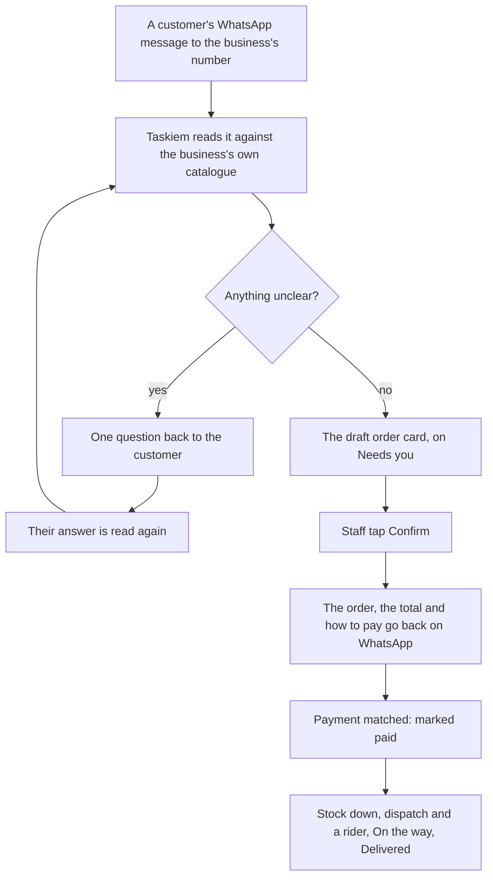

# Chat: five more flows

Status: **plan**, for review (8 November 2026; phase 0 added 9 November, from the founder's checks on a phone). Phases 0 to 3 are built (see As built under each). Written with the founder; the live
doc is [the shared plan](https://claude.ai/artifact/FycMX9CLMjjE6oMBiGCumm), and this file is its copy beside the code.

## Summary

Five flows that take work businesses do by hand in WhatsApp today and put it in the chat, each built on parts Taskiem already has. Orders from customers' messages come first, because most orders start there.

| # | Flow | What it replaces | Size |
| --- | --- | --- | --- |
| 1 | Orders from customers' messages | Retyping "2 jollof, 1 chapman, deliver to Yaba" from the business's WhatsApp into an order, then chasing payment | Large |
| 2 | Tasks for staff | Instructions lost in WhatsApp groups, and "did you do it?" | Small |
| 3 | Expenses from a receipt photo | Typing amounts from receipts, or not recording them at all | Small |
| 4 | Quote to cash | A quote in a PDF or a message, a deposit chased by hand, the balance forgotten | Medium |
| 5 | Restocking that drafts itself | Noticing stock is low, working out how much to buy, then ordering by message | Small to medium |

Every flow keeps the rule the chat already follows: Taskiem reads and proposes, a person confirms. Nothing is sent to a customer, spent or ordered on a guess.

## What exists today

Much of each flow's back half exists; what is missing is mostly the front: reading a customer's message, a photo, or a person's instruction, and turning it into the record that already works.

| Flow | Already there | Missing |
| --- | --- | --- |
| 1 Orders from messages | The business's own WhatsApp number (`engine/whatsapp/own.go`), routing of a stranger's message (`waUnbound`) to a menu of public workflows; customer account numbers and automatic matching of what they pay (`engine/invoicing`, `engine/matching`); invoices sent on WhatsApp with "Pay by transfer"; the 24-hour window and templates; riders and dispatch; voice-note transcription (beta, staff only) | A conversation with a customer as a thread; reading free text or a voice note as an order; a customer who isn't a known person gets "link your account" today; order totals go by SMS or email, not WhatsApp |
| 2 Tasks | Approvals, alerts put off "Later", money leaks assigned to a person, shift handover (`/v1/chat-handover`), rider dispatch for deliveries | Any task or to-do; "remind me" only starts the workflow builder |
| 3 Receipt expenses | "spent 12,000 on diesel" on WhatsApp and the web form record expenses in the money log, with a keyword category | Reading a photo: the AI layer takes text only (`ai.Message`), and a photo sent to Taskiem becomes a product or the logo |
| 4 Quote to cash | Storefront quotes: priced by the owner, 50% deposit and 7 days by default, accepted on the customer's status page; "quote AK-… 45000" in chat; invoices allow part payments | A quote built in the chat from tagged items and services; a web view to price one; deposit then balance as one story; trade "Ask for a quote" is only a text message |
| 5 Restocking | `Suggest()` (to target level); the low-stock card's Reorder for a linked supplier opens the order sheet; `DraftLowTx` drafts orders for low items by supplier; sending by business link, or by WhatsApp/Telegram with Confirm and Change, or SMS | Reorder for a supplier who isn't linked; one order per supplier gathering all their low items; a set day to draft them; the card telling when a draft is waiting |

## Flow 1: orders from customers' messages

Customers already message the business's own WhatsApp number. Taskiem keeps each customer's conversation as a thread in the chat, reads an order out of a message or voice note against the business's own products, and puts a draft order in front of staff. Confirmed, it goes back to the customer with the total and how to pay, and runs on through the order steps that exist.

**1. Customers' conversations, in the chat.** Messages from people who aren't staff, a rider or a linked business, sent to the business's own number, stop getting "link your account". They become a Customers list beside business chats: one thread per customer, with their name, what they owe and past orders. Staff reply there and the reply goes out from the business's number, inside WhatsApp's 24-hour window (outside it, only the approved templates, as today). The public-workflow menu still answers a customer who asks for it by its word.

**2. Reading an order.** A customer's message ("2 jollof and 1 chapman, deliver to 12 Herbert Macaulay, by 1pm"), a voice note (transcribed, as staff's are today), or a photo of a written list is read against the business's products, prices and stock:

- items and quantities, matched to products ("jollof" to Jollof rice; the variants plan's sizes when it exists);
- delivery or pickup, address, time;
- anything unclear becomes a question, never a guess: "Jollof: plate (₦4,500) or cooler (₦38,000)?"

Only the business's own catalogue is matched; a word that matches nothing is shown as written, for staff to pick.

**3. The draft order card**, in the customer's thread and on the Taskiem chat's "Needs you": the lines with prices, the delivery fee, the total, what is out of stock, and the questions. Staff tap a question's answer, change a line, or send the question to the customer as one message. **Confirm** is always a person's tap; a business can let a role confirm, never the model alone.

**4. Back to the customer**, on WhatsApp from the business's number: the order, the total and how to pay, using what exists: their own account number when they have one (paid money matched to them automatically), or a one-time account or payment link for this order, with "Pay by transfer". Pay on delivery is a choice per order.

**5. Paid, then fulfilled.** Matching marks the order paid and tells the customer; stock goes down as storefront orders do; delivery goes to dispatch and a rider; "On the way" and "Delivered" go to the customer. Each step is a line in the thread, so anyone can see where an order is.

**What it does not do:** it never confirms an order, quotes a price or promises a time by itself; it never invents an item or a price; it answers nothing but the order without staff, beyond "Thanks, we've got your message" if the business turns that on.

## Flow 1, from message to delivery

What Taskiem can't read for sure goes back to the customer as one question, and their answer is read again; only a staff tap turns the card into an order, which then runs on the payment matching, stock and dispatch that exist.

## Flow 2: tasks for staff

An owner or manager gives a task by tagging a person in any chat; it becomes a card with who, what, by when and a Done button, and Taskiem follows it up so the owner doesn't have to.

**Giving a task:**

1. **In words:** "@Tunde deliver Rivers Foods' order by 3pm" in the Taskiem chat or a business chat. Taskiem sees a person, a thing to do and a time, and offers "Make it a task?" (the same chip as a typed request). One tap makes the card; nothing is made from words alone.
2. **From a card:** "Give this to…" on an order, a low-stock card, a bill or a delivery, so the task links to the thing ("Deliver P-7K8YED").
3. **From Tools:** a Tasks tile with a short form: who (one person or a role, "any cashier"), what, when, and whether a photo is needed when done.

**Doing it:**

- The person sees it in their Taskiem chat, and on WhatsApp if that is where they work: "Ada asked you: deliver Rivers Foods' order by 3pm. Reply DONE when it is done, or send a photo."
- **Done** closes it, with a photo when one was asked for (a delivered parcel, a cleaned kitchen, a shelf restocked). A task linked to an order closes with the order's own step. Deliveries stay with rider dispatch, which already offers an order to a rider and follows it: "Give this to…" on an order to deliver opens dispatch rather than making a second, competing task.
- **Can't do it:** "Can't" with a word ("no fuel") goes back to whoever gave it.

**Following up:**

- 30 minutes before it is due, a nudge to the person; when it is late, a line to whoever gave it, "Deliver Rivers Foods' order is 20 minutes late (Tunde)", with Remind and Give to someone else.
- The morning briefing gains "Tasks: 3 due today, 1 late from yesterday".
- **Repeating tasks:** "every day at 7am: count the cash float", "every Monday: clean the freezer", each day's a task of its own.

**Limits:** a task is between people in one business; a linked business can't be given one. Staff see their own tasks and those of roles they hold; owners and managers see all.

## Flow 3: expenses from a receipt photo

A photo of a receipt sent to Taskiem (in the web chat, or on WhatsApp) is read for its amount, seller, date and what was bought, and proposed as an expense to confirm with one tap. It joins the expenses people already record by typing "spent 12,000 on diesel".

1. **Send the photo.** A photo with no product name and price (which today becomes a product) and that looks like a receipt is read; "receipt" or "expense" as its caption makes sure. A photo that can't be read asks for the amount instead.
2. **The proposal:** "Spent ₦18,500 at Total Ikeja on 8 Nov: diesel, 20 litres. Fuel." with Record, Change and Not an expense. The category comes from the business's own past expenses first, then today's keyword list (fuel, rent, salary, transport, food, phone, other), and the owner can add their own.
3. **Recorded:** an expense entry in the money log, with the photo kept with it as its proof, and a diary line: "Expense: ₦18,500 fuel (Total Ikeja) · Tunde".
4. **Staff and petty cash:** a staff member's receipt is recorded as theirs. With the payments plan's limits, one over their limit, or over the day's petty cash, waits for the owner's OK; the owner sees the photo beside it.
5. **Duplicates:** the same amount, seller and date twice asks "Already recorded on 8 Nov. Record again?"
6. **The week:** "how much did we spend this week?" answers by category, as "how did we do" answers sales.

Reading a photo needs the AI layer to take an image as well as text (`engine/ai`: `ai.Message` is text only today); it uses the same model provider the chat already uses, switched on per business like voice notes, and the photo never leaves for anything but the reading.

## Flow 4: quote to cash

A quote is built in the chat from the business's own products and services, sent as a card (to a customer on WhatsApp, or to a linked business in its chat), and carried through deposit, work and balance as one story. It extends the storefront quote that exists (priced by the owner, 50% deposit, 7 days) rather than adding a second kind.

1. **Build it.** From a customer's message ("catering for 80 guests on the 20th?"), from Tools, or from @-tagging items and services: lines with quantities and prices, a discount, delivery or setup, the deposit share (50% by default) and how long it stands (7 days by default). A service's price and time come from Services; lowest prices from the deals work apply to a discount.
2. **Send it.** To a customer: a WhatsApp message from the business's number with the quote, the deposit and Accept and Ask a question; the quote opens on the status page that exists. To a linked business: a quote card in its chat, turning today's "Ask for a quote" text into a real answer it can accept, counter (as offers already can) or decline.
3. **Accepted.** An invoice for the deposit is made and sent with "Pay by transfer"; paid, the job is booked (a date, the staff or tasks it needs, from Flow 2), and a line says "Deposit paid: ₦420,000 of ₦840,000".
4. **The balance.** When the work is done (or on a date set in the quote), the balance invoice goes out on its own, with the deposit shown as paid. Reminders follow as for any invoice.
5. **Lapsed or declined:** the card says so, and the owner can send it again with new dates or prices.

One quote is one record from first price to last payment: "Eko Events: quote Q-0012, ₦840,000; deposit paid; balance due 22 Nov". The owner can price one from the web too (no page does today).

## Flow 5: restocking that drafts itself

Taskiem already suggests how much to buy and can draft and send orders to suppliers; this joins those pieces so that every low item ends in a ready order, one per supplier, waiting for one tap.

1. **One order per supplier.** When items run low, Taskiem drafts an order to each item's usual supplier, gathering all that supplier's low items in one (`DraftLowTx` does this per item today), each sized to bring it back to its target level, and at least the supplier's minimum.
2. **Any supplier.** A linked supplier gets it in the chat (as the Reorder card does today); a supplier who isn't linked gets it on WhatsApp, Telegram or SMS with Confirm and Change (as purchase orders already can). The low-stock card offers Reorder for both, not only linked ones.
3. **One tap.** The card says "Order to Bayo Rice Mills is ready: 3 items, ₦612,000" with Send, Change and Not now. Over the person's limit, it waits for the owner's OK (as today).
4. **When.** As soon as items run low, or on a set day ("every Monday at 8am, draft what we need"), the owner chooses. Nothing is sent without a tap unless the owner switches a supplier to "send on its own up to ₦100,000".
5. **Learning the right amount.** "Usually lasts" from the last eight weeks of sales: the card says "20 bags lasts about 9 days", and suggests a higher target when the item ran out twice in a month.
6. **Arrived.** Receiving the order (as today) records the stock in, and the low-stock card goes.

## Data model, engine and API

Two shared pieces carry several flows: customer conversations (flows 1 and 4) and reading things into proposals (flows 1, 2 and 3). The rest extends records that exist.

| Flow | New or changed | Engine | API |
| --- | --- | --- | --- |
| 1 | `customer_conversations`, `customer_messages` (sealed like link messages, one thread per customer phone per business); `order_drafts` (lines, questions, status: reading, waiting for staff, waiting for customer, confirmed, dropped) | `waUnbound` routes a stranger on an own number to the conversation; a new `engine/orders/read` matches text against the catalogue; confirmed drafts become storefront orders (kind `chat`), so stock, payment matching and dispatch work as they do | `/v1/customer-chats` list, messages, reply; `/v1/order-drafts/{id}` change, ask, confirm, drop |
| 2 | `tasks` (who or role, what, due, needs photo, links to a record, status, repeat rule) and `task_events` | `engine/tasks`: due and late nudges on the existing scheduler; Done by WhatsApp reply or photo; repeats made daily | `/v1/tasks` create, list mine, done, can't, give to |
| 3 | Money entries gain an optional photo and "read from a receipt" | `engine/ai`: messages may carry an image; `engine/receipts` reads amount, seller, date, items, category | `POST /v1/money/receipts` reads a photo and returns a proposed entry; the existing entries route records it |
| 4 | Storefront quotes gain lines (not one basket line), a link to a customer conversation or a linked business, and deposit and balance invoices | `storefront.Quote` builds from lines; accept makes the deposit invoice; done or a date makes the balance invoice | `/v1/quotes` create, send, list; accept and decline as today on the status page and in link chats |
| 5 | Per-supplier schedule and "send on its own up to"; "usually lasts" per item | `DraftLowTx` gathers by supplier and runs on the schedule; `Suggest()` learns from eight weeks of sales | `/v1/reorders` list ready drafts; send as today through purchases |

**Reading things (one place):** every flow that reads (an order, a task in words, a receipt) uses one reader that returns a proposal with what it is sure of and what it must ask, never an action. It runs the model the chat already uses, with the business's own catalogue, people and categories as its context, and is off until the business switches on reading photos or voice notes.

## Safety, privacy and plain words

- **Nothing on a guess.** A read order, task or expense is a proposal until a person taps; the model never confirms an order, sends a price, spends money or messages a customer.
- **Customers' messages are customers' data.** Kept sealed like business chats; shown only to staff with a role that handles orders; deleted on the customer's STOP with the business's records of their orders kept, as invoices are today.
- **WhatsApp's rules.** Replies to customers only inside the 24-hour window; outside it, only approved templates (order total, payment received, on the way). Nothing is sent to a customer who said STOP.
- **Prices are the business's own.** A read order uses the catalogue's prices; staff can change one before confirming, and the change is a line in the thread.
- **Receipts.** A photo is read and kept with its expense; it is never used for anything else, and an owner can delete it.
- **Money.** Expenses and reorders keep the limits and owner's OK of the payments plan; restocking never sends on its own above what the owner set.
- **Plain words:** "Customers", "Needs you", "Tasks", "Done", "Quote", "Deposit", "Balance", "Ready to send"; no "draft", "parse", "OCR" or "SKU" on owners' screens.

## Phase 0: the chat's tools, motion and tables, put right

Before the new flows add more sheets and cards, four things the founder saw on a phone are fixed, because every flow below stands on them. Each was checked against the code and in a browser at 384 × 780 and 360 × 740 px (9 November 2026).

1. **The tools menu runs off the top of the screen.** It has no height limit and no scrolling of its own (`.tk-tools` in `src/chat.css`). With nine tools it is two columns of five at phone width, 628 px tall, and starts 38 px from the top of a 740 px screen. On a phone whose browser bar takes some of the height it starts above the screen, so its heading and first row are cut off. It also floats 8 px above the message bar on a margin, with a shadow, rather than resting on it. **Fix:** a height limit of the space above the message bar, less a gap at the top. The tiles scroll inside it while the "Tools" heading and the Recent row stay in place. It rests on the message bar as one surface. The tiles are shorter at phone width, so nine fit without scrolling on a 360 × 640 screen.
2. **A sheet rises twice.** Opening a sheet from a tile or a card plays two motions one after the other. First the sheet grows from what was tapped (`Sheet` in `src/kit.tsx`, an `el.animate` of 360 ms, during which the class `tk-morphing` turns the CSS animation off). When that ends the class is removed, so the CSS slide-up (`tkd-sheet` in `src/chat.css`) starts from the beginning. The sheet jumps to the bottom of the screen and rises again with an overshoot. Measured frame by frame, its top edge settles at 84 px, jumps to 780 px, then comes back to 84 px. The grow itself starts 368 px above the screen, not at the tile. Every sheet opened with a `from` does this: the tools, alert and approval cards, the buyer's sheets, a business's card. Also behind the jumpy feel: the sheet's entrance is defined three times (`tk-sheet-up` in `kit.css`, `tkd-sheet`, `tkd-drawer` and `tkd-panel` in `chat.css`), and `tk-rise` and `tk-grow` are each defined twice with different motion (`motion.css` and `kit.css`; the last one loaded wins). **Fix:**
   - One entrance per sheet. From a tile or card, it grows from the right place and nothing plays after it. Without one, it slides up once.
   - One definition of each keyframe and each surface's animation, in `motion.css`, with the other files using its names.
   - The rows' stagger starts after the sheet has arrived, not during it.
   - A check in the motion tests that a sheet's top edge never moves away from its resting place once it has reached it.
3. **A box flashes over whatever is tapped.** Android's browser draws a translucent box over a tapped link or button unless the page turns it off. The app turns it off only for the bottom tab bar, list rows, stat tiles and the side drawer (`src/styles.css`), so everything else gets the default 40% blue box, measured on a tool tile and the tools button. This includes the tools, Recent chips, sheet buttons, the close ✕ and every link in the app. Keyboard focus rings are not the cause: they already show only for the keyboard (`:focus-visible`). **Fix:**
   - `-webkit-tap-highlight-color: transparent` for the whole app.
   - In its place, a pressed state on every button, tile, chip and link: a slight dim and scale on `:active`, within 100 ms, as the tiles' hover already has. A tap still feels answered.
   - Focus rings for the keyboard stay as they are.
4. **The Tables tool is a plain list.** Opening a table in the chat's Tables tool (`TableTool` in `src/pages/ChatToolForms.tsx`) shows the first 20 rows only and the first three columns only, each row as "name: value" text. There is no header, no colour, no search and no way to see row 21. The desk's Tables page already searches and pages, through the same API (`?q=` and `next_cursor`). **Fix:** a table viewer worth opening:
   - **The table's look:** a header row in the brand's pine, its first column fixed while the rest scroll sideways, banded rows, and each column drawn by its type: money in naira, right-aligned; dates as dates; yes/no as a coloured pill; a photo as a thumbnail; a status column's values as coloured pills.
   - **Finding a row:** a search bar over every text column, and pages of 25 with "1–25 of 312", back and next.
   - **On a phone:** the same table, with no page scrolling sideways (the table scrolls inside its frame). Tapping a row opens it to edit, as today.
5. **Also found while checking:** the message box's hint wraps onto a second line that is cut off ("Ask Taskiem, or @ to tag" at 360 px; "Message, @ to tag" on the founder's phone). **Fix:** it fits on one line at 360 px, shortened if need be.

Done when: at 360 × 640 and 390 × 844, the tools menu shows its heading and every tile; every sheet opened from a tile or a card arrives in one motion; a tap shows no box anywhere in the app; a table opens with a coloured header, search and pages; and the axe, plain-words and motion tests pass in both themes.

### As built: phase 0

Built 9 November 2026 (`web/e2e/chat-phase0.spec.ts` checks each at 360 × 640 and 390 × 844, in both themes with axe).

- **The tools menu** (`ToolsPanel` in `src/pages/ChatTools.tsx`, `src/chat.css`):
  - It measures the room above the message bar, the keyboard's too (`visualViewport`), and takes that as its height limit.
  - The tiles scroll inside it; its heading and Recent stay in place.
  - On a phone it rests flush on the bar, with rounded top corners only.
  - Below 600 px a tile is a row (icon beside its words), two to a line, so nine fit on a 360 × 640 screen without scrolling (the menu is 386 px tall there).
- **One motion per sheet** (`Sheet` in `src/kit.tsx`, `src/chat.css`):
  - A sheet opened from a tile or card carries the class `tk-grown` from its first render, so the CSS rise is off before it is measured and stays off.
  - Measured frame by frame, its top edge now comes from the tile to its place once and stays there.
  - The rise in `kit.css` was a second definition of the one in `chat.css` and is gone; `kit.css`'s own `tk-rise` and `tk-grow` are now `tk-card-in` and `tk-bar-up`.
  - **Also fixed:** every dialog (`.modal`) used to open squashed from a flat line, because `kit.css`'s bar keyframe had replaced `motion.css`'s grow. `pop-in` is defined once, and `.modal` is animated once.
  - **Where it differs from the plan:** the sheet's motion stays in `chat.css` (defined there alone) rather than moving to `motion.css`.
- **No tap box** (`src/styles.css`, `src/main.tsx`): `-webkit-tap-highlight-color: transparent` for the whole app. In its place, a pressed look on buttons, links, tabs, menu items and tiles: `scale: 0.97` and a slight fade within 80 ms (no scale with reduced motion). An empty touch listener lets iOS Safari show it.
- **The message box's hint** is the words before its comma below 600 px ("Ask Taskiem", "Message"), all of it with room. A hint that still does not fit is cut, never wrapped.
- **The Tables tool's viewer** (`src/pages/TableViewer.tsx`, `src/lib/tableView.ts`):
  - **Columns:** every column, not three. A pine header, the first column held while the rest scroll inside the frame, banded rows.
  - **Kinds:** the shop's price, or a number named `*_kobo` or like `price`, `amount` or `total`, in naira, right-aligned; numbers grouped; dates in words; yes/no and `status` as coloured pills; the shop's product photos as thumbnails (from `GET /v1/storefront/catalogue`), else "2 photos".
  - **Pages:** pages of 25 with "1–25 of 312", back and next, through `POST /v1/tables/{id}/rows/query` (`count: "exact"`).
    - While a page loads, the count says "Loading…", the old rows fade, and both buttons wait. A second tap on Next can't skip a page, and the count never names a page that isn't shown.
  - **Search:** over every text column at once by default ("Search in: Everything"), or one column picked beside the box. `%` and `_` typed are themselves.
    - Every column at once is one `{"any": [...]}` filter group, which `rows/query` and the Xenibase connector's `read_rows` now take as the query body's `or`: up to 20 filters, one of which must hold. It is for reads only; a write by an `any` group is refused.
    - The test Xenibase now reads a backslash in a `like` pattern as Postgres does.
  - **Sort:** a tap on a header sorts by it, A to Z, then Z to A, then back to newest first. The header says so with an arrow and `aria-sort`; the page goes back to the first.
  - **Opening a row:** a tap on a row opens it to edit, as before. A row whose first cell is empty opens from "Open row 12".
  - **Sizes:** in the shop's products table, a size's row shows its product's photo (through the catalogue's `variant_of` column).
- **Also fixed:**
  - The red pill ("Cancelled", "Overdue") measured 4.1:1 to 4.4:1 against its background, under the 4.5:1 rule; it now has a solid background and a darker ink (`--tk-danger-bg`, `--tk-danger-ink`).
  - A sheet's search field showed a box inside the search box (the app's field rule outranked it).
  - The phone-width table rule (`.main table:not(.cards)`) made a table its own scroller; the viewer's table is not.
  - A search field's own clear "×" was the browser's blue; it is the app's grey.
- **Checked beyond the chat:** the pressed look and the search field fix apply app-wide. The Stock and Orders sheets and the Settings page were looked at in both themes at 390 px.
- **Tests:**
  - `web/e2e/chat-phase0.spec.ts` also checks a sheet's one motion on a computer (1280 × 800, its place frame by frame, its entrance not run again) and a size's photo.
  - `TestDataTables` (`api/datatables_test.go`) runs the viewer's own request through the real route against the test Xenibase: an `any` group with an exact count, a sort, the cursor's second page, and an escaped `%` and `_`.
  - `TestAnyGroup` (`connectors/xenibase`) checks the `or` it sends.

### As built: phase 1, customers' conversations

Built 9 November 2026. `TestCustomerConversations` and `TestCustomerConversationsEdges` (`api/customer_chat_test.go`) check the server. `web/e2e/whatsapp.spec.ts` checks the page at 390 and 360 px, in both themes with axe: a reply, its ticks, archiving, and STOP.

- **Who is a customer:** someone who writes to the business's own WhatsApp number and isn't on its team, a rider, a supplier or a linked business.
  - A six-digit code, a rider's or supplier's words, a key, or a sign-up still go where they went. Everything else they write goes to their thread.
  - Nothing is sent back: the business answers from the chat.
  - They no longer get "link your account". The shared number still says it to a stranger.
- **The public menu** answers a customer who asks for it with the word *menu*, then a number from the menu shown, or a workflow under way. Before, it answered any message.
- **Stored sealed:** migration 00411 adds `customer_conversations` and `customer_messages`.
  - One thread per customer number per business, the number and every message sealed under the customer's own subject (the phone's, the same key as their invoices).
  - Erasing the customer erases the thread.
- **Replies** go from the business's own number:
  - as words within 24 hours of the customer's last message;
  - after that, as the approved template `taskiem_customer_reply` ("[Mama Put Kitchen] Reply to your message: … Answer here to carry on.").
  - Until that template is approved, a late reply is refused with the reason, and can go when they write again.
  - A reply is refused after STOP, or when the business's number is no longer the one they wrote to.
  - A repeated send is one message.
  - A reply is written before it goes (shown as sending), so two sends of one message, even at once, go once. A reply WhatsApp refuses is taken back out, with the reason.
  - After the 24 hours a reply goes on one line, up to 900 characters. A longer one is refused, not cut, and the box says so as it is typed.
  - When the business has changed its number since the customer wrote, the thread moves to the new number and the reply goes from it.
- **Ticks:** WhatsApp's word on each reply (sent, delivered, read, or not delivered with the reason) is kept and shown under it. A status only moves forward.
- **STOP** from a customer deletes the thread's messages, stops every reply, stops the business's updates to that number too (the reach book), and tells them so in their language. **START** opens it again; it is only taken as that when they had stopped. This comes before the reach book's STOP.
- **Riders and suppliers:** a number on the business's riders or suppliers is never made a customer, even when it isn't linked.
- **How long:** a customer's message is kept for a year, then the daily purge deletes it (`taskiem_customer_messages_purge()`, owned by the dispatch role).
- **API:** `/v1/customer-chats` (list, `?archived=1` for archived; unread counts; search; one thread, with what they owe; messages; reply; read; archive), for `storefront.manage` or `order.handle`, in the Orders area.
- **The Chat page:**
  - **The list:** a Customers section under Taskiem, with the customer's name in the book, else their WhatsApp name, else their number as people say it ("+234 803 111 2222"). It shows how many are waiting, and each row keeps its unsent draft.
  - **Filters and keys:** Unread, Archived and the arrow keys cover customers. Search finds them by name or number, and finds words in their messages (the latest thousand).
  - **The Chat tab's count** includes customers' threads with unread messages.
  - **The thread:** what they wrote and who replied, what they owe in its head, and a box to reply from.
  - **Notes above the box:** one says when a reply will go as a message they answer (after a day), and one when a late reply is too long. After STOP, a red note replaces the box.
- **Where it differs from the plan:**
  - **Sealing:** the plan says "sealed like link messages", but business chats aren't sealed. Customers' messages are sealed as the Taskiem chat history is.
  - **Photos and voice notes:** what a customer sends that isn't words shows as what it was ("Photo", "Voice note", a location). No copy is kept yet; phase 2 reads orders from them.
  - **Live updates:** the thread and the list follow by asking every few seconds, not through the chat's live stream.
  - **Replies** are words only. "Thanks, we've got your message" isn't built: it is off by default, and the open question stands.
  - **The customer's name** comes from the business's own book of customers, else the name they gave WhatsApp (kept sealed), else their number.
  - **Late replies in the browser test:** the e2e test can't wait a day, so the 24-hour rule and the 900-character limit are checked in the Go tests and the helpers' unit tests.

### As built: phase 2, orders from customers' messages

Built 9 November 2026. `TestOrdersFromCustomersMessages` (`api/order_drafts_test.go`) checks the server end to end with a fake model, fake WhatsApp and a real catalogue; `engine/orders/read/read_test.go` checks the reader against a corpus (misspellings, pidgin, quantities in words, two that fit, sizes, two orders in one message, nothing orderable, a name the model made up). `web/e2e/whatsapp.spec.ts` checks the card at 390 and 360 px in both themes with axe.

- **The reader** (`engine/orders/read`): the model reads the customer's words, given the catalogue's names, into lines (their words, the catalogue name it clearly means, how many, any size or colour), delivery or pickup, where and when. Code then matches that to the catalogue, and never guesses:
  - the model's name is taken only when it is exactly a catalogue name; otherwise the customer's words are matched (a word of four letters or more may be one letter off, so "jolof" finds both jollof dishes);
  - words that fit two items, or a product in sizes with no size said, are a question with the answers and their prices ("2 jolof: Jollof rice plate (₦4,500) or Jollof rice cooler (₦38,000)?");
  - no quantity is a question; a name that matches nothing is kept as written, for staff to pick;
  - prices are only the catalogue's; out of stock and no price are shown.
- **When it reads:** after the webhook has answered WhatsApp, when Orders is on, a model is set up, the plan has AI and the month's budget is not spent, and the message names something sold (a cheap check first, so "good morning" never reaches the model). A thread is read up to six times at once, then once a minute.
- **Drafts:** migration 00412 adds `order_drafts`, sealed under the customer's subject. A thread works on one order at a time; the customer's next message is read onto it (their answers, and anything more they ask for). STOP deletes the thread's drafts; one goes with the message it was read from after a year.
- **The card** (the customer's pane, above the reply box): the lines with what they wrote, each question with the answers to tap, how many, a price where the catalogue has none, items added from the catalogue, delivered or picked up, where and the fee (a delivery area's fee when the business has areas), and how they pay. Staff change it one step at a time, on the version they see. **Ask them** sends its questions as one message; the answer is read onto it. **Confirm** and **Drop** are a person's taps; why Confirm waits is said under it. **Start an order** begins one by hand.
- **Confirmed:** a storefront order of the kind `chat`, decided when placed, so payment matching, stock and dispatch work on it as on an order from the page. The customer is sent the order, the delivery fee, the total and how to pay, in their thread:
  - **pay now:** the order's page, where they pay by bank transfer into an account number for the order, matched to it exactly (no card checkout is made for these orders, so the page offers a transfer only). Only for a business with a storefront whose payment rail gives account numbers for orders; otherwise it is not offered, and refused. The order waits 48 hours for the payment, and its stock goes when it is paid; unpaid, it lapses, the customer is told, and Needs you says so;
  - **pay when it arrives:** at the door, as dispatch does today; its stock goes at once;
  - **arranged by staff:** money that comes in is matched to it as to any order waiting for payment; its stock goes at once.
- **The customer told:** "Paid, thank you" when the payment is matched, and dispatch's on its way, arrived and delivered, all in their thread from the business's number, not by SMS. Outside the 24 hours these go as the customer reply template.
- **Needs you** has a card for each order waiting for staff, opening the customer's thread.
- **Voice notes:** where the business has voice notes on (Settings, Languages), a customer's voice note is transcribed after the webhook, the recording not kept; its words replace "Voice note" in the thread and are read for an order.
- **API:** `/v1/customer-chats/{id}/orders` (list, with the business's delivery areas, whether it has a page to pay on, and what may be picked; start one) and `/v1/order-drafts/{id}` (change; ask, confirm, tell again, drop), for those who handle orders, in the Orders area.
- **Where it differs from the plan:**
  - **The card** is in the customer's thread; Needs you opens it rather than holding the card itself.
  - **Their own account number** is not used for an order: money into it is counted to their invoices. An order is paid on its page, at the door, or as staff arrange.
  - **Templates:** no order templates were added. Outside the 24 hours, the order, its questions and its updates go as the customer reply template.
  - **Who confirms:** anyone who handles orders; a setting for which roles may is not built.
  - **Pay on delivery** is chosen per order; a business default is not built (the open question stands).
  - **Photos of written lists** wait for phase 4's image reading.
  - **Food options** (a dish's choices, "with chicken") are not read; staff note them.
  - **The business's order workflow is not started** for a chat order. The shop's order workflow begins by asking the owner to accept and tells the customer by its own steps; a chat order is accepted when a person confirms it and is told in its thread, so running it would ask again and tell twice. Workflows that should follow chat orders need a trigger of their own (not built).
  - **The browser test** puts an order together on the card against a stand-in for the order endpoints, since those tests run without a catalogue table or a model; reading, confirming and sending are tested in Go.

**Review fixes, 9 November 2026** (the review of phase 2 found 17 bugs and 6 gaps; all are fixed or decided):

- **Privacy:** the customer's address, when and note are sealed with their details; an order's zone is only one of the business's delivery areas. The reader's prompts pass through `ai.Redacted`; the call's record keeps no words. `docs/privacy.md` and `docs/ai.md` say what reaches the model.
- **Reading:** lines have ids, and an answer goes to the line its question was asked about, never to one staff changed meanwhile; an answer is not added again as a line; a new address or delivery choice replaces the old; an order sent in two quick messages is one order; a customer who sent STOP is not read; questions go in the business's language for customers.
- **The card:** staff settling what the customer was asked bring the order back to them; Confirm waits on lines out of stock or no longer on sale, and the order says why it waits (the server's own reason); a line's typed quantity or price stays on its line.
- **Paying:** see pay now above. Assign rider shows for orders paid at the door.
- **Load:** the catalogue is read from its table at most once a minute per business; reads run eight at a time on a server, with a pace per business.
- **Kept:** drafts started by hand go after a year with the purge. The briefing counts chat orders; rate your delivery is offered on them.
- **Tests added:** the storefront engine places chat orders, lowers their stock once, takes a payment, lets one lapse and tells the customer, and checks their page is transfer only (`engine/storefront/chat_db_test.go`); the status page reads a chat order (`engine/publicweb`); the API covers STOP, staff answering, pay refused, at the door, a lapsed order on Needs you and the purge; the rider card covers orders paid at the door; the browser test drives the real order endpoints as far as they go without a catalogue.

**Additions, 9 November 2026** (asked for after phase 2, built into it):

- **Invoices and Money in the chat's tools** (`web/src/pages/ChatMoney.tsx`, `web/src/lib/chatmoney.ts`), worked on as orders and stock are:
  - **Invoices** lists the business's invoices, searched by number, customer and what they are for, with chips for owed, overdue and drafts. An invoice opens to send it (or send a reminder), record a payment (entered in the money log as cash or a transfer and counted towards it, once per form), or cancel it with a reason. **New invoice** makes one from a name, a phone number, what it is for and an amount, and sends it or keeps it as a draft.
  - **Money** lists the money log, newest first, with chips for in, out and to match. An entry shows where it moved, what it counts towards and what is left; money in with something left is matched to an owed invoice from the sheet. **Add cash or expense** adds cash in or out, or an expense.
  - `GET /v1/money/entries` is new (invoice.read): the log with what each entry counts towards, what is left of it and whether matching left it for a person. A payer's details are never listed. Making an invoice, cancelling one and adding to the money log are now told as diary lines; sending and matching already were.
- **"/" to tag:** `/invoice`, `/product`, `/order` or `/customer` and a space (or `/`) opens a picker of those things, searched by the words after; a pick is written `#INV-0104`, as an item is. `/invoice` alone still opens the tools panel at Invoices.
  - **In the Taskiem chat** it offers the business's invoices, its orders (shop, chat and trade), the customers who write to it and its own products, each only to those who may see them. A `#reference` in a message is a chip: an invoice or a product opens in its tool, an order opens its page.
  - **In a business's conversation** it offers only what is between the two businesses: invoices we sent them and bills they sent us, orders they placed with us and orders we sent them (`GET /v1/link-chats/{link}/refs`). The message carries them as mentions of kind `invoice` or `order`, checked against the same list, with the total and the status when named; the other side's copy has no id of ours. A customer is never named to another business. `/product` there is the conversation's price list, as `#` is.
  - **Customers** cannot tag yet: their WhatsApp has no picker. The reader already finds the catalogue's items in their words (above).
- **Rows and cards** (asked for next, the same day):
  - **The rows** say who each thing is with (a business in full, a person masked), when, the total and where it stands, with a badge for what it is. There are five kinds: invoice (we sent it), bill (sent to us), order (placed with us), purchase (an order we placed with a supplier) and customer. `/invoice` offers invoices and bills, `/order` orders and purchases; `/bill` and `/purchase` narrow to those.
  - **Where it is typed:** the Taskiem chat offers everything the person may see (`GET /v1/chat-refs`); a business's conversation only what is between the two businesses.
  - **Cards:** a message naming an invoice, bill, order, purchase or customer shows each as a card, read when shown, so a payment made since shows as paid. Each side of a business's conversation sees its own card of the same thing (`GET /v1/link-chats/{link}/card` by number: our invoice is their bill); the Taskiem chat's are `GET /v1/chat-card` by kind and id.
    - An invoice's, bill's, order's or purchase's card has who and when, a status pill, the amount to pay with a bar of what is paid and the due date, and the first three lines.
    - A customer's card has their number (masked), their orders, what they owe (for those who see invoices) and their latest order.
    - **Open** shows it where it is worked on (its tool, the order's page, the customer's thread), beside the one action it offers to those who may: **Send it** (a draft), **Send a reminder** (owed), **Pay** (a bill owed), **Message them** (a customer who has not sent STOP).
  - **Tests:** `TestLinkChatRefs` (both sides' rows and cards, paid read live, someone else's refused, the Taskiem chat's rows, masking), the customer's and the order's cards in `TestOrdersFromCustomersMessages`, `refs.test.ts`, and the rows and cards in `web/e2e/chat-money.spec.ts` at 390 and 360 px with axe in both themes.
- **"#" in the Taskiem chat** now offers the business's own products first, then what its suppliers sell.
- **The briefing:**
  - It greeted "Good morning" and showed "8:00" whatever the hour. The server now sends the part of the day in Lagos (`part`: morning to noon, afternoon to five, evening after) and the time its numbers were read (`now`), and the card greets and shows those.
  - Got it put the card away until the next 8am with no way back, so a card put away on a busy morning was gone all day; it does come back each day from 8am (a test now moves the clock a day and checks). It can now be brought back at any time: the tools menu has a **Briefing** tile, and typing "briefing" (or "show the briefing") in the Taskiem chat brings today's back without sending a message (`GET /v1/chat-briefing?show=1`, which also undoes Got it).
  - **Sales** in the briefing and in "how did we do" were counter sales only. They now count shop, chat and trade orders decided that day (not those declined, cancelled, lapsed or refunded), and invoices sent that day, each for those who may see them; a trade order's own invoice is not counted twice. The handover still counts the till only.
- **Tests:** `TestChatInvoicesAndMoney` and `TestLinkChatRefs` (`api/chat_money_test.go`); the briefing's hours, show, the next day and the new sales in `TestCashierShift`; unit tests for the helpers (`chatmoney.test.ts`, `refs.test.ts`, `staff.test.ts`); `web/e2e/chat-money.spec.ts` (the two tools and the picker, at 390 and 360 px, axe in both themes) and the briefing coming back in `web/e2e/chat-staff.spec.ts`.

## Phases

Seven phases, each a PR that ships on its own. Phase 0 puts the chat's tools, motion and tables right first, since every flow adds sheets and cards on top of them. Customer conversations go next because flows 1 and 4 stand on them; tasks and restocking are small and can run beside the larger ones.

0. **The chat's tools, motion and tables, put right** (above): the tools menu fits the screen and rests on the message bar; one motion per sheet; no tap box; the Tables tool's viewer with colour, search and pages; the message box's hint on one line.
   - Done when: the checks above pass at 360 × 640 and 390 × 844, in both themes.
1. **Customer conversations** (built; above). The Customers list and threads; a stranger on the business's own number lands there instead of "link your account"; staff reply within the 24-hour window, templates outside it; STOP honoured.
   - Done when: a customer's WhatsApp message to the business's number appears as a thread in the web chat, and a staff reply reaches their WhatsApp.
2. **Orders from customers' messages** (built; above). The reader for text; the draft order card with questions; confirm; the total and how to pay sent back; paid matched; on to stock, dispatch and "On the way". Then voice notes for customers (the transcription that exists) and photos of written lists (after phase 4's image reading).
   - Done when: "2 jollof and 1 chapman, deliver to Yaba by 1" becomes a confirmed, paid, dispatched order without retyping.
3. **Staff and their tasks.** Folded in on 9 November 2026: staff management as it stood (members by email on the web, roles, chat sign-in) had no way to add someone by phone, no profile, no shifts or attendance and no page for one person's figures, and tasks need all of it. See "Phase 3 plan" below.
   - Done when: the owner adds Tunde by his phone number from chat, Tunde joins from WhatsApp, clocks in, gets "count the float every day at 7am" as a repeating task he closes from WhatsApp, a late one reaches the owner, and Tunde's page shows his hours, sales, handovers and tasks.
4. **Expenses from receipts.** Images in the AI layer; the receipt reader; propose, record, photo kept; staff limits; duplicates; "how much did we spend".
   - Done when: a photo of a fuel receipt becomes a categorised expense in one tap.
5. **Restocking that drafts itself.** One order per supplier for all low items; unlinked suppliers by WhatsApp, Telegram or SMS; the ready card; a set day; send on its own up to a limit; "usually lasts".
   - Done when: on Monday morning each supplier with low items has one ready order, sent with one tap each.
6. **Quote to cash.** Quotes built from lines in the chat; sent to customers and linked businesses; accept makes the deposit invoice; the balance follows; a web page to price one.
   - Done when: a caterer quotes ₦840,000 from a customer's message, gets the deposit, and the balance invoice goes out after the event.

## Phase 3 plan: staff and their tasks

Phase 3 builds what tasks stand on first: staff who can be added by phone and reached on WhatsApp, a profile for each, their shifts and when they clocked in, and one page per person. Tasks (flow 2, above) come on top.

**1. Adding staff by phone, from the web or from chat**

- **The web:** Settings, **Staff** (beside Members): Add staff with a name, a phone number and a role (cashier, shift manager, or any role the business has); email is optional.
- **Chat:** "add Tunde 0803 123 4567 as cashier" (WhatsApp, Telegram or the Taskiem chat), for those who manage members. Taskiem shows a card to confirm; nothing is added from words alone.
- **Joining:** Tunde gets a WhatsApp message from Taskiem (a template, since he has never written): "Ada added you to Ada Kitchen as a cashier. Reply JOIN to start." JOIN from that number, and only that number, makes his account: a person with no email (`staff+…@phone.taskiem.invalid`, as a business that signs up in chat), his WhatsApp bound, his role granted. A number already on an account joins that account. An invitation lasts seven days; it can be sent again or cancelled.
- **Signing in on the web** needs no email: the chat sign-in that exists (a code or a link to his chat).
- **Removing** someone is one step ("Remove from the business"): every role goes, their chat stops working for the business, their open tasks go back to whoever gave them. Their history stays.

**2. A profile for each person**

- Their name, phone, role(s), job title ("Head chef"), the day they started, a note, and their pay (an amount and per hour, day, week or month), for the record only: Taskiem pays no one here.
- The pay is seen only by those who manage members; the phone is masked to anyone without `pii.reveal`, as customers' are.

**3. Shifts and clocking in**

- **The rota:** each person's usual days and hours ("Mon to Sat, 8:00 to 16:00"), set on their profile.
- **Clocking in and out:** "in" and "out" on WhatsApp or Telegram, or a button in the Taskiem chat. A shift manager's handover clocks them out. Clocking in can carry the location WhatsApp shares, kept with the record and shown on a map link to managers; it is never asked for.
- **Late and missing:** 15 minutes after a shift should start with no "in", the owner (or the shift managers) get a line: "Tunde has not clocked in (due 8:00)". A shift left open 4 hours after it should end is closed at its end time, marked "closed by Taskiem".
- **Who is in:** the Staff page and a line in the briefing: "In now: Tunde, Bisi. Not in yet: Musa (due 8:00)".

**4. One page per person**

- For a day, a week or a month: hours worked (and late days), sales they recorded and how they were paid, handovers with the cash counted against the cash sold (short or over), orders they worked, and their tasks (done, late, open).
- Owners and managers see everyone's; a person sees their own in chat ("my week").

**5. Tasks** (flow 2, above), with these settled:

- A task is given to a person or to a role ("any cashier"); for a role, the first to take it has it.
- Tasks go to the person in chat; on WhatsApp outside the 24 hours, the staff task template.
- DONE closes it (a photo when one was asked for); CAN'T with a word sends it back.
- 30 minutes before it is due, a nudge; when late, a line to whoever gave it with Remind and Give to someone else.
- Repeating tasks make one task each time they fall due.
- The briefing gains "Tasks: 3 due today, 1 late".
- The Tasks tile in the chat's tools lists them; "Give this to…" on an order, a low-stock card, a bill or a delivery makes one linked to it (a delivery opens dispatch instead).

**Order of work:** staff by phone and removal; profiles; shifts and clocking in; tasks; the person's page last, since it reads all the rest. One pull request, built and reviewed in those steps.

**Open questions:**

- **Pay:** a record only for now. Paying staff from Taskiem (as riders are paid) would be a later phase.
- **Overtime and breaks** are not counted, only time between in and out.

### As built: phase 3, staff and their tasks

Built 9 November 2026, in the plan's five steps. `TestStaffByPhone`, `TestStaffProfile`, `TestStaffClock` and `TestStaffTasks` (`api/staff_test.go`) and `TestCashierShift` (`api/chat_staff_test.go`) check the server with fake WhatsApp and a test clock; `web/e2e/staff.spec.ts` and `web/e2e/tasks.spec.ts` check the Staff, person and Tasks pages at 390 and 360 px in both themes with axe.

- **1. Staff by phone.** Built on the chat invitations that already existed (`api/chat_invites.go`), not beside them. Migration 00413 gives an invitation a name and when it was sent, and lets it be cancelled. Staff (Settings, beside Members; for those who manage members) lists the people, who is still to tap Join, Send again (not within five minutes) and Cancel. In chat, "add Tunde 0803 123 4567 as cashier" is confirmed before the invitation goes. Join names the account and tells those who manage members. Remove takes every role; the business keeps at least one owner, and only an owner removes an owner.
- **2. Profiles.** Migration 00414: job title, the day they started, a note, pay (an amount per hour, day, week or month) and the usual hours, one shift a weekday. The pay is seen and set only by those who manage members; the audit log records that pay was set, never the amount.
- **3. Clocking in.** Migration 00415. "in" and "out" (and "clock in", "I'm out", …) on WhatsApp or Telegram, or the Clock in and Clock out tiles in the Taskiem chat's tools. A location shared within 30 minutes of "in" goes with that clock-in, as a maps link; it is never asked for, and sharing a location never clocks anyone in. A shift manager's handover clocks them out. A minute job: someone 15 minutes past their usual start (and under three hours) is told once to those who run the business ("Bisi has not clocked in. Due at 08:00."); a shift left open is closed at its usual end once four hours have passed, or after 16 hours with no usual hours, marked closed by Taskiem. "who is in", the Staff page's Today and the briefing's Staff tile show who is in and who is not in yet.
- **4. Tasks.** Migration 00416, and the WhatsApp template `taskiem_staff_task` (Done and Can't as quick replies). Those who manage members or invoices (owner, admin, shift manager) give tasks:
  - from the Tasks page or the Tasks tile in the chat's tools: what, who (a person, or anyone in a role), any time / by a time / every day / every week on a day, and a photo when done;
  - from a card: **Give this to…** on a tagged invoice, bill, order or order to a supplier, and on a low stock card, starts the task with the thing it is about ("Pack order P-7K8YED", "Restock Rice");
  - in chat: "@Bisi clean the freezer by 5pm, with a photo", "@cashier count the float by 7am", "@Tunde count the float every day at 7am" (or "every Monday at 9am" first): Taskiem asks "Make it a task for Bisi: clean the freezer, by 17:00, with a photo?" and makes it on Yes. A time already past today ("by 7am" said at 9am) is tomorrow's. Two people with the same first name are asked about ("Which one: Bisi Ade or Bisi Okon?"); "@" with a linked business's longer name is a message to the business, not a task.
  - The person hears in their chat with Done and Can't (a role's task goes to everyone in the role with I'll do it; the first to take it has it). Until Meta approves `taskiem_staff_task` on a number, a task outside the 24 hours goes as the business message template instead (DONE and CAN'T work as words). A button on a task from another of the person's businesses answers in that business. **DONE** closes it; with several open it lists them for DONE 2. A task that needs a photo asks for it, and the next photo within 30 minutes closes it, kept privately in the business's own storage (on the web, Done, with a photo). **CAN'T** and why sends it back to the giver.
  - The minute job nudges 30 minutes before it is due (a role's task, everyone in the role, until someone takes it), tells the giver once when it is late, with Remind ("Count the cash float is 5 minutes late (Bisi)"), and makes each repeat's task at the start of its day. A task given already due soon or late is not nudged or told late as well. A repeat set after today's time starts on its next day.
  - A task about an order closes when the order is ready or completed, and is called off when the order is declined, cancelled or expires; one about an invoice closes when it is paid and is called off when it is void. Other linked tasks are closed with DONE.
  - Givers see everyone's (Remind, Give to someone else, Call off; the person who had it is told) and the repeats (Stop); the briefing's Tasks tile counts those still due today and those late, each once. Removing someone gives their open tasks back to whoever gave them and stops their repeats; tasks and repeats they gave become those of whoever removed them, and they hear nothing more.
  - A photo is checked to be one, and the task checked, before it is kept.
- **5. One page per person.** `GET /v1/staff/{user}/figures?period=day|week|month`: the hours clocked over how many shifts, the days late and the days missed by their usual hours (from the day they joined or started), the sales they recorded by how paid, their handovers with the cash counted against the cash sold (a handover now records the cash sold with it), the orders they worked (from what they did to orders), and their tasks. On the person's page under Today, This week and This month; anyone's for those who run the business, and one's own in chat with "my day", "my week" or "my month".
- **Where it differs from the plan:**
  - Staff live in their own Staff page (and Tasks in their own), linked from the menu, rather than inside Settings.
  - "Give this to…" on an order makes a task about the order; sending a rider stays with dispatch on the order's page, as before.
  - Staff signing in on the web with no email uses the chat sign-in that already existed; nothing new was needed.

## Tests and checks

- **Go:** the order reader against a corpus of real order messages (abbreviations, pidgin, "2 jolof", quantities in words, two orders in one message, nothing orderable) with a fake model, asserting it asks rather than guesses; routing of strangers on an own number; the 24-hour window and STOP; tasks' due, late and repeat rules; receipt reading with sample photos through a fake model; duplicates; one order per supplier; quote deposit and balance invoices.
- **Browser (e2e), phase 0:** the tools menu's heading and last tile within the screen at 360 × 640; a sheet opened from a tile whose top edge, sampled every frame, never leaves its resting place once there (with motion on); no element with a visible tap highlight; the Tables tool's search, pages and coloured header at 390 and 360 px with axe in both themes.
- **Browser (e2e):** at 390 and 360 px in both themes with axe: a customer thread and reply; a draft order card answered and confirmed; a task given, done with a photo; a receipt recorded; a ready reorder sent; a quote accepted.
- **WhatsApp:** the fake Graph API the e2e tests already run, for a customer's message in and the business's reply out.
- **Plain words:** every new owner line through `src/lib/plainwords.test.ts`.
- **The recording:** new acts in `video/recording/`: a customer's WhatsApp order to delivered; a task done from WhatsApp; a receipt photo to an expense.

## Open questions

The plan assumes the answer in brackets.

- [ ] Customer threads: every staff member who handles orders, or only those the owner names? (Roles that handle orders.)
- [ ] An automatic "Thanks, we've got your message": on by default? (Off; the owner turns it on.)
- [ ] Customers' voice notes: transcribed for every business, or only where voice notes are switched on today? (Only where switched on.)
- [ ] Pay on delivery as a default for some businesses (food), or always chosen per order? (A business default, changeable per order.)
- [ ] Tasks to riders and drivers outside dispatch (fetch gas, take cash to the bank)? (Yes, as tasks; deliveries stay with dispatch.)
- [ ] Restocking that sends on its own: allowed at all? (Off by default, per supplier, under a limit the owner sets.)
- [ ] Quotes: deposit share and validity as business defaults (50%, 7 days today)? (Yes, changeable per quote.)
