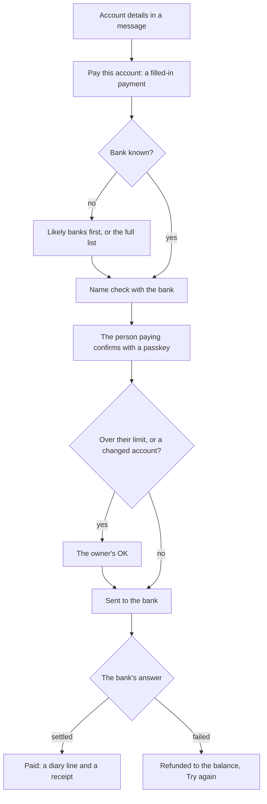

# Chat: paying people from the chat

Status: **built**: phases 1 to 4 (P1 to P4 of the [earlier build plan](build-plan-saved-tools-payments.md)), and paying one person finished on 24 November 2026 ([build-plan-gaps.md](build-plan-gaps.md) H7; see [As built (H7)](#as-built-h7-24-november-2026)). Real money waits for D6. Written with the founder (8 November 2026); the live
doc is [the shared plan](https://claude.ai/artifact/Nu43QWbcXtiYovgLXzwf2s), and this file is its copy beside the code.

## Summary

Owners and staff pay people from the chat: one person, several at once, or the whole payroll. Account details that arrive in a message become a filled-in payment in one tap, checked with the bank before any money moves.

Today an owner copies "0123456789 GTBank" out of WhatsApp, opens a banking app, types it in, pays, and later works out what the payment was for. Taskiem already connects the business's own payments account, checks names with banks, approves payments and runs payroll. What is missing is the way in from the chat.

- **Pay one person** from Tools, from a message's account details, or from a supplier, staff member or rider Taskiem already knows.
- **Pay several people** in one go, picked or pasted, with one approval and a result per person.
- **Payroll**, through Payrolla, from the chat.

Every payment says what it is for (a bill, wages, a delivery, a refund), so the books are right without work. That is what a bank app cannot do.

Money leaves only from the business's own payments account (Paystack, Moniepoint, Opay and the others it connects); Taskiem never holds it. Fraud from changed account details is the main risk, and the safety section is part of the first phase, not an afterthought.

## What exists today

Money leaves only through a workflow run: name check, approval, one payment with a key that can't pay twice, then a wait for the bank to confirm. The chat needs a way in to that machinery, not a new payment engine.

| Part | What it does today | What this plan needs from it |
| --- | --- | --- |
| Provider capabilities (`schemas/capabilities-v1.json`) | `balance`, `resolve_account` (name check), `list_banks`, `pay_bank`, `get_payout`. Paystack, Flutterwave, Moniepoint and Anchor have all five; iswallet has no bank list | Used as they are. `pay_many` is defined but no provider has it, so a batch loops `pay_bank` |
| Fees | Known after a payout (`fee_kobo`); only Flutterwave can quote one before | Show the fee before paying where the provider quotes it; otherwise "fee shown after" |
| Paying once, and settling (`engine/effects`, `await_settlement`) | A key per payment from a seed; waits for settled, failed or reversed, then asks the provider if nothing comes | Used as is: the seed is the payment's own id |
| Money log (`engine/runtime/moneylog.go`) | Records a payout, tells the bill side, remembers accounts paid (`payout_accounts`) | Gains "what for" from the payment |
| Bill pay (`api/bills.go`, `pay-linked-bill`) | Name check, approval, pay, settle, close the bill; started from a bill card or WhatsApp | The model for one payment; bills keep this path |
| Approvals (`ApproveSheet`, `api/approvals.go`) | The "Approve it?" sheet; step-up by policy (passkey, TOTP, WhatsApp PIN); first-payment warning | Payroll and supplier-payment approvals carry no account number, so they never show the warning: fix it |
| Payroll (`run-payroll.json`) | On pay day: staff table, every name checked, balance, approval, pay each, results to `payroll_lines` | **Deleted** (22 November 2026): payroll is Payrolla's |
| Pay a list (`pay-a-list.json`) | Pays the rows of a table in one run | Has no name check; the bulk flow adds one |
| Payrolla connector | Reads runs, staff and payslips; never pays | Payroll in Taskiem's own screens and chat; Payrolla pays (its API requests: [payrolla-api-requests](../integrations/payrolla-api-requests.md)) |
| Saved bank details | Riders' bank (sealed, passkey to change); staff linked to saved accounts (22 November 2026); suppliers only per bill | No payee list: added |
| Single-action step-up (`checkStepUp`) | A passkey for one sensitive action, used for rider bank changes | Used for every payment |
| Roles (`engine/access`) | No "pay" permission; bill pay rides on `invoice.manage` | A permission of its own, with limits |
| Reading account details from text | Nothing; a NUBAN check-digit test exists (`engine/pii`) and bank names map to codes (`links.BankCode`) | Built |
| WhatsApp words | "pay", "pay now" pay the Taskiem subscription | New words must not collide |

## Pay one person

A Pay sheet over the chat, reached three ways, always ending with the bank's name on the account shown large before anyone confirms.

**Three ways in:**

1. **From a message.** A message holding a 10-digit account number and a bank ("0123456789 GTBank Chidi Okeke", "Acct: 0123456789, Access", a screenshot's text) gets a "Pay this account" chip under it, in the web chat and in a business chat. Tapping it opens the sheet with the bank and number filled in, and the amount too when the message says one ("send 45k").
2. **From Tools.** A Pay tile: type a name, an account number or a bank, or pick from people paid before, staff, riders and suppliers.
3. **From someone Taskiem knows.** "Pay" on a bill card (as today), on a staff member, on a rider's delivery, on a refund.

**The sheet, top to bottom:**

1. **Who.** Bank and account number. As soon as both are there, the name check runs and shows "Chidi Okeke · GTBank · ••6789" in large type. If the message gave a name that doesn't match the bank's, it says so in amber: "The message says Chidi Okafor; the bank says Chidi Okeke."
2. **How much.** Naira, with "45k" and "45,000" both understood; the balance after shown under it, and the fee where the provider quotes one before paying (otherwise it shows on the result).
3. **What for.** A choice, prefilled where Taskiem can tell: a bill (settles it), wages, a delivery, a refund, stock bought, or other with a word. This is what lands in the money log.
4. **A note** for the person, sent with the transfer where the provider allows it.
5. **Pay ₦45,000.** Then a passkey, or the PIN (Safety), then either sent, or "Sent for Ada's OK" when it is over this person's limit.

**When the bank isn't known** (only "0123456789", a bank the app can't read, or someone typing from scratch):

1. **Banks the number could belong to come first.** A Nigerian account number carries a check digit that only some banks' codes satisfy, so Taskiem lists those banks first, with the business's most-paid banks ahead of the rest: often two to five instead of forty.
2. **The full list is one tap away:** every bank and fintech the business's payments account can pay to (its own `list_banks`), searchable by name or short form ("GTB", "Opay", "Moniepoint"). A provider with no bank list falls back to Taskiem's own list of bank codes.
3. **Pick the bank, and the name check runs at once**, showing the bank's name for the account before anything else. A wrong bank answers "No account found at Access Bank. Try another bank" and keeps the number.
4. **Or check the likely banks for me:** one tap runs the name check on the top three candidate banks at once and shows each answer ("GTBank: Chidi Okeke · Access: no account"); the owner picks the one that is right. Never more than three at a time, and never paid without a pick.
5. **The bank and name, once confirmed, stay with the beneficiary** when saved, so the next payment needs neither.

**After:**

- A diary line in the chat it started from: "Paid Chidi Okeke ₦45,000 (delivery) · GTBank ••6789", turning to "Received by the bank" when settled, or "Failed: refunded to your balance" with Try again.
- A receipt to share back in that chat: the person who sent the account details sees it was paid.
- "Save as a beneficiary" (on by default for a new account, with a name to call them by, "Chidi, rider") keeps the bank, number and checked name, so next time it is one tap from Tools or @. Left off, nothing is kept beyond the payment's own record. Beneficiaries can be listed, renamed and removed under Pay; changing one's account needs the owner and a passkey.

## One payment, from a message to paid

The person paying confirms with a passkey before anything else happens; the owner's OK is added only over a limit or for a changed account; the bank's answer decides between paid and money back.

## Pay several people

The same sheet with a list: each row is a person, an amount and what it is for. One check per row, one confirmation and one approval for the batch, and a result per person.

**Filling the list:**

- **Pick** from payees, staff, riders, and suppliers you owe (each bill's balance prefilled).
- **From messages:** **Add to the list** beside "Pay this account" adds each message to one list, the person's own across every chat and kept by Taskiem (so it is the same on the web and the phone), once per message and checked as a payee is (staff add saved accounts); "3 to pay" stays at the foot of each chat until sent or cleared. **Pay these** makes it a batch once every row has an amount; its rows leave the list when it is sent and come back if it is cancelled.
- **Paste or photograph a list:** "Chidi 0123456789 GTBank 45k" one per line, or a photo of a handwritten list. Each line becomes a row to check; a line that can't be read is shown as it was, to fix.
- **Copy last time's:** "Same as last Friday" for the riders' weekly pay.

**Before it goes:**

- Every row is name-checked; rows whose names disagree or fail are amber and held out until fixed or removed.
- The foot shows the total and the balance after (fees too where the provider quotes them). If the balance is short, it says by how much and which rows fit, not one lump "failed".
- Limit: 100 people a batch, so a mistake is never larger than one screen can show.

**After:** one diary line, "Paid 12 people ₦386,000 (riders, week 45)", opening to a row per person that fills in as each settles, fails or comes back. Failed rows can be paid again on their own.

## Payroll in Taskiem, on Payrolla

Rewritten 22 November 2026. **Payroll is Payrolla**, the same team's payroll product: Payrolla keeps employees, their pay and bank details, calculates each run, keeps the approvals, pays every employee once and issues payslips. Taskiem does none of that itself and never pays a salary. It is Payrolla's front: a business runs its payroll in Taskiem's own screens and chat, and Taskiem sends what people do to Payrolla through its API. Payrolla's screens are not embedded.

Taskiem's own **Run payroll** template, `salary-payout-approval`, `payroll-reminder` and the known `staff` table were deleted (no one used them: Taskiem was not in production).

1. **Payroll** in Tools (owners, and whoever they allow to see salaries): this month's run from Payrolla, its state, each person's line and payout status, who was not paid and why.
2. **Approving:** today, the approval card in the chat carries Payrolla's approval link; once Payrolla accepts Taskiem's signed approval, the approver approves in Taskiem with a passkey.
3. **Adjusting:** a bonus, a deduction or an advance repaid, per person, with a word: sent to Payrolla, which recalculates.
4. **Paid:** a result per person from Payrolla's payout events, and each employee's payslip on their own chat (Payrolla's link today; Taskiem's own payslip card once Payrolla gives its contents).
5. **Before pay day:** the funding balance checked, and a reminder to lock an approved run.
6. **Staff:** each Taskiem staff member is linked to their Payrolla employee (by phone or email, the owner confirming), and may be linked to one of the business's saved bank accounts for payments outside payroll (an advance, expenses back), paid with **Pay** on the staff page or as **Staff** in Pay several people.

What Taskiem needs from Payrolla's API for 2, 3 and the rest is in [What Taskiem needs from Payrolla's API](../integrations/payrolla-api-requests.md). Until each piece exists, that step is a link into Payrolla. Other payroll software a business already uses is a later discussion.

## Safety

Easy paying from a message is also easy paying of a scammer's message, so these rules ship in phase 1 and are not settings a business can switch off.

| Risk | What stops it |
| --- | --- |
| "We've changed our bank details", from a supplier or staff member, or someone pretending to be them | A payee paid before to a different account gets a red warning: "Not the account you paid Bayo Rice Mills before (GTBank ••6789). Call them on a number you know before paying." The new account needs the owner's OK, whoever pays |
| A first payment to an account | The existing "First payment to this account" warning, on every Pay sheet |
| The name on the message isn't the account holder | The bank's name shown large; a mismatch with the message or the payee's saved name in amber |
| Someone using a signed-in phone, or a stolen session | A passkey, or the person's PIN with a lower limit, for every payment and every batch; being signed in is not enough |
| A staff member paying too much or too often | Per-role limits on one payment and a day's total, set by the owner; staff start at ₦0. Over a limit goes to the owner's OK, like a deal under the lowest price |
| Paying twice: a double tap, a retry, a message sent again | Each payment has one key from the moment it is made; the provider is asked once and a retry reuses the key. A chip already paid says "Paid ₦45,000 on 8 Nov" |
| A payment started from WhatsApp, Telegram or Slack text | Prepared there, confirmed only in the app, or by the PIN in WhatsApp's secure form within the PIN's limit |
| A batch hiding a wrong row | Rows failing any check are held out; the confirmation names how many rows go and their total |
| Something goes wrong later | Every payment is in the money log and the audit log with who prepared, who approved and who confirmed it, and why |

## Data model, engine and API

A payment is a record first and a workflow run second: the chat creates the record, a managed workflow pays it, and the record carries the result back. One payment and a batch share the same tables; payroll fills a batch.

**New tables:**

| Table | Holds |
| --- | --- |
| `payees` | **Settled 19 November 2026: payees are [saved objects](saved-objects.md) of the kind bank account** (one list; `payments.payee` points to the object), with everything below. A person or business paid before: name, bank code, account number (sealed, like riders' bank), the bank's checked name, kind (staff, rider, supplier, other) and a link to them where one exists. Changing the account needs the owner and a passkey |
| `payments` | One payment: payee, amount, what for (bill, wages, delivery, refund, stock, other + a word), note, who prepared, who approved, who confirmed, status (prepared, waiting for OK, sending, paid, failed, reversed), fee, provider's payout id, the run, and where it started (a message, a card, Tools) |
| `payment_batches` | A batch: its payments, total, kind (list, riders, payroll + period), status |
| `pay_limits` | Per role: one payment, a day's total; set by the owner |

**Engine (`engine/payments`, new):**

- **Reading account details from text** (`ReadAccount`): a 10-digit number that passes the NUBAN check digit for a named bank, the bank by name or common short form ("GTB", "First", "Opay") through `links.BankCode`, an optional name and amount. Run on new messages in the web chat and business chats, and on photo text; it only proposes, never pays. Photo text is read on the phone (the photo is not sent) and given with `from: "photo"`, so letters read in place of digits are put right first (`saved.PhotoText`).
- **Checks** before a payment can be confirmed: name check, payee account changed, first payment, limits, balance, duplicate (same payee and amount in 24 hours asks "Pay again?").
- **Paying:** one managed workflow per business, from a `pay-person` template like `pay-linked-bill`: `resolve_account`, approval when over a limit or the account changed, `pay_bank` with seed `payment:<id>`, `await_settlement`, then `payments@1 finish`. A batch runs the same steps in a loop (seed per payment, 5 at a time) and fixes `pay-a-list`'s missing name check.
- **Money log:** each finished payment is recorded with its "what for"; a bill payment closes the bill as today, wages and deliveries post to their accounts.
- **Approvals:** subjects for payroll and supplier payments carry the account number, so the first-payment warning shows on them too.
- **Preparing from a workflow:** the action `payments@1 prepare` makes a payment record from a run (a payee, an amount, what for) and stops there, in "prepared": a person who may pay confirms it with a passkey, as any payment. It never sends. It is how a business's own workflow or made tool pays a saved account ([the build plan](build-plan-saved-tools-payments.md), P1 and S3).
- **Permission:** `money.pay`, given to owners and to roles the owner chooses, always with `pay_limits`.

**API:**

- `POST /v1/payments` prepares; `POST /v1/payments/{id}/confirm` (passkey proof) sends; `GET /v1/payments`, `/v1/payments/{id}`.
- `POST /v1/payments/read` returns what `ReadAccount` found in a message: the number, the bank if named, otherwise the candidate banks. GET /v1/banks lists the banks the connected account pays to (candidates first for a given number); POST /v1/name-check checks one bank, or up to three at once.
- Payees are read and changed through saved objects' API (`/v1/saved`, kind bank account; change of account by step-up), not a `/v1/payees` of their own; `/v1/payment-batches` prepare, confirm, list; `/v1/pay-limits`.
- Payroll: Taskiem's own `/v1/payroll` reads (and, as Payrolla's API grows, acts on) Payrolla's runs through the connection; no payroll batch of Taskiem's own.

## WhatsApp, Telegram and Slack

Most account details arrive on WhatsApp, so a payment can be prepared there; it is confirmed only where identity can be checked.

- **Forward or reply "pay" to a message with account details** in the Taskiem chat on WhatsApp: Taskiem checks the name and answers "Pay Chidi Okeke (GTBank ••6789) how much, and for what?"
- **Or say it:** "send chidi 45k for delivery" (a known payee), "transfer 45k to 0123456789 gtbank". "Pay" and "pay now" alone already pay the Taskiem subscription, so "pay" starts a transfer only when a person or an account follows it.
- **Confirm:** a link that opens the Pay sheet filled in, for a passkey tap; or the person's PIN in WhatsApp's secure form, within the PIN's limit. Nothing pays on a plain "yes".
- **Results** come back in the same chat: "Paid Chidi Okeke ₦45,000. Received by the bank."
- **Payroll's approval card** reaches the approver on their chat app with an Approve link, as approvals do today.
- **Bulk from chat apps:** a pasted list is read and answered with "12 people, ₦386,000. Open to check and pay" and a link; a batch is never confirmed in text.

**Built (22 November 2026), in the Taskiem chat on WhatsApp, Telegram, Slack and the web, for those with `money.pay`:** "pay my list" (or "pay the list", "pay my list for wages") makes the person's collected list a batch, as Pay these does in the app; a list under a first line "pay these" or "pay this list" (with "for wages" and the like) is read a line at a time as Paste a list reads it ("Chidi 0123456789 GTBank 45k", or a saved account by name, "@bayo 45k"), a line whose account is saved paid by its @name (the only way staff pay), and prepared as a batch (`api/payments_chat_list.go`). The answer says how many people and how much with a link to `/payments/batches/{id}` (the app opens the batch), then each row held out and each line not read, with why; nothing read makes no batch. When a payment prepared from the chat ends paid, failed (with the reason) or declined, its preparer is told on the first chat app they linked (WhatsApp, then Telegram, then Slack), from the outbox (kinds `payment` and `payment_batch`, queued in the transaction that records the end, once); a batch is told once, when its last row ends: "Paid 1 of 2 people, ₦45,000. 1 not paid: …" (`api/payments_chat_result.go`). **Built 24 November 2026 (H7):** a message forwarded to Taskiem with account details (WhatsApp's forwarded mark, Telegram's forward, a message shared into the Slack DM), or a reply of "pay" quoting one (Telegram sends the quoted words; on WhatsApp and Slack a message with account details is kept, sealed, a week under its id, `chat_pay_quotes`), is read as a typed one is: the name is checked and Taskiem answers "Pay Chidi Okeke (GTBank ••6789) how much, and for what?", then asks as Pay an account number does ("45k for a delivery" answers both), and prepares it for the link or the PIN (`api/payments_forward.go`). A batch row refused at confirming ends refused with why, so the batch ends, and is told, when its other rows have.

## Built on the chat menus (21 November 2026)

[Chat menus](chat-menus.md) landed after this plan was written: one catalogue of actions (`api/chat_actions.go`) gives help, the menus on every channel, the model's list, and one form per action in the app and on the web (`ActionFormSheet`, `ActionForm`), whose fields can offer the business's own records as chips. Paying is built on it, not beside it:

- **A Pay topic** in the catalogue, for those with `money.pay` and a payments connection:
  - `pay.person`, **Pay someone** ("From your balance, checked with the bank"): `who` (kind `payee`), `amount` (`money`), `for` (a choice: a bill, wages, a delivery, a refund, stock bought, other), `note` (optional). Its command is *send 45k to @chidi for delivery*. In the app and on the web its form **is** the Pay sheet of "Pay one person" (the sheet's look, with the bank's name large), filled with what was said; on WhatsApp, Telegram and Slack its questions are asked and end with the confirmation below.
  - `pay.account`, **Pay an account number**: `number` (kind `account`: ten digits, the check digit checked), `bank` (kind `bank`: the banks the number can belong to first, from the provider's `list_banks`), then `amount` and `for`. Its command is *transfer 45k to 0123456789 gtbank*. The "Pay this account" chip (phase 2) opens this form filled in.
  - **Payments** (show: today's and the week's, with their results) and **Your payees** (page: the saved bank accounts, the Saved page's Accounts).
- **New field kinds:** `payee` (a saved account the person may pay: the business's for staff; an owner's own too, marked personal; chips the most paid first, as `@name`), `account` and `bank`. A payee's account number is never a chip, a value the model sees, or in a menu: the server reads it at the payment, as a run's saved things are read (saved objects S3).
- **Confirmation is the catalogue's first that needs more than the form's button.** An action gains `confirm: "passkey"`: in the app and on the web the form's button opens the single-action step-up (`checkStepUp`) before the command runs; the PIN within its limit is the fallback; on the chat apps the questions end with a link that opens the form filled in, for that passkey. "Nothing pays on a plain yes" holds on every channel; the model may pick `pay.person` with its values, and the confirmation is still the person's.
- **What moves earlier:** the chat apps' words ("send chidi 45k for delivery", phase 4) come with phase 1, since a catalogue action is on every channel at once; the build plan's "the reader learns the words that pay" (P1) is these entries.
- **What stays:** `payments`, `pay_limits`, `money.pay`, the `pay-person` workflow, `payments@1 prepare` for workflows (a run's `saved.<name>` never holds the account number: `prepare` takes the saved thing's name and reads it on the server), the warnings, limits, the diary line, the receipt and the money log, as above.

## Phases

Four phases, each a PR that ships on its own. Safety is in the first one, because the first payment is the one that matters.

1. **Pay one person, safely.** Payees as bank account objects (their store is the build plan's S0), `payments`, `payments@1 prepare`, `pay_limits`, `money.pay`; the `pay-person` workflow; the Pay tile and sheet; the bank list with candidate banks first and a fallback list; the name check on one or three banks; saving a beneficiary; "what for"; the passkey on confirm; account-changed and first-payment warnings; limits and the owner's OK; diary lines, the receipt, money log; the first-payment warning on payroll and supplier approvals.
   - Done when: an owner pays a rider ₦45,000 from Tools in under 30 seconds, it is recorded as a delivery, and a changed account for a past payee is stopped for the owner's OK.
2. **From a message.** `ReadAccount` on web chat and business-chat messages and photo text; the "Pay this account" chip; a chip already paid says so; Pay on staff, riders and refunds.
   - Done when: account details in a WhatsApp message that reached the web chat become a checked, filled-in payment in one tap.
3. **Pay several people.** `payment_batches`; picking, collecting from messages, pasting and photographing a list, copying last time's; a check per row; held-out rows; one confirmation; results per person and paying the failed ones again.
   - Done when: 12 riders are paid in one batch, a bad account is held out before anything moves, and the others are paid.
4. **Payroll in Taskiem, on Payrolla; and the chat apps.** Payroll in Taskiem's own screens and chat over Payrolla's API (its runs, approval, adjustments, payslips; each a link into Payrolla until its API has it); staff linked to Payrolla employees and to saved accounts; WhatsApp, Telegram and Slack words with confirmation by link or code.
   - Done when: a business sees and approves this month's Payrolla run from Taskiem's chat, each employee gets their payslip on their own chat, and a payment prepared on WhatsApp is confirmed in the app.

## Tests and checks

Money tests run against the providers' fakes the repo already uses (iswallet, the payout events), never real money.

- **Go:** `ReadAccount` against a corpus of real-world shapes ("0123456789 GTB", "Acct no: 0123456789 First Bank", a number with a bad check digit, two numbers in one message); every check (changed account, first payment, limits, balance, duplicate); one key per payment, so a retry or double confirm pays once; a batch with failing rows; settled, failed and reversed results reaching the record and the money log; permissions and limits per role.
- **Browser (e2e):** the Pay sheet at 390 and 360 px in both themes with axe; a chip on a message to paid; a changed account stopped; a batch with a held-out row; payroll's card approved in the chat.
- **Security review** of phase 1 before it ships: step-up on every confirm, sealed account numbers, nothing paid from text.
- **Plain words:** "Pay", "Send money", "What it's for"; "Beneficiary", the word bank apps use; no "payout" or "NUBAN" on owners' screens.
- **The recording:** a new act: a rider's account details in a message, the chip, the check, the passkey, paid.

## Settled (19 November 2026)

The founder answered the open questions. Where the text above says otherwise, this holds.

| # | Question | Settled |
| --- | --- | --- |
| 1 | Who may pay at all | **Owners, and roles the owner chooses**, from the first release. Every staff role starts at a limit of ₦0, so nothing changes until the owner gives a role the right to pay and sets its limit. Staff pay the business's saved accounts only ([saved objects](saved-objects.md) §7.3) |
| 2 | A business with no payments provider | **Pay is shown, with the step to connect.** The step offers two paths. First, **Open a Taskiem wallet**: a business with no account at any provider is given **iswallet**, Taskiem's own wallet, which covers its payment needs (being paid and paying). It asks for an email and the director's BVN, in plain words and with why. Second, **I already have an account with…** Paystack, Flutterwave, Moniepoint or Anchor. On owners' screens the wallet is "your Taskiem wallet", never "iswallet". Only the owner sees the step; staff see "Ask the owner to set up payments". After it, the person lands back on the Pay sheet with what they typed. Money leaves from the wallet's balance, so the sheet shows the balance and **Add money** (the wallet's own account number). Saved accounts work without a provider; only paying waits. **The step itself is built in the build plan's S0**, before this plan's first phase, so a saved account's name can be checked from the first day; this plan adds the balance, **Add money** and paying |
| 3 | A fallback for owners with no passkey | **A PIN, not a code by text.** A passkey first, a six-digit PIN as the fallback. It is the PIN people already set for approvals on WhatsApp (`api/whatsapp_pin.go`): one PIN for a person, called "your PIN", never a business's. A lower limit when a payment is confirmed by PIN (proposed ₦100,000 a payment, and a day's total). **Passkey only** for changing a saved account's number and for the owner's OK on a changed account. Locked after 5 wrong tries. Asked for only in the app's own pad or WhatsApp's secure form, never in a message ("Taskiem will never ask for your PIN in a message"). A first PIN may be set at sign-up, once the phone is verified (today setting one needs a passkey or an authenticator). **No reset by text:** a forgotten PIN is reset with a passkey, or by signing in again and waiting 24 hours before the new PIN can pay. **Built 22 November 2026** (`api/payments_pin.go`): ₦100,000 a payment and ₦200,000 a day across the person's PIN-confirmed payments in every business, in the app's PIN pad and in WhatsApp's form for one payment; batches stay passkey only; Telegram and Slack keep the link |
| 4 | Who bears a payout's fee | **The business paying.** The payee receives the full amount. The sheet shows the fee and the balance after, before the passkey or PIN ("₦45,000 + ₦25 fee"). The fee is its own line in the money log, as bank charges. The balance check includes it. A batch shows the total of fees. Limits apply to the amount, not the fee. Taskiem adds nothing on top in this plan |
| 5 | Payslips | **The full breakdown:** basic pay, allowances, deductions and the net. Private to the person's own chat; a notification says only "Your payslip for November is ready". On WhatsApp it is a short message with a link, opened after the person proves who they are. It can be saved as a PDF with the business's name |
| 6 | Does the person paid see it in the chat? | **Yes**, as a card in the conversation, as bill payments do. Posted only when the provider confirms; a failed or reversed payment updates the same card. It shows the amount, what for, the date and the last four digits of their own account; not who approved, the payer's balance or the fee. Not for wages, an owner paying their own saved account, or refunds to customers. **Tell them in the chat** is a tick on the Pay sheet, on by default. A payee not on Taskiem gets nothing unless the payer picks **Send them a receipt** |
| 7 | Banks only, or wallets too? | **Banks, and Taskiem wallet to Taskiem wallet** where both sides have one: at once, with no bank between. Taskiem chooses the route and the sheet says so ("Taskiem wallet · arrives at once"); it falls back to the bank otherwise. The same checks apply. OPay, PalmPay and Moniepoint accounts are paid as banks, by their account numbers. Mobile money by phone number comes later |

## As built (H7, 24 November 2026)

[build-plan-gaps.md](build-plan-gaps.md) H7 finished paying one person, built and tested against the stand-in payments account (never a real provider), as P1 to P4 were. Migration `00650_pay_people_h7.sql`.

- **The provider's contract** (`schemas/capabilities-v1.json`) gained `quote_fee` (an amount, optionally the bank and the wallet; answering `fee_kobo`). `balance` and `pay_wallet` were there already: iswallet maps both. No real provider is asked for a quote yet; the Go tests' stand-in (`standInRails`) answers all three.
- **The balance and Add money** (Settled 2): `GET /v1/payments/balance` says what people are paid from, its balance where it says one, whether the fee is known before paying, and for a Taskiem wallet the wallet's own account number to add money to. The Pay sheet shows it at the top, on the web (`PayBalanceLine`) and in the app (`PayBalanceRow`).
- **The fee before paying** (Settled 4; founder, 24 November: pay anyway when there is no quote): a payment keeps the fee its payments account quoted when it was prepared (`fee_quote_kobo`); the sheet says "₦45,000 + ₦25 fee" and the balance after, or "The fee shows after paying". A balance that does not cover the amount and the fee refuses it (409 `short`, by how much), when it is prepared and again when it is confirmed (by passkey or PIN); limits count the amount only. The pay-person workflow passes the fee the provider reported to `payments@1 finish`, and the fee is written as its own money-log line, kind `fee`, category *bank charges* (keyed `payout.fee` on the payout), while the payout's own line carries none.
- **What for in the money log**: a payout that pays a payment (the payment learns its payout when the rail takes it, `links.Payments.PayoutSent`) is recorded with the payment's purpose as its category (`moneylog.PayoutPurposeTx`): *delivery*, *wages*, *bill*, *refund*, *stock bought*, or the payer's word for other; the journal export puts it under *Payouts: Delivery* and the fee under *Bank and payment fees*.
- **The diary line**: a payment confirmed (by passkey or PIN) writes "Paid Chidi Okeke ₦45,000 (delivery) · GTBank ••6789" in the chat it was paid from: the person's Taskiem chat (the default for a person, so Tools too), or their side of a linked business's chat (`where`, the link). The line names its payment (`chat_history.payment_id`, `link_messages.payment_id`), so the web and the app show it as it stands: "Received by the bank", "Failed: refunded to your balance" with **Try again** (`POST /v1/payments/{id}/again`: prepared again as it was asked for, to confirm), or "Came back". A batch has one line, "Paid 12 people ₦386,000 (riders, week 45)", naming the batch.
- **A receipt**: a paid payment's receipt (`GET /v1/payments/{id}/receipt`, `/receipt/pdf`) says who paid whom, how much, what for, when, and the bank and last four digits; never who approved, the balance or the fee. Its PDF has a signed link of its own (`/v1/pay-receipts/{token}/pdf`, no session) to send the person paid; `POST /v1/payments/{id}/share` puts it in the Taskiem chat as a card, or in a linked business's chat as a message from the payer with the link.
- **The card to the person paid** (Settled 6): once the provider confirms, a rider is told on the chat app they tapped in on, and a staff member in their Taskiem chat (a *paid you* card) and on their first chat app: the amount, what for, the day and their account's last four digits (outbox kind `payee_paid`, once). A payment the bank later sends back (a `payout.reversed` event) turns `reversed`, and the person paid is told it did not reach them; the payer, when it was prepared from the chat, too. Not for wages, an owner's own account, or refunds. **Tell them in the chat** is a tick on the sheet, on by default, for those who can be told; for anyone else the sheet offers **Send them a receipt**, and the chat app's result then carries the receipt's link to send them. A Taskiem business paid wallet to wallet is not told by Taskiem: it sees the money in its own wallet.
- **Save as a beneficiary**: on the sheet for an account typed or read, on by default, with a name from the bank's (*chidi*); saved as a bank-account saved thing once confirmed, web and app.
- **First-payment warning on supplier approvals**: `supplier-payment-approval`'s subject carries the account and its bank, and `pay-riders-weekly`'s and `pay-a-list`'s their accounts (`accounts`), so the warning shows when any was never paid. The approver sees the account masked (••6789) and a list as how many.
- **Pay on a refund**: an order whose customer paid by transfer and is owed it back has **Pay it back** (owners who may pay), opening the Pay sheet with the amount and *a refund*, on the web and in the app. Invoices have no refund of their own in Taskiem, so there is none to pay from there. Staff and riders were built in P2.
- **Paying several**: the batch's foot says the fees and the balance after; when the balance is short, by how much and which rows fit (`fees_kobo`, `fees_unknown`, `balance_kobo`, `short_kobo`, `fit`), and confirming is refused (409 `short`). One diary line for the batch.
- **Taskiem wallet to Taskiem wallet** (Settled 7; founder: Taskiem chooses whenever it can): when the business pays from its Taskiem wallet and the account is another business's Taskiem wallet (`taskiem_wallet_for_account`, a definer that answers that wallet's id only), the payment's route is `wallet`: "Taskiem wallet · arrives at once", no fee. The pay-person workflow pays it with `pay_wallet`; if that fails, its `on_error` pays the bank with the payment's own key, and the payment says so (route `bank`). The workflow is made again for a business whose was made before (`pay_settings.shape`), and on a payments account that cannot pay wallets the wallet steps are left out.
- **Forward or reply "pay"** on WhatsApp, Telegram and Slack, and **a batch whose last row is refused at confirming**: above, under WhatsApp, Telegram and Slack.
