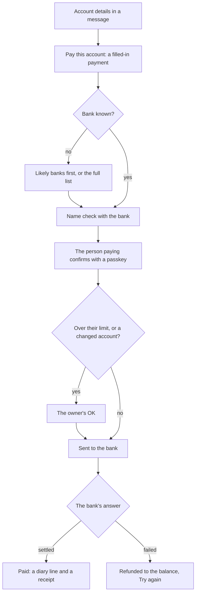

# Chat: paying people from the chat

Status: **plan**, for review (8 November 2026). Written with the founder; the live
doc is [the shared plan](https://claude.ai/artifact/Nu43QWbcXtiYovgLXzwf2s), and this file is its copy beside the code.

## Summary

Owners and staff pay people from the chat: one person, several at once, or the whole payroll. Account details that arrive in a message become a filled-in payment in one tap, checked with the bank before any money moves.

Today an owner copies "0123456789 GTBank" out of WhatsApp, opens a banking app, types it in, pays, and later works out what the payment was for. Taskiem already connects the business's own payments account, checks names with banks, approves payments and runs payroll. What is missing is the way in from the chat.

- **Pay one person** from Tools, from a message's account details, or from a supplier, staff member or rider Taskiem already knows.
- **Pay several people** in one go, picked or pasted, with one approval and a result per person.
- **Run payroll** from the chat, with its approval as a card.

Every payment says what it is for (a bill, wages, a delivery, a refund), so the books are right without work. That is what a bank app cannot do.

Money leaves only from the business's own payments account (Paystack, Moniepoint, Opay and the others it connects); Taskiem never holds it. Fraud from changed account details is the main risk, and the safety section is part of the first phase, not an afterthought.

## What exists today

Money leaves only through a workflow run: name check, approval, one payment with a key that can't pay twice, then a wait for the bank to confirm. The chat needs a way in to that machinery, not a new payment engine.

| Part | What it does today | What this plan needs from it |
| --- | --- | --- |
| Provider capabilities (`schemas/capabilities-v1.json`) | `balance`, `resolve_account` (name check), `list_banks`, `pay_bank`, `get_payout`. Paystack, Flutterwave, Moniepoint and Anchor have all five; iswallet has no bank list | Used as they are. `pay_many` is defined but no provider has it, so a batch loops `pay_bank` |
| Fees | Known after a payout (`fee_kobo`); only Flutterwave can quote one before | Show the fee before paying where the provider quotes it; otherwise "fee shown after" |
| Paying once, and settling (`engine/effects`, `await_settlement`) | A key per payment from a seed; waits for settled, failed or reversed, then asks the provider if nothing comes | Used as is: the seed is the payment's own id |
| Money log (`engine/runtime/moneylog.go`) | Records a payout, tells the bill side, remembers accounts paid (`payout_accounts`) | Gains "what for" from the payment |
| Bill pay (`api/bills.go`, `pay-linked-bill`) | Name check, approval, pay, settle, close the bill; started from a bill card or WhatsApp | The model for one payment; bills keep this path |
| Approvals (`ApproveSheet`, `api/approvals.go`) | The "Approve it?" sheet; step-up by policy (passkey, TOTP, WhatsApp PIN); first-payment warning | Payroll and supplier-payment approvals carry no account number, so they never show the warning: fix it |
| Payroll (`run-payroll.json`) | On pay day: staff table, every name checked, balance, approval, pay each, results to `payroll_lines` | Reused; started and approved from the chat |
| Pay a list (`pay-a-list.json`) | Pays the rows of a table in one run | Has no name check; the bulk flow adds one |
| Payrolla connector | Reads runs, staff and payslips; never pays | Shown in the chat; pays nothing through Taskiem |
| Saved bank details | Riders' bank (sealed, passkey to change); staff in the staff table; suppliers only per bill | No payee list: added |
| Single-action step-up (`checkStepUp`) | A passkey for one sensitive action, used for rider bank changes | Used for every payment |
| Roles (`engine/access`) | No "pay" permission; bill pay rides on `invoice.manage` | A permission of its own, with limits |
| Reading account details from text | Nothing; a NUBAN check-digit test exists (`engine/pii`) and bank names map to codes (`links.BankCode`) | Built |
| WhatsApp words | "pay", "pay now" pay the Taskiem subscription | New words must not collide |

## Pay one person

A Pay sheet over the chat, reached three ways, always ending with the bank's name on the account shown large before anyone confirms.

**Three ways in:**

1. **From a message.** A message holding a 10-digit account number and a bank ("0123456789 GTBank Chidi Okeke", "Acct: 0123456789, Access", a screenshot's text) gets a "Pay this account" chip under it, in the web chat and in a business chat. Tapping it opens the sheet with the bank and number filled in, and the amount too when the message says one ("send 45k").
2. **From Tools.** A Pay tile: type a name, an account number or a bank, or pick from people paid before, staff, riders and suppliers.
3. **From someone Taskiem knows.** "Pay" on a bill card (as today), on a staff member, on a rider's delivery, on a refund.

**The sheet, top to bottom:**

1. **Who.** Bank and account number. As soon as both are there, the name check runs and shows "Chidi Okeke · GTBank · ••6789" in large type. If the message gave a name that doesn't match the bank's, it says so in amber: "The message says Chidi Okafor; the bank says Chidi Okeke."
2. **How much.** Naira, with "45k" and "45,000" both understood; the balance after shown under it, and the fee where the provider quotes one before paying (otherwise it shows on the result).
3. **What for.** A choice, prefilled where Taskiem can tell: a bill (settles it), wages, a delivery, a refund, stock bought, or other with a word. This is what lands in the money log.
4. **A note** for the person, sent with the transfer where the provider allows it.
5. **Pay ₦45,000.** Then a passkey or code tap (Safety), then either sent, or "Sent for Ada's OK" when it is over this person's limit.

**When the bank isn't known** (only "0123456789", a bank the app can't read, or someone typing from scratch):

1. **Banks the number could belong to come first.** A Nigerian account number carries a check digit that only some banks' codes satisfy, so Taskiem lists those banks first, with the business's most-paid banks ahead of the rest: often two to five instead of forty.
2. **The full list is one tap away:** every bank and fintech the business's payments account can pay to (its own `list_banks`), searchable by name or short form ("GTB", "Opay", "Moniepoint"). A provider with no bank list falls back to Taskiem's own list of bank codes.
3. **Pick the bank, and the name check runs at once**, showing the bank's name for the account before anything else. A wrong bank answers "No account found at Access Bank. Try another bank" and keeps the number.
4. **Or check the likely banks for me:** one tap runs the name check on the top three candidate banks at once and shows each answer ("GTBank: Chidi Okeke · Access: no account"); the owner picks the one that is right. Never more than three at a time, and never paid without a pick.
5. **The bank and name, once confirmed, stay with the beneficiary** when saved, so the next payment needs neither.

**After:**

- A diary line in the chat it started from: "Paid Chidi Okeke ₦45,000 (delivery) · GTBank ••6789", turning to "Received by the bank" when settled, or "Failed: refunded to your balance" with Try again.
- A receipt to share back in that chat: the person who sent the account details sees it was paid.
- "Save as a beneficiary" (on by default for a new account, with a name to call them by, "Chidi, rider") keeps the bank, number and checked name, so next time it is one tap from Tools or @. Left off, nothing is kept beyond the payment's own record. Beneficiaries can be listed, renamed and removed under Pay; changing one's account needs the owner and a passkey.

## One payment, from a message to paid

The person paying confirms with a passkey before anything else happens; the owner's OK is added only over a limit or for a changed account; the bank's answer decides between paid and money back.

## Pay several people

The same sheet with a list: each row is a person, an amount and what it is for. One check per row, one confirmation and one approval for the batch, and a result per person.

**Filling the list:**

- **Pick** from payees, staff, riders, and suppliers you owe (each bill's balance prefilled).
- **From messages:** "Pay this account" on several messages adds each to one list ("3 to pay" stays at the foot of the chat until sent or cleared).
- **Paste or photograph a list:** "Chidi 0123456789 GTBank 45k" one per line, or a photo of a handwritten list. Each line becomes a row to check; a line that can't be read is shown as it was, to fix.
- **Copy last time's:** "Same as last Friday" for the riders' weekly pay.

**Before it goes:**

- Every row is name-checked; rows whose names disagree or fail are amber and held out until fixed or removed.
- The foot shows the total and the balance after (fees too where the provider quotes them). If the balance is short, it says by how much and which rows fit, not one lump "failed".
- Limit: 100 people a batch, so a mistake is never larger than one screen can show.

**After:** one diary line, "Paid 12 people ₦386,000 (riders, week 45)", opening to a row per person that fills in as each settles, fails or comes back. Failed rows can be paid again on their own.

## Payroll in the chat

Payroll is a batch whose rows come from the staff list and whose amounts come from each person's pay, so it reuses the batch above rather than being a third system. The payroll that already runs as a template (on its day, from a staff table, approved, paid per person) keeps running; the chat becomes its front door.

1. **A Payroll tile** in Tools (owners and whoever they allow): this month's run, prefilled from staff and their pay, with this month's changes shown ("Tunde: +₦5,000 overtime", "Ngozi: joined on the 12th, half month").
2. **Adjust in place:** a bonus, a deduction or an advance repaid, each with a word, per row.
3. **Check and approve:** every name checked with the bank; the approval card in the Taskiem chat shows the total, the balance, and anyone who won't be paid and why.
4. **Paid:** a result per person, and a payslip each person gets on WhatsApp (amount, period, the adjustments), only to their own number.
5. **The day it is due:** the scheduled payroll posts its card in the chat for approval instead of waiting in a page.

Businesses using Payrolla keep paying through Payrolla: Taskiem only reads it, so the chat shows Payrolla's runs and reminders through the templates that already connect it, and pays nothing itself.

## Safety

Easy paying from a message is also easy paying of a scammer's message, so these rules ship in phase 1 and are not settings a business can switch off.

| Risk | What stops it |
| --- | --- |
| "We've changed our bank details", from a supplier or staff member, or someone pretending to be them | A payee paid before to a different account gets a red warning: "Not the account you paid Bayo Rice Mills before (GTBank ••6789). Call them on a number you know before paying." The new account needs the owner's OK, whoever pays |
| A first payment to an account | The existing "First payment to this account" warning, on every Pay sheet |
| The name on the message isn't the account holder | The bank's name shown large; a mismatch with the message or the payee's saved name in amber |
| Someone using a signed-in phone, or a stolen session | A passkey (or one-time code) for every payment and every batch; being signed in is not enough |
| A staff member paying too much or too often | Per-role limits on one payment and a day's total, set by the owner; staff start at ₦0. Over a limit goes to the owner's OK, like a deal under the lowest price |
| Paying twice: a double tap, a retry, a message sent again | Each payment has one key from the moment it is made; the provider is asked once and a retry reuses the key. A chip already paid says "Paid ₦45,000 on 8 Nov" |
| A payment started from WhatsApp, Telegram or Slack text | Prepared there, confirmed only in the app or with a one-time code |
| A batch hiding a wrong row | Rows failing any check are held out; the confirmation names how many rows go and their total |
| Something goes wrong later | Every payment is in the money log and the audit log with who prepared, who approved and who confirmed it, and why |

## Data model, engine and API

A payment is a record first and a workflow run second: the chat creates the record, a managed workflow pays it, and the record carries the result back. One payment and a batch share the same tables; payroll fills a batch.

**New tables:**

| Table | Holds |
| --- | --- |
| `payees` | A person or business paid before: name, bank code, account number (sealed, like riders' bank), the bank's checked name, kind (staff, rider, supplier, other) and a link to them where one exists. Changing the account needs the owner and a passkey |
| `payments` | One payment: payee, amount, what for (bill, wages, delivery, refund, stock, other + a word), note, who prepared, who approved, who confirmed, status (prepared, waiting for OK, sending, paid, failed, reversed), fee, provider's payout id, the run, and where it started (a message, a card, Tools) |
| `payment_batches` | A batch: its payments, total, kind (list, riders, payroll + period), status |
| `pay_limits` | Per role: one payment, a day's total; set by the owner |

**Engine (`engine/payments`, new):**

- **Reading account details from text** (`ReadAccount`): a 10-digit number that passes the NUBAN check digit for a named bank, the bank by name or common short form ("GTB", "First", "Opay") through `links.BankCode`, an optional name and amount. Run on new messages in the web chat and business chats, and on photo text; it only proposes, never pays.
- **Checks** before a payment can be confirmed: name check, payee account changed, first payment, limits, balance, duplicate (same payee and amount in 24 hours asks "Pay again?").
- **Paying:** one managed workflow per business, from a `pay-person` template like `pay-linked-bill`: `resolve_account`, approval when over a limit or the account changed, `pay_bank` with seed `payment:<id>`, `await_settlement`, then `payments@1 finish`. A batch runs the same steps in a loop (seed per payment, 5 at a time) and fixes `pay-a-list`'s missing name check.
- **Money log:** each finished payment is recorded with its "what for"; a bill payment closes the bill as today, wages and deliveries post to their accounts.
- **Approvals:** subjects for payroll and supplier payments carry the account number, so the first-payment warning shows on them too.
- **Permission:** `money.pay`, given to owners and to roles the owner chooses, always with `pay_limits`.

**API:**

- `POST /v1/payments` prepares; `POST /v1/payments/{id}/confirm` (passkey proof) sends; `GET /v1/payments`, `/v1/payments/{id}`.
- `POST /v1/payments/read` returns what `ReadAccount` found in a message: the number, the bank if named, otherwise the candidate banks. GET /v1/banks lists the banks the connected account pays to (candidates first for a given number); POST /v1/name-check checks one bank, or up to three at once.
- `/v1/payees` list, add, change account (step-up); `/v1/payment-batches` prepare, confirm, list; `/v1/pay-limits`.
- Payroll: `POST /v1/payroll/preview` builds this month's batch from the staff table; confirm goes through the batch.

## WhatsApp, Telegram and Slack

Most account details arrive on WhatsApp, so a payment can be prepared there; it is confirmed only where identity can be checked.

- **Forward or reply "pay" to a message with account details** in the Taskiem chat on WhatsApp: Taskiem checks the name and answers "Pay Chidi Okeke (GTBank ••6789) how much, and for what?"
- **Or say it:** "send chidi 45k for delivery" (a known payee), "transfer 45k to 0123456789 gtbank". "Pay" and "pay now" alone already pay the Taskiem subscription, so "pay" starts a transfer only when a person or an account follows it.
- **Confirm:** a link that opens the Pay sheet filled in, for a passkey tap; or, for a business that allows it, a one-time code sent by text, typed back. Nothing pays on a plain "yes".
- **Results** come back in the same chat: "Paid Chidi Okeke ₦45,000. Received by the bank."
- **Payroll's approval card** reaches the approver on their chat app with an Approve link, as approvals do today.
- **Bulk from chat apps:** a pasted list is read and answered with "12 people, ₦386,000. Open to check and pay" and a link; a batch is never confirmed in text.

## Phases

Four phases, each a PR that ships on its own. Safety is in the first one, because the first payment is the one that matters.

1. **Pay one person, safely.** `payees`, `payments`, `pay_limits`, `money.pay`; the `pay-person` workflow; the Pay tile and sheet; the bank list with candidate banks first and a fallback list; the name check on one or three banks; saving a beneficiary; "what for"; the passkey on confirm; account-changed and first-payment warnings; limits and the owner's OK; diary lines, the receipt, money log; the first-payment warning on payroll and supplier approvals.
   - Done when: an owner pays a rider ₦45,000 from Tools in under 30 seconds, it is recorded as a delivery, and a changed account for a past payee is stopped for the owner's OK.
2. **From a message.** `ReadAccount` on web chat and business-chat messages and photo text; the "Pay this account" chip; a chip already paid says so; Pay on staff, riders and refunds.
   - Done when: account details in a WhatsApp message that reached the web chat become a checked, filled-in payment in one tap.
3. **Pay several people.** `payment_batches`; picking, collecting from messages, pasting and photographing a list, copying last time's; a check per row; held-out rows; one confirmation; results per person and paying the failed ones again.
   - Done when: 12 riders are paid in one batch, a bad account is held out before anything moves, and the others are paid.
4. **Payroll and chat apps.** The Payroll tile over `run-payroll`; adjustments; its approval card in the chat; payslips to each person's WhatsApp; WhatsApp, Telegram and Slack words with confirmation by link or code.
   - Done when: this month's payroll is reviewed, adjusted, approved and paid from the chat, and a payment prepared on WhatsApp is confirmed in the app.

## Tests and checks

Money tests run against the providers' fakes the repo already uses (iswallet, the payout events), never real money.

- **Go:** `ReadAccount` against a corpus of real-world shapes ("0123456789 GTB", "Acct no: 0123456789 First Bank", a number with a bad check digit, two numbers in one message); every check (changed account, first payment, limits, balance, duplicate); one key per payment, so a retry or double confirm pays once; a batch with failing rows; settled, failed and reversed results reaching the record and the money log; permissions and limits per role.
- **Browser (e2e):** the Pay sheet at 390 and 360 px in both themes with axe; a chip on a message to paid; a changed account stopped; a batch with a held-out row; payroll's card approved in the chat.
- **Security review** of phase 1 before it ships: step-up on every confirm, sealed account numbers, nothing paid from text.
- **Plain words:** "Pay", "Send money", "What it's for"; "Beneficiary", the word bank apps use; no "payout" or "NUBAN" on owners' screens.
- **The recording:** a new act: a rider's account details in a message, the chip, the check, the passkey, paid.

## Open questions

The plan assumes the answer in brackets.

- [ ] Who may pay at all: owners only at first, or staff with limits from day one? (Owners and roles the owner chooses, staff starting at ₦0.)
- [ ] A business with no payments provider connected: offer to connect one from the Pay tile, or hide Pay? (Show it, with the step to connect one.)
- [ ] One-time code by text as an alternative to a passkey, for owners without one: allowed? (Yes, to the owner's own number.)
- [ ] Payslips: amount and period only, or the full breakdown? (The breakdown.)
- [ ] Should a person paid through a business chat (a supplier) see the payment as a card in that chat? (Yes, as bill payments do today.)
- [ ] Mobile money and wallets (`pay_wallet`, `pay_mobile_money`): in scope, or banks only? (Banks only; wallets later.)
