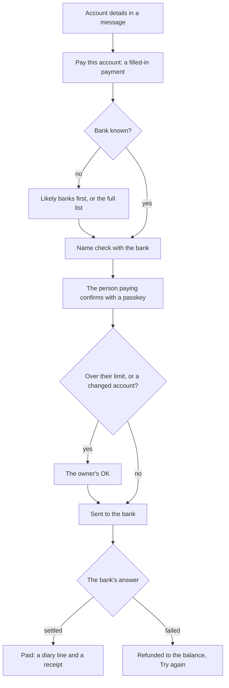

# Chat: paying people from the chat

Status: **plan**, for review (8 November 2026). Written with the founder; the live
doc is [the shared plan](https://claude.ai/artifact/Nu43QWbcXtiYovgLXzwf2s), and this file is its copy beside the code.

## Summary

Owners and staff pay people from the chat: one person, several at once, or the whole payroll. Account details that arrive in a message become a filled-in payment in one tap, checked with the bank before any money moves.

Today an owner copies "0123456789 GTBank" out of WhatsApp, opens a banking app, types it in, pays, and later works out what the payment was for. Taskiem already connects the business's own payments account, checks names with banks, approves payments and runs payroll. What is missing is the way in from the chat.

- **Pay one person** from Tools, from a message's account details, or from a supplier, staff member or rider Taskiem already knows.
- **Pay several people** in one go, picked or pasted, with one approval and a result per person.
- **Payroll**, through Payrolla, from the chat.

Every payment says what it is for (a bill, wages, a delivery, a refund), so the books are right without work. That is what a bank app cannot do.

Money leaves only from the business's own payments account (Paystack, Moniepoint, Opay and the others it connects); Taskiem never holds it. Fraud from changed account details is the main risk, and the safety section is part of the first phase, not an afterthought.

## What exists today

Money leaves only through a workflow run: name check, approval, one payment with a key that can't pay twice, then a wait for the bank to confirm. The chat needs a way in to that machinery, not a new payment engine.

| Part | What it does today | What this plan needs from it |
| --- | --- | --- |
| Provider capabilities (`schemas/capabilities-v1.json`) | `balance`, `resolve_account` (name check), `list_banks`, `pay_bank`, `get_payout`. Paystack, Flutterwave, Moniepoint and Anchor have all five; iswallet has no bank list | Used as they are. `pay_many` is defined but no provider has it, so a batch loops `pay_bank` |
| Fees | Known after a payout (`fee_kobo`); only Flutterwave can quote one before | Show the fee before paying where the provider quotes it; otherwise "fee shown after" |
| Paying once, and settling (`engine/effects`, `await_settlement`) | A key per payment from a seed; waits for settled, failed or reversed, then asks the provider if nothing comes | Used as is: the seed is the payment's own id |
| Money log (`engine/runtime/moneylog.go`) | Records a payout, tells the bill side, remembers accounts paid (`payout_accounts`) | Gains "what for" from the payment |
| Bill pay (`api/bills.go`, `pay-linked-bill`) | Name check, approval, pay, settle, close the bill; started from a bill card or WhatsApp | The model for one payment; bills keep this path |
| Approvals (`ApproveSheet`, `api/approvals.go`) | The "Approve it?" sheet; step-up by policy (passkey, TOTP, WhatsApp PIN); first-payment warning | Payroll and supplier-payment approvals carry no account number, so they never show the warning: fix it |
| Payroll (`run-payroll.json`) | On pay day: staff table, every name checked, balance, approval, pay each, results to `payroll_lines` | **Deleted** (22 November 2026): payroll is Payrolla's |
| Pay a list (`pay-a-list.json`) | Pays the rows of a table in one run | Has no name check; the bulk flow adds one |
| Payrolla connector | Reads runs, staff and payslips; never pays | Payroll run from Taskiem's own screens and chat on Payrolla's Connect API; Payrolla pays ([below](#payroll-in-taskiem-on-payrolla), [decision 0074](../decisions/0074-payroll-run-from-taskiem.md)) |
| Saved bank details | Riders' bank (sealed, passkey to change); staff linked to saved accounts (22 November 2026); suppliers only per bill | No payee list: added |
| Single-action step-up (`checkStepUp`) | A passkey for one sensitive action, used for rider bank changes | Used for every payment |
| Roles (`engine/access`) | No "pay" permission; bill pay rides on `invoice.manage` | A permission of its own, with limits |
| Reading account details from text | Nothing; a NUBAN check-digit test exists (`engine/pii`) and bank names map to codes (`links.BankCode`) | Built |
| WhatsApp words | "pay", "pay now" pay the Taskiem subscription | New words must not collide |

## Pay one person

A Pay sheet over the chat, reached three ways, always ending with the bank's name on the account shown large before anyone confirms.

**Three ways in:**

1. **From a message.** A message holding a 10-digit account number and a bank ("0123456789 GTBank Chidi Okeke", "Acct: 0123456789, Access", a screenshot's text) gets a "Pay this account" chip under it, in the web chat and in a business chat. Tapping it opens the sheet with the bank and number filled in, and the amount too when the message says one ("send 45k").
2. **From Tools.** A Pay tile: type a name, an account number or a bank, or pick from people paid before, staff, riders and suppliers.
3. **From someone Taskiem knows.** "Pay" on a bill card (as today), on a staff member, on a rider's delivery, on a refund.

**The sheet, top to bottom:**

1. **Who.** Bank and account number. As soon as both are there, the name check runs and shows "Chidi Okeke · GTBank · ••6789" in large type. If the message gave a name that doesn't match the bank's, it says so in amber: "The message says Chidi Okafor; the bank says Chidi Okeke."
2. **How much.** Naira, with "45k" and "45,000" both understood; the balance after shown under it, and the fee where the provider quotes one before paying (otherwise it shows on the result).
3. **What for.** A choice, prefilled where Taskiem can tell: a bill (settles it), wages, a delivery, a refund, stock bought, or other with a word. This is what lands in the money log.
4. **A note** for the person, sent with the transfer where the provider allows it.
5. **Pay ₦45,000.** Then a passkey, or the PIN (Safety), then either sent, or "Sent for Ada's OK" when it is over this person's limit.

**When the bank isn't known** (only "0123456789", a bank the app can't read, or someone typing from scratch):

1. **Banks the number could belong to come first.** A Nigerian account number carries a check digit that only some banks' codes satisfy, so Taskiem lists those banks first, with the business's most-paid banks ahead of the rest: often two to five instead of forty.
2. **The full list is one tap away:** every bank and fintech the business's payments account can pay to (its own `list_banks`), searchable by name or short form ("GTB", "Opay", "Moniepoint"). A provider with no bank list falls back to Taskiem's own list of bank codes.
3. **Pick the bank, and the name check runs at once**, showing the bank's name for the account before anything else. A wrong bank answers "No account found at Access Bank. Try another bank" and keeps the number.
4. **Or check the likely banks for me:** one tap runs the name check on the top three candidate banks at once and shows each answer ("GTBank: Chidi Okeke · Access: no account"); the owner picks the one that is right. Never more than three at a time, and never paid without a pick.
5. **The bank and name, once confirmed, stay with the beneficiary** when saved, so the next payment needs neither.

**After:**

- A diary line in the chat it started from: "Paid Chidi Okeke ₦45,000 (delivery) · GTBank ••6789", turning to "Received by the bank" when settled, or "Failed: refunded to your balance" with Try again.
- A receipt to share back in that chat: the person who sent the account details sees it was paid.
- "Save as a beneficiary" (on by default for a new account, with a name to call them by, "Chidi, rider") keeps the bank, number and checked name, so next time it is one tap from Tools or @. Left off, nothing is kept beyond the payment's own record. Beneficiaries can be listed, renamed and removed under Pay; changing one's account needs the owner and a passkey.

## One payment, from a message to paid

The person paying confirms with a passkey before anything else happens; the owner's OK is added only over a limit or for a changed account; the bank's answer decides between paid and money back.

## Pay several people

The same sheet with a list: each row is a person, an amount and what it is for. One check per row, one confirmation and one approval for the batch, and a result per person.

**Filling the list:**

- **Pick** from payees, staff, riders, and suppliers you owe (each bill's balance prefilled).
- **From messages:** **Add to the list** beside "Pay this account" adds each message to one list, the person's own across every chat and kept by Taskiem (so it is the same on the web and the phone), once per message and checked as a payee is (staff add saved accounts); "3 to pay" stays at the foot of each chat until sent or cleared. **Pay these** makes it a batch once every row has an amount; its rows leave the list when it is sent and come back if it is cancelled.
- **Paste or photograph a list:** "Chidi 0123456789 GTBank 45k" one per line, or a photo of a handwritten list. Each line becomes a row to check; a line that can't be read is shown as it was, to fix.
- **Copy last time's:** "Same as last Friday" for the riders' weekly pay.

**Before it goes:**

- Every row is name-checked; rows whose names disagree or fail are amber and held out until fixed or removed.
- The foot shows the total and the balance after (fees too where the provider quotes them). If the balance is short, it says by how much and which rows fit, not one lump "failed".
- Limit: 100 people a batch, so a mistake is never larger than one screen can show.

**After:** one diary line, "Paid 12 people ₦386,000 (riders, week 45)", opening to a row per person that fills in as each settles, fails or comes back. Failed rows can be paid again on their own.

## Payroll in Taskiem, on Payrolla

Rewritten 23 November 2026, after Payrolla shipped its whole Connect API for Taskiem ([decision 0074](../decisions/0074-payroll-run-from-taskiem.md), accepted 24 November 2026). First written 22 November 2026.

**Payroll is Payrolla**, the same team's payroll product. Payrolla keeps employees, their pay and bank details, works out each run, keeps the approvals, pays every employee once and issues payslips. Taskiem does none of that itself and never pays a salary. It is Payrolla's front: a business runs its payroll in Taskiem's own screens and chat, and Taskiem sends what people do to Payrolla through its API. Payrolla's screens are not embedded.

Taskiem's own **Run payroll** template, `salary-payout-approval`, `payroll-reminder` and the known `staff` table were deleted (no one used them: Taskiem was not in production).

**P4a is built** on Payrolla's read API ([Payrolla](../integrations/payrolla.md#in-taskiems-own-screens)): the Payroll page and a run's page, staff linked to their Payrolla employee, `payroll.read`, and pay and payslip messages to each employee's own chat. Approving was a link into Payrolla.

**P4b runs payroll from Taskiem.** Taskiem asked Payrolla for what it needed ([the request](../integrations/payrolla-api-requests.md)). Payrolla answered and shipped it all in three phases ([A](../integrations/payrolla-reference/05-phase-a-response.md), [B](../integrations/payrolla-reference/06-phase-b-response.md), [C](../integrations/payrolla-reference/07-phase-c-response.md)). Our answers to its questions are [drafted](../integrations/payrolla-reference/08-taskiem-answers.md).

### What a business does in Taskiem

In plain words, as an owner would see it:

1. **Connect Payrolla** with one button. A business not on Payrolla yet signs up in the same step.
2. **Team:** add someone with their pay and bank account (the bank's name for it shown before saving), change their pay or details, end their employment.
3. **This month's pay:** prepare it, see what each person gets and why (basic, allowances, tax, pension), add a bonus or a deduction, leave someone out this month.
4. **Approve it** with a code Payrolla sends to the approver's own phone or authenticator app, typed into Taskiem.
5. **Lock and pay:** Payrolla pays everyone on pay day. If the wallet is short, Taskiem says by how much, before and on the day.
6. **After:** who was paid, who was not and why, **Pay now**, and **Pay the failed ones again**.
7. **Payslips** as Taskiem's own cards, the full breakdown, private to each person.
8. **A changed salary account** waits for a second person to approve it, whoever asked. An employee can ask for their own.
9. **Settings and schedules:** the payroll settings, and the tax and pension schedules to file.

**Still done in Payrolla:** changing settings, fixing a locked payroll (a correction run), cancelling an approved one, and changing someone's phone number.

### Confirming with Payrolla's code

Every step that commits money is confirmed the same way: approving, locking, paying now, paying the failed ones again, approving a changed bank account, linking a Payrolla account, and an employee's own account change.

1. The person taps **Approve** (or **Lock and pay**, and so on). Taskiem asks Payrolla for a code for that one action.
2. Payrolla checks first that the action is allowed: the run's state, the person's role, separation of duties. A refusal is said in words before anything is sent (below).
3. Payrolla sends the code to the person's own phone, email or authenticator app. Its message names what is being confirmed: "lock November 2026 payroll and pay ₦9,200,000 to 48 people on 28 Nov 2026".
4. Taskiem says where it went ("Payrolla sent a code to your phone ending 4567") and waits. The person types it in:
   - **web and app:** a six-box code sheet;
   - **WhatsApp and Telegram:** the Taskiem thread itself;
   - **Slack:** a link to the web's code sheet. Slack threads are shared, so a code is never typed there.
5. Taskiem sends the code to Payrolla with the action, once. A wrong code asks again. An expired or locked code offers **Send a new code**.

**Typing the code in a WhatsApp or Telegram thread:**

- **When a message counts as the code:** while one code is waiting for that person in that thread (at most 10 minutes), a message of six digits, spaces allowed, is taken as the code. Anything else is answered as usual, and the code keeps waiting until it expires. "stop" drops it.
- **The code is never kept.** It is not stored, logged, sent to the model, or kept in Taskiem's copy of the conversation, which records "Code entered". It stays only on the person's own phone, and there it is useless: it works once, within 5 minutes, for one action.

**What Taskiem never does:**

- ask for the code anywhere but these places;
- send the code anywhere but Payrolla;
- add its own passkey or PIN to these steps. Payrolla's code is the factor, and it is Payrolla's (decision 0074, point 2).

**Rejecting** moves no money: it needs a linked person and a short note, and no code.

### Who may do what

Taskiem's permission decides who sees a button. Payrolla's role decides whether the action is allowed. Both must say yes, and Payrolla's refusal is shown in words.

| In Taskiem | Lets a person | Payrolla's side |
| --- | --- | --- |
| `payroll.read` (exists, P4a) | See runs, each person's pay and breakdown, payslips, the payment's progress, the funding wallet, settings and the tax and pension schedules | Needs `payroll:read`; payslips `payslips:read`; schedules `reports:read` |
| `payroll.prepare` (new) | Add, change and end employees and their pay; ask for a bank account change; prepare a run, add or remove a bonus or a deduction, leave someone out or put them back, recalculate, cancel before approval | Acts as the connected app with `employees:write` and `payroll:write`; no Payrolla role needed. Comes with `payroll.read` |
| `payroll.approve` (new) | Approve, reject and lock a run; pay now and pay the failed ones again; approve or reject a held bank change | The person's linked Payrolla user must be an **Owner** or **Approver** (`can_approve`), and allowed to pay (`can_pay`) for paying now and paying again; `payroll:approve`. Comes with `payroll.read` |
| The employee themselves (no permission) | See their own payslips; ask to change their own salary account | Must be the staff member linked to that employee (P4a). `payslips:read` and `self_service` |
| Owner | Connect, reconnect and disconnect Payrolla; unlink anyone's Payrolla account | A Payrolla company **owner** allows the connection in Payrolla |

All three permissions are the owner's alone unless given to a role, because each shows what people earn.

**Links between the two:**

- **Linking:** anyone with `payroll.approve` links their own Payrolla account, once, with a code. Taskiem suggests the Payrolla user with the same email.
- **Preparing:** a person with `payroll.prepare` needs no Payrolla account at all. A run they prepare is recorded in Payrolla as made by Taskiem, with their name beside it.

### What Taskiem keeps

As little as it can:

- **The connection,** in the vault, sealed:
  - the access token, its expiry and the refresh token (an OAuth connection), or the key (a key connection);
  - the scopes, the company's id and name, and live or test.
- **The webhook subscription:** its id and signing secret, as P4a keeps them.
- **The staff-to-employee links** P4a keeps: Payrolla's employee id and the name it gave.

**Not kept, anywhere in Taskiem:**

- salaries, breakdowns, bank account numbers, pension PINs or payslip contents. Screens fetch them from Payrolla when opened. Nothing is cached in the database, only within one request;
- who is linked to which Payrolla user (Payrolla's `linked_as` is the record; Taskiem reads `GET /connect/approvers`);
- the codes;
- a payslip PDF, which is made when asked for and not kept.

**Kept, but small:**

- **A waiting code in a chat** keeps Payrolla's challenge id, the action, the run or bank change, the person and the expiry, for at most 10 minutes, never the code.
- **Chat cards** keep Payrolla's ids and the period, and draw the figures when shown.
- **Messages** carry a run's total and headcount, never one person's pay. The payslip notice says only "Your payslip for November is ready".
- **The audit** records who did what to which run, employee or bank change, and whether it was confirmed with a code. It holds no amounts of pay.

### Every write to Payrolla

- **`Idempotency-Key`,** one per change:
  - **Web and app:** an id made when the form or sheet opens and kept through its retries.
  - **Chat:** the card and the action.
  - **Confirmations:** the challenge and the attempt, so each try at a code gets a new key.
  - Taskiem sends a hash of these with the connection and the route.
  - **Retries:** a timeout or a 5xx is retried with the same key, so Payrolla answers once. `IDEMPOTENCY_IN_PROGRESS` is retried shortly. `IDEMPOTENCY_KEY_REUSED` is a bug in Taskiem: logged, and the person told "Something went wrong on our side".
- **`X-Acting-User`** is the person's Taskiem user id, `tsk_user_<uuid>`: their own account's id, the same in every business they work in and never reused (decision 0068). It is not a membership id. An employee's own bank change acts as the employee's own id.
- **`X-Acting-User-Name`** is their name as the business knows them.
- **`external_ref`:** an employee Taskiem adds from one of its staff gets the same `tsk_user_<uuid>` as their `external_ref`, and the staff link is made at once.
- **Rate limits:** Payrolla allows 120 calls a minute per connection. A `429` is retried after its `Retry-After`.

### Payrolla's refusals, in plain words

Every refusal says what happened and what to do. Payrolla's codes are never shown.

| Payrolla says | Taskiem says |
| --- | --- |
| `SOD_VIOLATION` | "You prepared this payroll, so someone else must approve it." It names who can: the linked approvers |
| `SAME_PERSON` | "You asked for this account change, so someone else must approve it." |
| `CODE_INVALID` | "That code isn't right. Check it and type it again." |
| `CODE_EXPIRED`, `CHALLENGE_NOT_FOUND` | "That code has expired." **Send a new code** |
| `CODE_LOCKED` | "Too many wrong tries for that code." **Send a new code** |
| `CODE_USED` | "That code was already used." **Send a new code** |
| `TOO_MANY_CODES` | "Payrolla has sent you too many codes. Try again in 10 minutes." (An employee: 30 minutes) |
| `APPROVER_NOT_LINKED` | "Link your Payrolla account first. It takes one code." **Link my Payrolla account** |
| `ALREADY_LINKED` | "You're linked to another Payrolla account. Unlink it first." |
| `NOT_AN_APPROVER` | "In Payrolla you can't approve payroll. Ask the owner to make you an Approver in Payrolla." |
| `CANNOT_PAY` | "In Payrolla you can't send payments. Ask the owner." |
| `PAYMENT_CONFIRMATION_NOT_SET_UP` | "Payrolla has nowhere to send you a code yet. Ask the owner to add your phone in Payrolla." |
| `NO_PAYOUT_DESTINATION` | "Some people have no account to be paid into: Musa Ali, Ada Obi. Add their account, or leave them out this month." Names come from the run's lines |
| `AWAITING_FUNDS` | "Your Payrolla wallet is short by ₦120,000. Add money, and Payrolla pays as soon as it's in." |
| `ALREADY_PAYING` | "Payrolla is already paying this payroll." |
| `NOTHING_TO_RETRY` | "There are no failed payments to send again." |
| `INVALID_STATE` | "This payroll has moved on: it's now approved (or locked, or cancelled)." The page is fetched again |
| `DUPLICATE_RUN` | "There is already a payroll for November." **Open it** |
| `EXTERNAL_REF_TAKEN` | "This person is already in Payrolla." **Open them** |
| `ALREADY_EXCLUDED` | Taken as done |
| `PHONE_CHANGE_NOT_AVAILABLE` | "A phone number can't be changed from Taskiem. Change it in Payrolla." (Taskiem does not offer it, so this is only a fallback) |
| `EMPLOYEE_UNREACHABLE` | "Payrolla has no phone number for you, so it can't send you a code. Ask your employer to change your account." |
| `SAME_ACCOUNT` | "You're already paid into that account." |
| `EMPLOYEE_NOT_ACTIVE` | "This person has left, so their account can't be changed." |
| `PAYSLIP_NOT_FINAL` | "This payslip is ready once the payroll is locked." |
| `SCOPE_REQUIRED` | To an owner: "Payrolla hasn't allowed Taskiem to do this. Reconnect Payrolla and allow *Approve and pay*" (the scope in Payrolla's own words). To others: "Ask the owner to allow this in Payrolla." |
| `API_KEY_INVALID`, `invalid_grant`, `company.disconnected` | To an owner: "Payrolla is no longer connected." **Reconnect Payrolla**. To others: "Payroll isn't connected right now. The owner has been told." |
| A run's `compute_error` | "Payrolla couldn't work out this payroll: [Payrolla's reason]. Fix it in Payrolla's settings, then **Recalculate**." |
| `UNKNOWN_FIELD`, `IDEMPOTENCY_KEY_REUSED` | A bug in Taskiem: logged, and "Something went wrong on our side. Try again in a minute." |

### P4b, slice by slice

Five slices, in this order. Each is a PR (or a few, by server, web and app, merged together) that ships on its own, on the web and in the app. Each slice switches on only where the connection has the scopes it needs; otherwise the button says "Reconnect Payrolla to do this here" (an owner) or stays hidden (others).

#### P4b-1. Connect in one step, keep keys, reconnect, link approvers

Needs: P4a. Before building, two things:

- Payrolla registers Taskiem ([our answers](../integrations/payrolla-reference/08-taskiem-answers.md)), and the client ids and secrets go into the vault, never chat or email.
- The current OpenAPI file is fetched into `payrolla-reference/api/`. The copy there is from 23 October.

**The connector:**

- `payrolla@1` gains `auth.oauth2`:
  - PKCE, and HTTP Basic at the token URL;
  - Taskiem's platform app per mode: production for live, Payrolla's sandbox for test;
  - the scopes of [our answers](../integrations/payrolla-reference/08-taskiem-answers.md);
  - for sign-up, `company_name`, `rc_number` and `email` from the business's profile and the owner, in `authorize_params`.
- Payrolla sends the browser back to `/v1/payrolla/callback`, served by the same handler as `/v1/connections/oauth/callback`.
- Refresh tokens are spent once, under the connection's lock (`RotateCredentials`, [connector SDK](../connector-sdk.md)). The new one is stored before the new access token is used.
- A key connection keeps working as it does today.

**Screens (web, app):**

- **Connections → Payrolla:** **Connect Payrolla** (Live or Test, as today), and **I'm not on Payrolla yet**, which is the same button with sign-up filled in. Pasting a key stays under **Use a key instead**.
- **Payroll page, key connections:** an owner sees **Reconnect Payrolla**: "Connect again in one step so you can run payroll here." After it, Taskiem moves the connection to the tokens, sets its webhooks up again and says "Now remove Taskiem's old key in Payrolla → Settings → Connected apps."
- **Payroll page, ended connections:** an expired connection shows **Reconnect Payrolla** to owners and "Payroll isn't connected right now" to others.
- **Payroll → Approvers:** Payrolla's list of who may approve and pay, with whether each can get codes and who in Taskiem they are linked to.
  - **Link my Payrolla account** (for `payroll.approve`): pick yourself, with the same email first, then type the code.
  - **Unlink** is for owners and for the person themselves.

**Chat:**

- "connect payrolla" gives an owner a link to Connect.
- "link my payrolla" lists the matching Payrolla users and takes the code in the thread (WhatsApp, Telegram, the web and app conversation).

**Events:**

- `company.disconnected` marks the connection expired and tells the owners once, on their first linked chat.
- Taskiem keeps one webhook subscription of its own per connection (`"*"`), made when connecting and again on reconnecting, beside the workflows' own (decision 0021). It updates cards and sends the messages below.

**Errors:**

- Payrolla's connect screen errors (`INVALID_REDIRECT_URI` and the rest) are bugs in Taskiem's registration, so they are logged.
- `access_denied`: "You didn't allow Taskiem in Payrolla. Nothing changed."
- A `state` that does not match is refused.
- `invalid_grant` on refresh: the connection is expired, and the owners see Reconnect.
- The linking codes' errors are in the table above.

**Done when:**

- An owner new to Payrolla taps **Connect Payrolla**, signs up with the company filled in, and lands back connected, with its webhooks made.
- A key-connected business keeps working until its owner reconnects in one step.
- An approver links with one code.
- Revoking Taskiem in Payrolla marks the connection expired, and the owner is told.

**As built: P4b-1 (24 November 2026).** On branch `p4b1`; not yet in production, waiting for Payrolla to register Taskiem (client ids and secrets in the vault as `TASKIEM_OAUTH_PAYROLLA_*` for live and `TASKIEM_OAUTH_PAYROLLA_SANDBOX_*` for test).

- **Payrolla's current OpenAPI file** was fetched from the sandbox on 24 November 2026 and kept beside the old copy as `payrolla-reference/api/payrolla-connect-v1-2026-11-24.yaml` (the 23 October copy stays, as what P4a was built from). It has Phases A to C, the OAuth section and `company.disconnected`. Production's file (`ispend.name.ng`) was still the older one that day. The sandbox's sign-in app, where an owner allows Taskiem, is `payroller.surge.sh`; production's is set with `TASKIEM_PAYROLLA_APP_URL`, and live connections are not offered in one step until it is.
- **The connector** (`connectors/payrolla`, `payrolla@1` 1.2.0): `auth.oauth2` beside the pasted key (PKCE S256, `response_type=code`, the client in HTTP Basic at `${server}/oauth/token` and `/oauth/revoke` on the mode's own API host, the ten scopes of our answers, a platform app per mode). A connection holds a key or Taskiem's tokens, never both (`CheckCredentials`). The tokens, Taskiem's client, the company, the scopes allowed and Payrolla's id for the connection are its sealed credentials, as every connection's are. Access tokens are refreshed under the connection's lock (`RotateCredentials`): the new refresh token is stored before the new access token is used, a worker that waited spends nothing, an access token Payrolla refuses is refreshed once, and a refused refresh (`invalid_grant`) is `ErrConnectionEnded`. `payrolla.Client` is the typed Connect API for Taskiem's own screens: answers unwrapped from `{"data": …}`, refusals as `*Error` with Payrolla's code, every write with `Idempotency-Key`, `X-Acting-User` (`tsk_user_<the person's own account id>`) and `X-Acting-User-Name`, retried with the same key after a timeout, a 5xx, a 429 or `IDEMPOTENCY_IN_PROGRESS`; `IDEMPOTENCY_KEY_REUSED` and `UNKNOWN_FIELD` are `ErrBug`. P4b-1 uses the company and the approvers; the later slices add their calls the same way.
- **A mode's own consent page:** connector/v1 gained `auth.modes[].authorize_url` (Payrolla's sign-in app differs per deployment), and `${server}` in OAuth URLs is now the mode's own address.
- **Connecting:** `POST /v1/payroll/connect` (owners) starts Taskiem's OAuth machinery with the sign-up fields when asked (the business's name, its RC number if given, the owner's email). Payrolla sends the browser back to `/v1/payrolla/callback`, served by the connections callback's own handler, with the browser binding cookie on that path; the browser ends on `/payroll/settings`. `access_denied` says "You didn't allow Taskiem in Payrolla. Nothing changed"; a connect screen's other errors are logged as Taskiem's.
- **Reconnecting** (a key connection, or one that ended) moves **the same connection** onto the new tokens: the request remembers which connection it replaces (migration 00591), the callback replaces its credentials (the key goes), makes it an OAuth connection and active again, declares Taskiem's own subscription and marks every subscription made through it to be made again on the new tokens (`remote.RepairConnection`). Its name, workflows and staff links stay. The page then says "Now remove Taskiem's old key in Payrolla → Settings → Connected apps".
- **Taskiem's own subscription** per connection: the trigger `connection_event` (`registration: connection`, `"*"`), made when connecting in one step and again on reconnecting; a key connection holds none. Its deliveries reach `ingest.Handler.Heard`, where `api.PayrollaHeard` takes `company.disconnected`: when it names this connection (not an old key's), the connection is marked expired and the owners are told once, on their first linked chat (`alerts.TellOwners`, kind `payrolla_disconnected`). A refused refresh token ends the connection the same way.
- **Disconnecting** from Taskiem (Payroll settings, or Connections) revokes the refresh token at Payrolla.
- **Approvers:** `GET /v1/payroll/approvers` is Payrolla's list with who each is linked to in Taskiem (Payrolla's `linked_as`; Taskiem keeps no copy), the one with the person's email first. `POST …/{user}/link` and `…/link/confirm` link a person with `payroll.approve` (new, beside `payroll.read`; the owner's alone unless given) with one code; one Payrolla account per person (`ALREADY_LINKED` is checked first); `DELETE …/link` is for owners and the person themselves. The key of each change is a hash of the connection, the route and the sheet's own id; each try at a code has its own. The code goes to Payrolla once and is not stored, logged or audited (the audit says a code confirmed it). Every refusal in the table above is said in its words.
- **Screens:** the web's Payroll settings (`/payroll/settings`: Connect Payrolla, I'm not on Payrolla yet with the RC number, Use a key instead, Reconnect Payrolla, Disconnect, who can approve, Link my Payrolla account with the code sheet, Unlink), and the Payroll page's callouts for a key connection and an ended one. In the app, Payroll settings with the same rows and the code sheet (`chat/payroll_settings.dart`); connecting and reconnecting open Taskiem's web, since Payrolla sends the browser back there.
- **Tests:** a fake Payrolla (`connectors/payrolla/payrollatest`, for the later slices to extend with `Handle`) whose routes and error codes are checked against the OpenAPI file; Go tests for refreshing once with ten workers, a reused refresh token ending the chain, a key connection unchanged, linking with each code refusal, connecting with sign-up, refusing, reconnecting from a key and from an ended connection, `company.disconnected`, a refused refresh and disconnecting; web vitest, Playwright at 390 and 360 px in both themes with axe, and the app's widget and picture tests.
- **Not yet:** "connect payrolla" and "link my payrolla" in the chat (the chat's code-in-the-thread arrives with P4b-3's approvals), and a WhatsApp or Telegram code. Approving, locking and paying are P4b-3 and P4b-4.

#### P4b-2. Staff and pay from Taskiem

Needs: P4b-1.

**Screens (web, app):**

- **Payroll → Team:** everyone in Payrolla, linked staff marked, pay shown to `payroll.read`.
- **Add someone** (`payroll.prepare`):
  - their name;
  - a phone or an email (one is needed, for their payslip);
  - their start date and department;
  - their monthly pay, with basic, housing and transport if wanted, and whether it is pensionable;
  - their bank and account number, checked with the bank. The bank's name for the account is shown large before saving.

  **Add to payroll** on a staff member's page fills this in, sets `external_ref`, and makes the staff link at once. The account given when someone is added is not held.
- **Change:** name, email, department, cost centre, or pay from a date (today by default). There is no job title (Payrolla keeps none), and the phone is shown but not changeable.
- **Change their bank account:**
  - the new account is checked, then "Held until another approver approves it. They're paid into ••6789 until then";
  - the waiting change shows on their row.
- **End their employment:** "This takes effect today. Payrolla can't set a last day." The person is asked to confirm with **yes**.
- **Payroll → Account changes:** what is waiting, each with the employee, the bank's name for the new account and its last four digits, who asked and how ("in Taskiem", "by the employee"). **Approve** takes a code (`payroll.approve`). **Reject** takes a short note.
- **My pay**, a staff member's own page in the business, linked to their employee:
  - **Change my salary account:** pick the bank, type the number, see "Is this your account? ZAINAB A. BELLO ••2222", then type the code Payrolla texts them.
  - Then: "Held for your employer to approve. You're paid into ••6789 until then."
  - Their phone shows as Payrolla has it.

**Chat:**

- "add musa to payroll", "raise zainab's pay to 500k from january", "move zainab to sales": a form in the app and web, and a link to it on WhatsApp, Telegram and Slack, since a bank account is typed only in a form.
- "end musa's employment" asks **yes**, with the warning above.
- "account changes" lists what is waiting. "approve zainab's account change" takes the code in the thread.
- From an employee, "change my salary account" gives a link to My pay.

**Permissions:**

- `payroll.prepare` for the team and asking for a change.
- `payroll.approve` for deciding a change. The person who asked is refused (`SAME_PERSON`), unless they are the company's only approver.
- The employee for their own account only.

**Events:**

- `employee.created`, `employee.updated` and `employee.terminated` refresh what is open.
- `employee.bank_change_requested` sends a card to the linked approvers other than whoever asked: "Zainab Bello's salary account change is waiting: ZAINAB A. BELLO, GTBank ••2222. Asked by Ngozi in Taskiem."
- `employee.bank_change_approved` and `_rejected` update that card and tell whoever asked. Payrolla tells the employee itself, by SMS and email, and Taskiem adds a line in a linked employee's own chat.

**Leaving:** someone removed from the business in Taskiem is unlinked, as today. Their employment in Payrolla is not ended, and the owner is asked: "Musa left the business in Taskiem. End his employment in Payrolla too?"

**Done when:**

- An owner adds a new staff member to payroll with their bank checked, and raises another's pay from next month.
- A changed bank account asked by one person is approved, with a code, by another.
- An employee asks for their own new account from My pay, and it waits for approval.

**As built: P4b-2 (24 November 2026).** On branch `p4b2`, built on P4b-1; live when P4b-1 is.

- **The client** (`connectors/payrolla/employees.go`): employees listed, read and found by `external_ref`, added (`NewEmployee`), changed (`EmployeeChange`: only the fields set; no phone, no job title), ended; held bank changes listed, approved in two calls (`StartBankChangeApproval`, then `ApproveBankChange` with the code) and rejected with a note; an employee's own change (`StartOwnBankChange`, `ConfirmOwnBankChange`); `ReadEmployeeEvent` for the employee events. Every write goes through P4b-1's `write` (Idempotency-Key, `X-Acting-User`, `X-Acting-User-Name`, retried with the same key).
- **The fake** (`payrollatest.NewTeam`, added with `Handle`): employees with accounts checked against the accounts a test gives the banks (`INVALID_BANK`), pay only to `payroll:read`, `EXTERNAL_REF_TAKEN`, `PHONE_TAKEN`, `NO_CONTACT_DETAILS`, `NAME_REQUIRED`, `UNKNOWN_FIELD` and `PHONE_CHANGE_NOT_AVAILABLE` on a change, held changes (a new one replaces a waiting one), `SAME_PERSON` unless the only approver, `APPROVER_NOT_LINKED`, `NOT_AN_APPROVER`, `INVALID_STATE`, an employee's codes (10 minutes, 5 tries, 3 in 30 minutes; `EMPLOYEE_UNREACHABLE`, `EMPLOYEE_NOT_ACTIVE`, `SAME_ACCOUNT`). Its routes and codes are checked against the OpenAPI file like P4b-1's. **`CHALLENGE_NOT_FOUND`** is in Payrolla's Phase C reply but not its OpenAPI file, which answers a confirm with an unknown code as any 404: the fake answers `NOT_FOUND`, and Taskiem says "That code has expired" for either.
- **`payroll.prepare`** ("Prepare payroll: add and change staff and pay, prepare runs"), beside `payroll.read` and `payroll.approve`. Team needs `payroll.read` or `payroll.prepare` (which comes with it: pay is shown to both); Account changes any of the three; adding, changing, a new account and ending `payroll.prepare`; deciding a change `payroll.approve`; My pay only the person linked to the employee.
- **Screens' API** (`api/payroll_team.go`): `GET /v1/payroll/team` (and `/{employee}`), `POST /v1/payroll/team`, `PATCH /v1/payroll/team/{employee}`, `POST …/{employee}/bank`, `POST …/{employee}/end` (`confirm: "yes"`), `POST /v1/payroll/name-check`, `GET /v1/payroll/banks` (CBN's codes for the banks offered by name), `GET /v1/payroll/bank-changes`, `POST …/{change}/code`, `…/approve`, `…/reject`, and `GET /v1/payroll/me`, `POST /v1/payroll/me/bank-change` and `…/confirm`. Each refusal in the table above is said in its words (and `INVALID_BANK`, `PHONE_TAKEN`; `TOO_MANY_CODES` says 30 minutes to an employee).
- **The bank's name before saving:** Payrolla has no check of its own before saving, so the form asks the business's payments connection (`/v1/payroll/name-check`, the saved accounts' own check) and shows the bank's name large. Without a payments connection it says Payrolla checks the account when it is saved, and the name Payrolla returns is shown large once added. An employee's own change shows Payrolla's `account_name` and last four digits before the code is typed.
- **Adding from a staff member** (Add to payroll on their page, or Staff not in Payrolla on Team) sends their `tsk_user_<uuid>` as `external_ref` and makes P4a's staff link at once; `EXTERNAL_REF_TAKEN` answers with the employee Payrolla has, to open.
- **Who asked** for a held change is the audit's (`payroll.bank_change_ask`, `payroll.my_bank_change`, by Payrolla's id for the change): Account changes shows "Asked by Ngozi in Taskiem", "Asked by the employee" or "Asked in Payrolla", and marks the person's own (they get only Reject). Approving one's own as the only approver is shown "Approved by the person who asked".
- **Events** (`api.PayrollaTeamHeard`, beside `PayrollaHeard` through `HeardAll`): `employee.bank_change_requested` tells the linked approvers (Payrolla's `linked_as`) other than whoever asked and the employee, in the bell and on their chat ("Zainab Bello's salary account change is waiting: ZAINAB A. BELLO, Access Bank ••2222. Asked by Ngozi in Taskiem.", with the account read from Payrolla, never the event); `…_approved` and `…_rejected` tell whoever asked in Taskiem and give a linked employee a line in their own chat (`alerts.TellPeople`, new: some people, not the owners as such). `employee.updated` with a name in `changed_fields` renames the linked staff member's Payrolla name; `employee.created`, `.terminated` and other changes need nothing, as every screen reads Payrolla when it opens. A card is not updated in place: the decision is told as a new line.
- **Leaving:** someone removed from the business who was linked to an employee gets the owners asked "Musa left the business in Taskiem. End their employment in Payrolla too?" (`payrolla_leaver`), linking to Team; nothing is ended by itself.
- **Nothing of bank numbers kept:** an account number passes to Payrolla once; the audit, alerts and notifications hold none (a test reads them after a full run), and no pay.
- **Screens:** the web's Payroll → Team (`/payroll/team`, with `?add=<staff>` from a staff member's Add to payroll), Account changes (`/payroll/account-changes`) and My pay (`/payroll/me`, in the menu for those without `payroll.read`); the app's `chat/payroll_team.dart` (Team, Account changes, My pay; My pay also on You for staff without `payroll.read`).
- **Tests:** Go (the client against the fake for every flow and code; the API end to end: adding from staff, each refusal, approving by another with a code, SAME_PERSON, rejecting, My pay with each employee refusal, the events telling the right people, leaving, nothing of an account kept); web vitest and Playwright (Team, Account changes, My pay at 390 and 360 px in both themes with axe; the new pages in the axe sweep); the app's widget tests with pictures of Team, Account changes and My pay.
- **Not yet:** the chat's words ("add musa to payroll", "account changes", "approve zainab's account change" with the code in the thread, "change my salary account"), which come with the chat's code-in-the-thread in P4b-3; an approver's card updated in place.

#### P4b-3. This month's run in Taskiem

Needs: P4b-2 (its team screens), and P4b-1 for approvers.

**Screens (web, app):**

- **The Payroll page's This month panel:**
  - **Prepare November payroll** (`payroll.prepare`). The pay date is the period's last day unless changed. Weekly and fortnightly companies pick the dates.
  - A run Payrolla could not work out shows its reason and **Recalculate**.
- **The run's page:**
  - its total, people and pay date, and what changed since last month (who is new, who left, whose pay changed);
  - each person's gross, additions, deductions and net, opened to each line by name ("Basic", "Housing", "Tax (PAYE)", "Pension (yours)", "Pension (employer's)", "NHF");
  - **Add a bonus or deduction** (amount and reason; "Advance repaid" is a deduction), and removing one;
  - **Leave out this month** (with a reason) and **Put back**;
  - **Recalculate**, and **Cancel this payroll** before approval.
- **The funding line,** from `GET /connect/funding` against the run's total net: "Your Payrolla wallet has ₦9,080,000. This payroll needs ₦9,200,000: short by ₦120,000. Add money before 28 Nov."
- **Approving:** **Approve** and **Reject** (`payroll.approve`), then **Lock and pay**: "Locking pays everyone on 28 Nov. A locked payroll can't be unlocked." Then the code, then "Locked. Payrolla pays 48 people ₦9,200,000 on 28 Nov."

**Chat (the web and app conversation, WhatsApp, Telegram; Slack by link):**

- **The approval card** goes to linked approvers when a run is worked out. It replaces the template's link for connections with `payroll:approve`. It shows the period, total, people, pay date, the change from last month and the wallet's shortfall, with **Approve**, **Reject** and **Open**.
  - **Approve:** "Payrolla sent a code to your phone ending 4567. Type it here to approve November payroll." Then "Approved. Lock and pay?"
- **Words:**
  - "payroll", or "this month's payroll", shows the card;
  - "prepare december payroll";
  - "bonus 100k to zainab for q4 target", "deduct 20k from musa, advance repaid";
  - "leave out ada this month, unpaid leave", "put ada back";
  - "approve payroll", "reject payroll, musa's bonus is wrong", "lock payroll".
- **The model** is given names and the words said, never Payrolla's figures. A change asks **yes** and shows its effect on that person's net pay (read from Payrolla) before it is sent.

**Permissions:**

- Preparing, changing and cancelling: `payroll.prepare`.
- Approving, rejecting and locking: `payroll.approve`, with a linked Payrolla Owner or Approver.
- With separation of duties on, a linked person who prepared the run is refused (`SOD_VIOLATION`, said before any code is sent), and the card offers it to the others.

**Events:**

- `run.computed`, `run.adjusted` and `run.excluded` refresh the run and the card.
- `run.approved`, `run.rejected` and `run.cancelled` update the card. Whoever prepared it is told of a rejection, with the note.
- `approval.recorded` names who decided and where ("Approved by Ngozi Eze in Payrolla"), so a decision made in Payrolla shows in Taskiem too.
- `run.locked` and `run.payment_scheduled` turn the card into "Pays on 28 Nov".

**Done when:**

- November's payroll is prepared in Taskiem, a bonus added and one person left out, then approved by another person with a code typed into the WhatsApp thread, and locked with a code in the app.
- Nothing is done in Payrolla's own screens.
- The preparer cannot approve it where separation of duties is on.

**As built: P4b-3 (24 November 2026).** On branch `p4b3`, beside P4b-2 (built in parallel on the same base); not yet in production, as P4b-1.

- **The client** (`connectors/payrolla/runs.go`): `CreateRun` (a month, or the first and last day; the pay date the period's last day unless given), `Run`, `Runs`, `Lines` (each line's gross, earnings, deductions, net and items), `Adjustments`, `Exclusions`, `AddAdjustment`/`RemoveAdjustment`, `Exclude` (`ALREADY_EXCLUDED` taken as done)/`PutBack`, `Compute`, `Cancel`, `Funding`, `StartRunConfirmation` (approve or lock), `Decide` (the code, sent once), `Reject` (a note, no code), and `ReadRunEvent` for the run's events. Every write as P4b-1's: an `Idempotency-Key` hashed from the connection, the route and the form's own id (each try at a code its own), `X-Acting-User` and the person's name. Refusals keep Payrolla's `details` (`NO_PAYOUT_DESTINATION`'s employees).
- **The fake** (`payrollatest/runs.go`, switched on with `ServeRuns`, added through `Handle`): runs worked out from its employees (basic, housing, transport, a bonus or a deduction, PAYE, pension and NHF, the employer's pension), one regular run a period, a company's settings that can't be worked out (`compute_error`), separation of duties, `NO_PAYOUT_DESTINATION`, codes as P4b-1's (5 minutes, 5 tries, one use, 5 in 10 minutes), the funding wallet, and the events queued for `Flush`. Its routes and codes are checked against the OpenAPI file.
- **The API** (`api/payroll_runs.go`): `POST /v1/payroll/runs` (`payroll.prepare`; `duplicate_run` names the period's run; a run not worked out is made with `compute_error` in words), `…/{run}/adjustments` (and `DELETE …/{id}`), `…/exclusions` (and `DELETE …/{id}`), `…/compute`, `…/cancel`; `…/confirmations`, `…/approve`, `…/lock` and `…/reject` (`payroll.approve`). `GET /v1/payroll/runs/{run}` adds each line's breakdown in plain words ("Tax (PAYE)", "Pension (yours)", "Pension (employer's)"), the bonuses and deductions, who is left out, who is new, who left and whose pay changed since the last payroll, the wallet against the total ("short by ₦…", `GET /connect/funding`), what this person may do, and "Pays on 28 Nov" once locked; Payrolla's approval link only where approving is not here. `GET /v1/payroll` adds This month and `may_prepare`. `payroll.prepare` is new ("Prepare payroll: add and change staff and pay, prepare runs"); a run is seen with any of the three payroll permissions. Each refusal of the table above is said in its words (`SOD_VIOLATION` names the linked approvers who can; `APPROVER_NOT_LINKED` carries the link to Payroll settings; `NO_PAYOUT_DESTINATION` names the people; `INVALID_STATE` says what the payroll is now). The audit records who prepared, changed and decided which run (`payrolla-run:<id>`), and that a code confirmed it; no amounts, never the code.
- **The chat** (`api/payroll_runs_chat.go`): "payroll" (or "this month's payroll") shows the card; "prepare december payroll"; "approve payroll", "lock payroll", "reject payroll, <why>". In the Taskiem chat on the web and in the app the card is kept as the run's id and period (history kind `payroll_run`) and drawn live, with Approve (or Lock and pay), Reject and Open, its code typed in the sheet. On WhatsApp and Telegram the card is words with Approve and Reject (Lock and pay once approved), and Approve asks Payrolla for a code that is then typed in the thread: while one waits for that person in that thread (`payroll_code_waits`, migration 00593: the challenge, the action, the run and the period, at most 10 minutes, never the code) six digits, spaces allowed, are sent to Payrolla once; the history keeps "Code entered"; anything else is answered as usual; "stop" drops it; an expired, locked or used code offers Send a new code. Slack gets a link to the web. Words in the five language files (others in English, marked not translated).
- **Events** (Taskiem's own subscription, `PayrollaHeard`): `run.computed` sends the approval card to those with `payroll.approve` (web conversation and their first chat app, once a run; outbox kind `payroll_run`, its figures read from Payrolla when sent); `run.rejected` tells whoever prepared it, with the note; `approval.recorded` made in Payrolla says who decided there; `run.payment_scheduled` says "Payrolla pays 48 people ₦… on 28 Nov". `run.adjusted`, `run.excluded`, `run.approved`, `run.locked` and `run.cancelled` change nothing kept: cards and pages read the run when shown.
- **Screens:** the web's Payroll page (This month: Prepare November payroll, or the month's payroll) and the payroll's page (`pages/PayrollRun.tsx`: the breakdown under each person, Add a bonus or deduction, Leave out this month and Put back, Recalculate, Cancel this payroll, the wallet's shortfall, Approve, Reject and Lock and pay with the code sheet and its warning), and the card in the Taskiem chat. In the app the same (`chat/payroll_run.dart`): the page, a person's breakdown in a sheet with Leave out, the bonus sheet, the code sheet, the reject sheet, This month on Payroll, and the chat's card.
- **Tests:** Go against the fake (preparing, a duplicate, the breakdown, a bonus and a deduction, leaving out and putting back, recalculating, cancelling, separation of duties, not linked, not an approver, not at that step, no account to pay into, a wrong, expired and used code, too many codes, a compute error, rejecting, locking and the payment scheduled; the card on WhatsApp and the code typed in the thread, the code kept nowhere (audit, outbox, waits); Telegram and the web chat's card); web vitest and Playwright at 390 and 360 px in both themes with axe; the app's widget tests, large text, and its pictures.
- **Not yet:** the chat's words for a bonus, a deduction and leaving someone out ("bonus 100k to zainab for q4 target", "leave out ada this month") with yes and the effect on that person's net pay: they are done on the payroll's page; weekly and fortnightly companies picking their dates (the API takes them; the screens offer the month). After locking (payment status, Pay now, paying again, awaiting funds, payslips) is P4b-4.

#### P4b-4. After locking: paid, short, again, and payslips

Needs: P4b-3.

**Screens (web, app), the run's Payment:**

- its state: Pays on 28 Nov; Waiting for money (short by ₦120,000); Paying; Paid; Paid, 2 not paid;
- each person: paid, not paid with Payrolla's reason, or returned by the bank;
- **Pay now** before the date, with a code (`payroll.approve` and Payrolla's `can_pay`);
- **Pay the failed ones again**, with a code. It goes to each person's current account, and not to returned payments.

**Payslips** are Taskiem's own card: the full breakdown, the employer's name and RC number, and the payment's state ([settled](#settled-19-november-2026), 5).

- Those with `payroll.read` open anyone's from the run.
- A linked employee sees their own, newest first, on **My pay**.
- **Save as PDF** makes one with the business's name, when asked, and does not keep it.
- **Send a link** stays, for someone not on Taskiem (Payrolla's 7-day link).

**Chat:**

- **The employee's own chat:** "Your payslip for November is ready." It opens the card in the app and web. On WhatsApp it is a link, opened after the person proves who they are (settled 5). "my payslip" and "my payslips" ask for them.
- **Owners and approvers, on the pay date if the wallet is short:** "November payroll is waiting for money: short by ₦120,000. Add money to your Payrolla wallet; Payrolla pays as soon as it's in."
- **Earlier warnings:** Taskiem's morning check warns three days and one day before the pay date of any approved or locked run the wallet does not cover. It replaces the payday template's comparison with another connection's balance.
- **Results:** "Paid 46 of 48 people. 2 not paid: Musa Ali (account closed), Ada Obi (name didn't match)." It comes with **Pay the failed ones again** for those allowed.
- "pay payroll now" and "pay the failed salaries again" take a code in the thread.

**Events:**

- `run.awaiting_funds` sends the shortfall message.
- `run.disbursement_started`, then `payout.succeeded`, `payout.failed` and `payout.reversed`, then `run.completed` and `run.partially_completed`, update the Payment and the card.
- `payslip.issued` sends each linked employee their notice.
- The P4a templates keep their own events.

**Done when:**

- A locked run pays on its date, and each employee opens their payslip card in their own chat.
- A short wallet is warned three days before and said on the day.
- A failed payment is sent again with a code.
- An employee sees last month's payslips on My pay.

**As built: P4b-4 (24 November 2026).** On branch `p4b4`, built on P4b-3 (P4b-5 built beside it on the same base); not yet in production, as P4b-1.

- **The client** (`connectors/payrolla/payment.go`): `RunPayment` (`GET /connect/runs/{id}/payment`: `SCHEDULED`, `AWAITING_FUNDS`, `PAYING`, `COMPLETED`, `PARTIALLY_COMPLETED`, with the counts), `Decide` taking `pay_now` and `retry_failed` beside approve and lock (`/pay-now`, `/retry-failed`, the code sent once), `Payslip` (`PAYSLIP_NOT_FINAL` before the run is locked), `EmployeePayslips`, `CreatePayslipLink`, and `ReadPaymentEvent` for `run.awaiting_funds`, `run.disbursement_started`, `run.completed`, `run.partially_completed`, `payout.*` and `payslip.issued`. Every write as P4b-1's.
- **The fake** (`payrollatest/payment.go`, switched on with `ServeRuns`): a locked run paid on its date (`PayDay`), waiting for money while the wallet is short (`run.awaiting_funds` each time it looks) and paid on `TopUp`, a payout failing with Payrolla's reason (`FailPayout`) or returned by the bank (`Reverse`), `pay_now` and `retry_failed` with a code (`CANNOT_PAY`, `AWAITING_FUNDS`, `ALREADY_PAYING`), payslips final once locked with an employee's own list and the 7-day link (`PAYSLIP_LINKS_DISABLED`). Its routes and codes are checked against the OpenAPI file. **`NOTHING_TO_RETRY`** is in Payrolla's Phase B reply but not its OpenAPI file, which answers a run with nothing failed as `INVALID_STATE`: the fake answers that, and Taskiem says "There are no failed payments to send again" for either (`retryNothing`).
- **The run's Payment** (`api/payroll_payment.go`): `GET /v1/payroll/runs/{run}` gains `payment` once locked: the state in words ("Pays on 28 Nov", "Waiting for money: short by ₦120,000" from `GET /connect/funding` against the total, "Paying", "Paid", "Paid, 2 not paid"), the counts, and what this person may do: `may_pay_now` (scheduled, and the person's linked Payrolla user may pay), `may_retry` (some failed), `may_payslips` (`payroll.read`), `cannot_pay` (linked, but Payrolla's role can't pay). Each person's line keeps P4a's state and Payrolla's reason. `POST …/confirmations` takes `pay_now` and `retry_failed`; `POST …/pay-now` and `…/retry-failed` take the code (`payroll.approve`). The audit records `payroll.run_pay_now` and `payroll.run_retry_failed`, confirmed with a code, no amounts.
- **Payslips** as Taskiem's own cards, read from Payrolla when opened and kept nowhere: `GET /v1/payroll/payslips/{payslip}` (and `/pdf`) for `payroll.read` only, preparing or approving not being enough, each opening audited (`payroll.payslip_view`, `payroll.payslip_pdf`, no pay); `POST …/link` gives Payrolla's 7-day link for someone not on Taskiem; `GET /v1/payroll/me/payslips`, `…/{payslip}` and `…/pdf` a linked employee's own, anyone else's not found. The PDF (`engine/pdf`, A5) has the business's name, the employer's RC number, each line, gross, net, what the business pays on top, and the payment, and is made when asked.
- **Told** (Taskiem's own subscription, `PayrollaHeard` → `payrollaPaymentHeard`; the outbox's `payroll_run` kind, figures read from Payrolla when sent): `run.awaiting_funds` once a run to those with `payroll.approve` and whoever prepared it ("November 2026 payroll is waiting for money: short by ₦120,000. Add money to your Payrolla wallet; Payrolla pays as soon as it's in."), not sent once the money came; `run.completed` and `run.partially_completed` say who was paid and who was not and why ("paid 2 of 3 people. 1 not paid: Musa Ali (account closed).") with **Pay them again** on WhatsApp and Telegram; `payslip.issued` gives the linked employee only "Your payslip for November is ready": the card in their Taskiem conversation (history kind `payslip`, migration 00594), on a chat app the words and a link to `/payroll/me/payslips/{id}`, opened after they sign in. `run.disbursement_started` and `payout.*` change nothing kept: the Payment and the card read Payrolla when shown.
- **The morning check** (`PayrollFundsCheck`, hourly from the API role's invoice loop, `RunInvoices`; from 7am in Lagos): each business with a Payrolla connection (`taskiem_money_connections()`), each approved or locked payroll (still scheduled) paying in three days or in one that the wallet does not cover is told once each ("pays on 31 Dec, in 3 days … short by …", "pays tomorrow …"), to the same people. It replaces the `payrolla-payday-check` template's comparison with another connection's balance for businesses run here.
- **The chat** (`api/payroll_payment_chat.go`, words in P4b-3's `waPayroll`): "pay payroll now" and "pay the failed salaries again" take the code in the WhatsApp or Telegram thread (`payroll_code_waits` takes `pay_now` and `retry_failed`, migration 00594; never the code); on the web and in the app they show the card, whose sheet takes it. "my payslip" and "my payslips" give a linked employee their own: cards in the Taskiem chat, links elsewhere; anyone not linked is told so. Words in the five language files (others in English, marked not translated).
- **P4a's payslip link replaced** where a staff member is linked: `payrolla-tell-staff` sends Payrolla's 7-day link only when its message did not reach a linked staff member's own chat (`via` other than `staff_chat`); a linked one gets Taskiem's card from `payslip.issued` instead.
- **Screens:** the web's payroll page gains Payment (Pay now, Pay the failed ones again with the code sheet, Add money, each person's Payslip link for `payroll.read`), the payslip page (`pages/Payslip.tsx`: `/payroll/payslips/:id` and `/payroll/me/payslips/:id`, Save as PDF, Send a link on the payer side), Payslips on My pay, and the payslip's card in the Taskiem chat. In the app the same (`chat/payslip.dart`, the Payment section of `chat/payroll_run.dart`, Open the payslip from a person's sheet, Payslips on My pay, the chat's card).
- **Tests:** Go against the fake (the client: payment states, waiting for money and paid on top-up, a failed payout sent again with a code, a returned one not, pay now, `CANNOT_PAY`, `AWAITING_FUNDS`, `ALREADY_PAYING`, nothing to retry, `PAYSLIP_NOT_FINAL`, payslips and an employee's own; the API end to end on WhatsApp: the shortfall told once, the results with who and why, paying again with the code typed in the thread, the payslip notice with no figures, the payslip for `payroll.read` only, the PDF, an employee's own and never another's, "my payslips" on WhatsApp and the web chat's card, the morning warnings three days and one day before once each and not when covered, Pay now in the thread, and no pay or code in the audit or the outbox); the template's tests; web vitest and Playwright (the Payment, paying again, Pay now, a payslip, My pay at 390 and 360 px in both themes with axe; the new pages in the axe sweep); the app's widget tests with pictures of the paid payroll, a payslip and My pay's payslips.
- **Not yet:** a payroll's card in the chat updated in place as payouts arrive (it is drawn when shown); Add money's account number (Payrolla's funding answer gives none); a key connection (no subscription of Taskiem's own) gets no payslip notice, so its linked staff get none until the owner reconnects in one step.

#### P4b-5. Settings and the tax and pension schedules

Needs: P4b-1. It can be built beside P4b-2 to P4b-4.

**Screens (web, app):**

- **Payroll → Settings:** how often people are paid, the tax state, whether separation of duties is on, how the payroll is funded, whether a PAYE tax number is on file, and the deductions in force (PAYE, pension rates, NHF, NHIS). Read-only, with **Change in Payrolla**.
- **Payroll → Tax and pension:**
  - the PAYE, pension, NHF and NHIS schedules for each run, to pay or paid, each with its total and a line per person;
  - pension PINs and PFAs shown masked (the last four), in full only after a passkey, each reveal recorded, as a saved account is;
  - **Download** makes a spreadsheet when asked, not kept.

**Chat:** "payroll settings", and "pension schedule for november", which gives a card with the total and a link.

**Permissions:** `payroll.read`. Schedules are treated like payslips: never in a message, only behind sign-in. Needs `reports:read`; without it, an owner sees "Reconnect Payrolla and allow *Read statutory reports*".

**Events:** none new. Screens read what is there when opened.

**Done when:** an owner sees November's PAYE and pension schedules, with each person's line, and the settings that decided them, without opening Payrolla.

### Tests

**Against a fake Payrolla, never real money:**

- **The fake** is in `connectors/payrolla`'s tests. It follows Payrolla's current OpenAPI file, and a test fails if the fake serves a route, a field or an error code the file does not have.
- **End to end,** runs use Payrolla's test company, whose wallet has no money. A live connection is never used by a test.

**What the tests check:**

- **Connecting:** OAuth with PKCE, a `state` that does not match, a refusal, a code used twice, and sign-up's fields.
- **Tokens:** ten workers refreshing at once refresh once, and an old refresh token used again ends the connection, which is marked expired. `company.disconnected` does the same.
- **Key connections** are unchanged.
- **Codes:**
  - each refusal in the table above, in words, in English and the other languages that are on;
  - separation of duties, and `SAME_PERSON`;
  - a code accepted once;
  - a new `Idempotency-Key` for each attempt at a code, and the same key on a retry after a timeout;
  - a WhatsApp or Telegram message of six digits taken as the code only while one is waiting, and not kept in the conversation, the logs, the audit or what is sent to the model.
- **Who does what:**
  - `X-Acting-User` is always the user id, and an employee's own when it is their change;
  - `payroll.read`, `payroll.prepare` and `payroll.approve` per role;
  - an employee seeing only their own payslips and changing only their own account.
- **Nothing of pay kept:** salaries never in the database, logs, audit, outbox or the model's input. A test reads each after a full run.
- **Money states:** `NO_PAYOUT_DESTINATION` naming the people, awaiting funds and paying after a top-up, pay now, paying again, and a returned payment.
- **Browser (e2e):** the run's page, the code sheet, Team, Account changes and My pay, at 390 and 360 px in both themes with axe. The approval card approved with a code in the web conversation.
- **Plain words:** "Lock and pay", "Pay the failed ones again", "Account change waiting". No "disbursement", "run", "scope" or "exclusion" on owners' screens.

### Payrolla's own rules

Taken as they are (decision 0074, point 6), and said where they matter:

- **One approver per run.**
- **Separation of duties** when the company has it on.
- **No unlocking.** A locked run is corrected with a correction run, in Payrolla.
- **No job title.**
- **The phone cannot be changed from Taskiem.**
- **Ending employment is immediate.**
- **An advance repaid is a deduction**, and Payrolla recovers its own advances and loans itself.
- **Bonuses and deductions are gross.**
- **A bank change is held** for an approver other than whoever asked.
- **Changes after approval are refused.**

### Staff and saved accounts

Each Taskiem staff member may also be linked to one of the business's saved bank accounts for payments outside payroll (an advance, expenses back), paid with **Pay** on the staff page or as **Staff** in Pay several people. That account is Taskiem's and is not the salary account in Payrolla. Changing one does not change the other.

### Settled by the founder (24 November 2026)

Points where Payrolla's design meets something already settled here. The founder accepted [decision 0074](../decisions/0074-payroll-run-from-taskiem.md) and every proposed answer, as below. Where the text above says otherwise, this holds.

| # | Question | Settled |
| --- | --- | --- |
| 1 | **A code by text.** Settled 3 chose a PIN over a code by text for payments, as weaker against a stolen phone number. Payrolla's code may go by SMS (or email, or an authenticator app) | **Accepted for payroll,** since the factor is Payrolla's and the payer's. Where an approver's code goes by SMS, Taskiem shows "A code from an authenticator app is safer: set one up in Payrolla." |
| 2 | **A code typed in a chat thread.** A PIN is never typed in a message ("Taskiem will never ask for your PIN in a message"), and money from the chat apps is confirmed by link or WhatsApp's secure form. Payrolla's message itself says "Never share it" | **The thread is accepted for Payrolla's code.** It works once, for one action, in 5 minutes, and it is not kept. Payrolla is asked to word codes Taskiem asked for as "type it into Taskiem only" ([our answers](../integrations/payrolla-reference/08-taskiem-answers.md)). Not taken: the code only in WhatsApp's secure form and the web's sheet |
| 3 | **A passkey of Taskiem's own** on approving and locking (decision 0074, point 2) | **None.** Payrolla's code is the factor |
| 4 | **The first-payment warning on payroll approvals** (P1 planned one) | **Not built.** Taskiem never sees a salary account, and Payrolla holds every bank change for a second approver instead |
| 5 | **The only approver approving their own bank change.** Payrolla allows it, with their code, and records it | **Allowed,** as Payrolla does. Taskiem shows it as "approved by the person who asked" |
| 6 | **Taskiem's approval policies and pay limits** on payroll | **They do not apply to payroll.** Payrolla's one approver and separation of duties are the rules |

## Safety

Easy paying from a message is also easy paying of a scammer's message, so these rules ship in phase 1 and are not settings a business can switch off.

| Risk | What stops it |
| --- | --- |
| "We've changed our bank details", from a supplier or staff member, or someone pretending to be them | A payee paid before to a different account gets a red warning: "Not the account you paid Bayo Rice Mills before (GTBank ••6789). Call them on a number you know before paying." The new account needs the owner's OK, whoever pays |
| A first payment to an account | The existing "First payment to this account" warning, on every Pay sheet |
| The name on the message isn't the account holder | The bank's name shown large; a mismatch with the message or the payee's saved name in amber |
| Someone using a signed-in phone, or a stolen session | A passkey, or the person's PIN with a lower limit, for every payment and every batch; being signed in is not enough |
| A staff member paying too much or too often | Per-role limits on one payment and a day's total, set by the owner; staff start at ₦0. Over a limit goes to the owner's OK, like a deal under the lowest price |
| Paying twice: a double tap, a retry, a message sent again | Each payment has one key from the moment it is made; the provider is asked once and a retry reuses the key. A chip already paid says "Paid ₦45,000 on 8 Nov" |
| A payment started from WhatsApp, Telegram or Slack text | Prepared there, confirmed only in the app, or by the PIN in WhatsApp's secure form within the PIN's limit |
| A batch hiding a wrong row | Rows failing any check are held out; the confirmation names how many rows go and their total |
| A payroll approved, locked or paid again from a chat message | Payrolla's own code, sent to the person's own phone or authenticator, for one action on one run, within 5 minutes; never kept by Taskiem ([confirming with Payrolla's code](#confirming-with-payrollas-code)) |
| Something goes wrong later | Every payment is in the money log and the audit log with who prepared, who approved and who confirmed it, and why |

## Data model, engine and API

A payment is a record first and a workflow run second: the chat creates the record, a managed workflow pays it, and the record carries the result back. One payment and a batch share the same tables; payroll fills a batch.

**New tables:**

| Table | Holds |
| --- | --- |
| `payees` | **Settled 19 November 2026: payees are [saved objects](saved-objects.md) of the kind bank account** (one list; `payments.payee` points to the object), with everything below. A person or business paid before: name, bank code, account number (sealed, like riders' bank), the bank's checked name, kind (staff, rider, supplier, other) and a link to them where one exists. Changing the account needs the owner and a passkey |
| `payments` | One payment: payee, amount, what for (bill, wages, delivery, refund, stock, other + a word), note, who prepared, who approved, who confirmed, status (prepared, waiting for OK, sending, paid, failed, reversed), fee, provider's payout id, the run, and where it started (a message, a card, Tools) |
| `payment_batches` | A batch: its payments, total, kind (list, riders, payroll + period), status |
| `pay_limits` | Per role: one payment, a day's total; set by the owner |

**Engine (`engine/payments`, new):**

- **Reading account details from text** (`ReadAccount`): a 10-digit number that passes the NUBAN check digit for a named bank, the bank by name or common short form ("GTB", "First", "Opay") through `links.BankCode`, an optional name and amount. Run on new messages in the web chat and business chats, and on photo text; it only proposes, never pays. Photo text is read on the phone (the photo is not sent) and given with `from: "photo"`, so letters read in place of digits are put right first (`saved.PhotoText`).
- **Checks** before a payment can be confirmed: name check, payee account changed, first payment, limits, balance, duplicate (same payee and amount in 24 hours asks "Pay again?").
- **Paying:** one managed workflow per business, from a `pay-person` template like `pay-linked-bill`: `resolve_account`, approval when over a limit or the account changed, `pay_bank` with seed `payment:<id>`, `await_settlement`, then `payments@1 finish`. A batch runs the same steps in a loop (seed per payment, 5 at a time) and fixes `pay-a-list`'s missing name check.
- **Money log:** each finished payment is recorded with its "what for"; a bill payment closes the bill as today, wages and deliveries post to their accounts.
- **Approvals:** subjects for supplier payments carry the account number, so the first-payment warning shows on them too. Payroll's approvals are Payrolla's, and Taskiem never sees a salary account ([for the founder](#settled-by-the-founder-24-november-2026), 4).
- **Preparing from a workflow:** the action `payments@1 prepare` makes a payment record from a run (a payee, an amount, what for) and stops there, in "prepared": a person who may pay confirms it with a passkey, as any payment. It never sends. It is how a business's own workflow or made tool pays a saved account ([the build plan](build-plan-saved-tools-payments.md), P1 and S3).
- **Permission:** `money.pay`, given to owners and to roles the owner chooses, always with `pay_limits`.

**API:**

- `POST /v1/payments` prepares; `POST /v1/payments/{id}/confirm` (passkey proof) sends; `GET /v1/payments`, `/v1/payments/{id}`.
- `POST /v1/payments/read` returns what `ReadAccount` found in a message: the number, the bank if named, otherwise the candidate banks. GET /v1/banks lists the banks the connected account pays to (candidates first for a given number); POST /v1/name-check checks one bank, or up to three at once.
- Payees are read and changed through saved objects' API (`/v1/saved`, kind bank account; change of account by step-up), not a `/v1/payees` of their own; `/v1/payment-batches` prepare, confirm, list; `/v1/pay-limits`.
- Payroll: Taskiem's own `/v1/payroll` reads Payrolla's runs through the connection (P4a) and, from P4b, acts on them: employees, runs, codes and payslips ([above](#p4b-slice-by-slice)); no payroll batch of Taskiem's own.

## WhatsApp, Telegram and Slack

Most account details arrive on WhatsApp, so a payment can be prepared there; it is confirmed only where identity can be checked.

- **Forward or reply "pay" to a message with account details** in the Taskiem chat on WhatsApp: Taskiem checks the name and answers "Pay Chidi Okeke (GTBank ••6789) how much, and for what?"
- **Or say it:** "send chidi 45k for delivery" (a known payee), "transfer 45k to 0123456789 gtbank". "Pay" and "pay now" alone already pay the Taskiem subscription, so "pay" starts a transfer only when a person or an account follows it.
- **Confirm:** a link that opens the Pay sheet filled in, for a passkey tap; or the person's PIN in WhatsApp's secure form, within the PIN's limit. Nothing pays on a plain "yes".
- **Results** come back in the same chat: "Paid Chidi Okeke ₦45,000. Received by the bank."
- **Payroll's approval card** reaches the approver on their chat app. Until P4b it carries Payrolla's approval link. From P4b-3, **Approve** asks Payrolla for a code, which the approver types into the WhatsApp or Telegram thread (Slack: a link to the web). [Confirming with Payrolla's code](#confirming-with-payrollas-code) says how.
- **Bulk from chat apps:** a pasted list is read and answered with "12 people, ₦386,000. Open to check and pay" and a link; a batch is never confirmed in text.

**Built (22 November 2026), in the Taskiem chat on WhatsApp, Telegram, Slack and the web, for those with `money.pay`:** "pay my list" (or "pay the list", "pay my list for wages") makes the person's collected list a batch, as Pay these does in the app; a list under a first line "pay these" or "pay this list" (with "for wages" and the like) is read a line at a time as Paste a list reads it ("Chidi 0123456789 GTBank 45k", or a saved account by name, "@bayo 45k"), a line whose account is saved paid by its @name (the only way staff pay), and prepared as a batch (`api/payments_chat_list.go`). The answer says how many people and how much with a link to `/payments/batches/{id}` (the app opens the batch), then each row held out and each line not read, with why; nothing read makes no batch. When a payment prepared from the chat ends paid, failed (with the reason) or declined, its preparer is told on the first chat app they linked (WhatsApp, then Telegram, then Slack), from the outbox (kinds `payment` and `payment_batch`, queued in the transaction that records the end, once); a batch is told once, when its last row ends: "Paid 1 of 2 people, ₦45,000. 1 not paid: …" (`api/payments_chat_result.go`). Not yet: the PIN in WhatsApp's form, forwarding or replying "pay" to a message, and a batch whose last row is refused at confirming (it stays prepared, so no message is sent until it ends).

## Built on the chat menus (21 November 2026)

[Chat menus](chat-menus.md) landed after this plan was written: one catalogue of actions (`api/chat_actions.go`) gives help, the menus on every channel, the model's list, and one form per action in the app and on the web (`ActionFormSheet`, `ActionForm`), whose fields can offer the business's own records as chips. Paying is built on it, not beside it:

- **A Pay topic** in the catalogue, for those with `money.pay` and a payments connection:
  - `pay.person`, **Pay someone** ("From your balance, checked with the bank"): `who` (kind `payee`), `amount` (`money`), `for` (a choice: a bill, wages, a delivery, a refund, stock bought, other), `note` (optional). Its command is *send 45k to @chidi for delivery*. In the app and on the web its form **is** the Pay sheet of "Pay one person" (the sheet's look, with the bank's name large), filled with what was said; on WhatsApp, Telegram and Slack its questions are asked and end with the confirmation below.
  - `pay.account`, **Pay an account number**: `number` (kind `account`: ten digits, the check digit checked), `bank` (kind `bank`: the banks the number can belong to first, from the provider's `list_banks`), then `amount` and `for`. Its command is *transfer 45k to 0123456789 gtbank*. The "Pay this account" chip (phase 2) opens this form filled in.
  - **Payments** (show: today's and the week's, with their results) and **Your payees** (page: the saved bank accounts, the Saved page's Accounts).
- **New field kinds:** `payee` (a saved account the person may pay: the business's for staff; an owner's own too, marked personal; chips the most paid first, as `@name`), `account` and `bank`. A payee's account number is never a chip, a value the model sees, or in a menu: the server reads it at the payment, as a run's saved things are read (saved objects S3).
- **Confirmation is the catalogue's first that needs more than the form's button.** An action gains `confirm: "passkey"`: in the app and on the web the form's button opens the single-action step-up (`checkStepUp`) before the command runs; the PIN within its limit is the fallback; on the chat apps the questions end with a link that opens the form filled in, for that passkey. "Nothing pays on a plain yes" holds on every channel; the model may pick `pay.person` with its values, and the confirmation is still the person's.
- **What moves earlier:** the chat apps' words ("send chidi 45k for delivery", phase 4) come with phase 1, since a catalogue action is on every channel at once; the build plan's "the reader learns the words that pay" (P1) is these entries.
- **What stays:** `payments`, `pay_limits`, `money.pay`, the `pay-person` workflow, `payments@1 prepare` for workflows (a run's `saved.<name>` never holds the account number: `prepare` takes the saved thing's name and reads it on the server), the warnings, limits, the diary line, the receipt and the money log, as above.

## Phases

Four phases, each a PR that ships on its own. Safety is in the first one, because the first payment is the one that matters.

1. **Pay one person, safely.** Payees as bank account objects (their store is the build plan's S0), `payments`, `payments@1 prepare`, `pay_limits`, `money.pay`; the `pay-person` workflow; the Pay tile and sheet; the bank list with candidate banks first and a fallback list; the name check on one or three banks; saving a beneficiary; "what for"; the passkey on confirm; account-changed and first-payment warnings; limits and the owner's OK; diary lines, the receipt, money log; the first-payment warning on payroll and supplier approvals.
   - Done when: an owner pays a rider ₦45,000 from Tools in under 30 seconds, it is recorded as a delivery, and a changed account for a past payee is stopped for the owner's OK.
2. **From a message.** `ReadAccount` on web chat and business-chat messages and photo text; the "Pay this account" chip; a chip already paid says so; Pay on staff, riders and refunds.
   - Done when: account details in a WhatsApp message that reached the web chat become a checked, filled-in payment in one tap.
3. **Pay several people.** `payment_batches`; picking, collecting from messages, pasting and photographing a list, copying last time's; a check per row; held-out rows; one confirmation; results per person and paying the failed ones again.
   - Done when: 12 riders are paid in one batch, a bad account is held out before anything moves, and the others are paid.
4. **Payroll in Taskiem, on Payrolla; and the chat apps.**
   - **P4a (built):** payroll in Taskiem's own screens over Payrolla's read API; staff linked to Payrolla employees and to saved accounts.
   - **P4b:** payroll run from Taskiem on Payrolla's Connect API, in five slices ([above](#p4b-slice-by-slice)), each step that commits money confirmed with Payrolla's own code:
     1. connect in one step, and link approvers;
     2. staff and pay;
     3. this month's run, approved and locked;
     4. after locking: paying, payslips;
     5. settings and schedules.
   - **The chat apps:** WhatsApp, Telegram and Slack words for paying, with confirmation by link or PIN.
   - Done when: a business prepares, adjusts, approves and locks this month's payroll from Taskiem's screens and chat, with nothing done in Payrolla's own screens; Payrolla pays it; each employee gets their payslip card on their own chat; and a payment prepared on WhatsApp is confirmed in the app.

## Tests and checks

Money tests run against the providers' fakes the repo already uses (iswallet, the payout events), never real money.

- **Go:** `ReadAccount` against a corpus of real-world shapes ("0123456789 GTB", "Acct no: 0123456789 First Bank", a number with a bad check digit, two numbers in one message); every check (changed account, first payment, limits, balance, duplicate); one key per payment, so a retry or double confirm pays once; a batch with failing rows; settled, failed and reversed results reaching the record and the money log; permissions and limits per role.
- **Browser (e2e):** the Pay sheet at 390 and 360 px in both themes with axe; a chip on a message to paid; a changed account stopped; a batch with a held-out row; payroll's card approved in the chat.
- **Security review** of phase 1 before it ships: step-up on every confirm, sealed account numbers, nothing paid from text.
- **Plain words:** "Pay", "Send money", "What it's for"; "Beneficiary", the word bank apps use; no "payout" or "NUBAN" on owners' screens.
- **The recording:** a new act: a rider's account details in a message, the chip, the check, the passkey, paid.

## Settled (19 November 2026)

The founder answered the open questions. Where the text above says otherwise, this holds.

| # | Question | Settled |
| --- | --- | --- |
| 1 | Who may pay at all | **Owners, and roles the owner chooses**, from the first release. Every staff role starts at a limit of ₦0, so nothing changes until the owner gives a role the right to pay and sets its limit. Staff pay the business's saved accounts only ([saved objects](saved-objects.md) §7.3) |
| 2 | A business with no payments provider | **Pay is shown, with the step to connect.** The step offers two paths. First, **Open a Taskiem wallet**: a business with no account at any provider is given **iswallet**, Taskiem's own wallet, which covers its payment needs (being paid and paying). It asks for an email and the director's BVN, in plain words and with why. Second, **I already have an account with…** Paystack, Flutterwave, Moniepoint or Anchor. On owners' screens the wallet is "your Taskiem wallet", never "iswallet". Only the owner sees the step; staff see "Ask the owner to set up payments". After it, the person lands back on the Pay sheet with what they typed. Money leaves from the wallet's balance, so the sheet shows the balance and **Add money** (the wallet's own account number). Saved accounts work without a provider; only paying waits. **The step itself is built in the build plan's S0**, before this plan's first phase, so a saved account's name can be checked from the first day; this plan adds the balance, **Add money** and paying |
| 3 | A fallback for owners with no passkey | **A PIN, not a code by text.** A passkey first, a six-digit PIN as the fallback. It is the PIN people already set for approvals on WhatsApp (`api/whatsapp_pin.go`): one PIN for a person, called "your PIN", never a business's. A lower limit when a payment is confirmed by PIN (proposed ₦100,000 a payment, and a day's total). **Passkey only** for changing a saved account's number and for the owner's OK on a changed account. Locked after 5 wrong tries. Asked for only in the app's own pad or WhatsApp's secure form, never in a message ("Taskiem will never ask for your PIN in a message"). A first PIN may be set at sign-up, once the phone is verified (today setting one needs a passkey or an authenticator). **No reset by text:** a forgotten PIN is reset with a passkey, or by signing in again and waiting 24 hours before the new PIN can pay. **Built 22 November 2026** (`api/payments_pin.go`): ₦100,000 a payment and ₦200,000 a day across the person's PIN-confirmed payments in every business, in the app's PIN pad and in WhatsApp's form for one payment; batches stay passkey only; Telegram and Slack keep the link |
| 4 | Who bears a payout's fee | **The business paying.** The payee receives the full amount. The sheet shows the fee and the balance after, before the passkey or PIN ("₦45,000 + ₦25 fee"). The fee is its own line in the money log, as bank charges. The balance check includes it. A batch shows the total of fees. Limits apply to the amount, not the fee. Taskiem adds nothing on top in this plan |
| 5 | Payslips | **The full breakdown:** basic pay, allowances, deductions and the net. Private to the person's own chat; a notification says only "Your payslip for November is ready". On WhatsApp it is a short message with a link, opened after the person proves who they are. It can be saved as a PDF with the business's name |
| 6 | Does the person paid see it in the chat? | **Yes**, as a card in the conversation, as bill payments do. Posted only when the provider confirms; a failed or reversed payment updates the same card. It shows the amount, what for, the date and the last four digits of their own account; not who approved, the payer's balance or the fee. Not for wages, an owner paying their own saved account, or refunds to customers. **Tell them in the chat** is a tick on the Pay sheet, on by default. A payee not on Taskiem gets nothing unless the payer picks **Send them a receipt** |
| 7 | Banks only, or wallets too? | **Banks, and Taskiem wallet to Taskiem wallet** where both sides have one: at once, with no bank between. Taskiem chooses the route and the sheet says so ("Taskiem wallet · arrives at once"); it falls back to the bank otherwise. The same checks apply. OPay, PalmPay and Moniepoint accounts are paid as banks, by their account numbers. Mobile money by phone number comes later |
